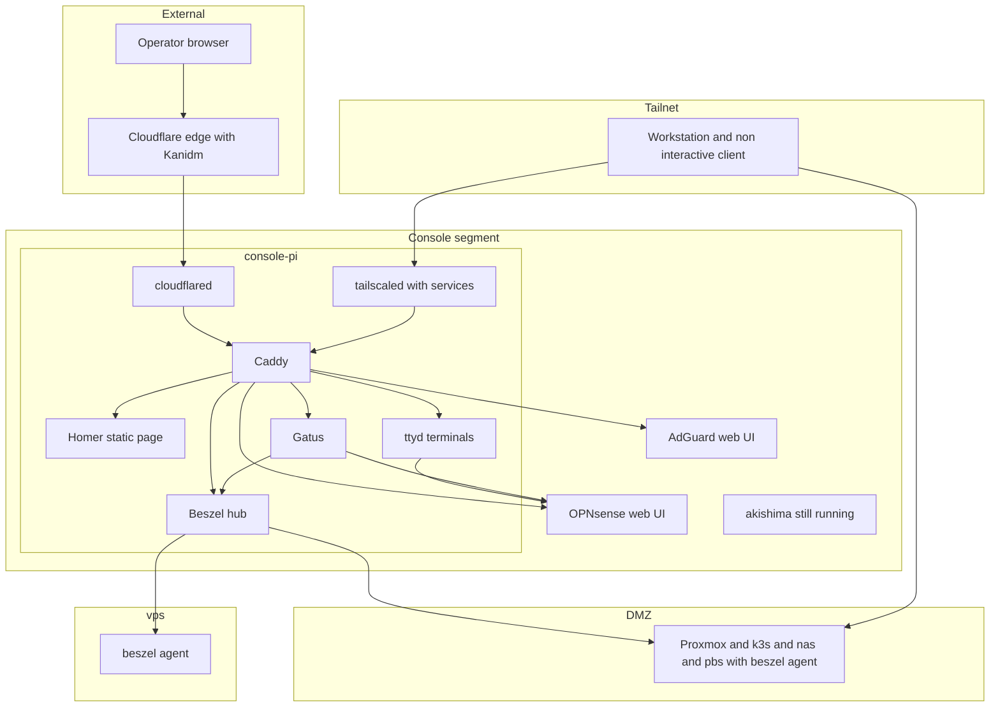
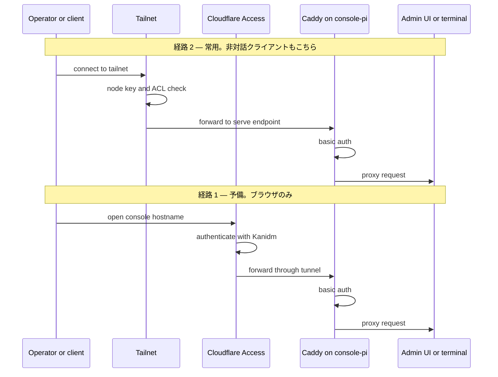
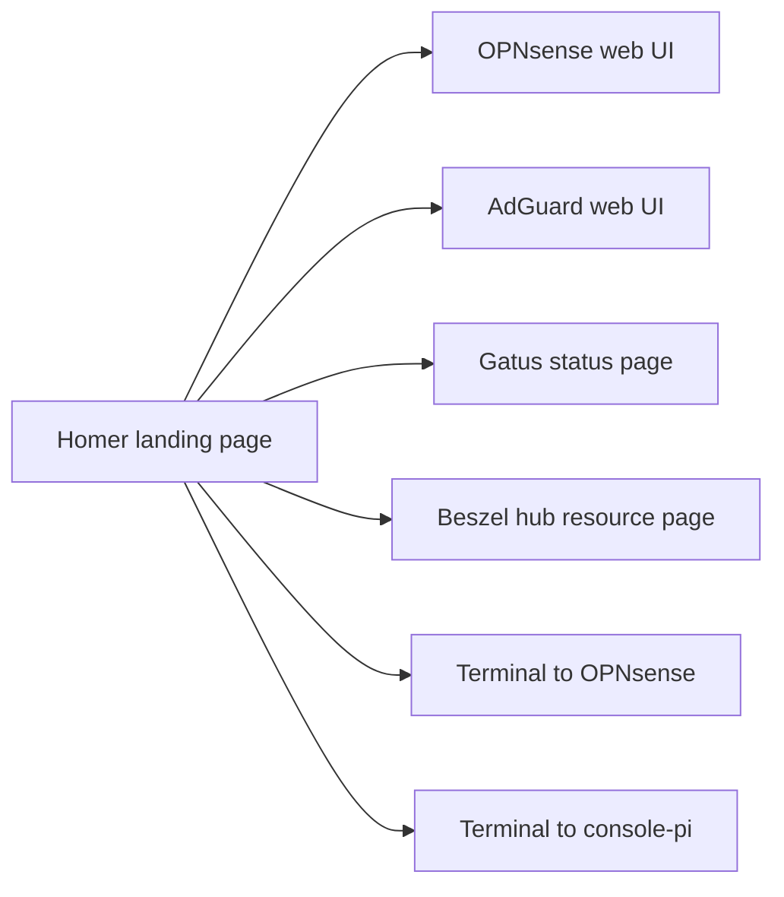
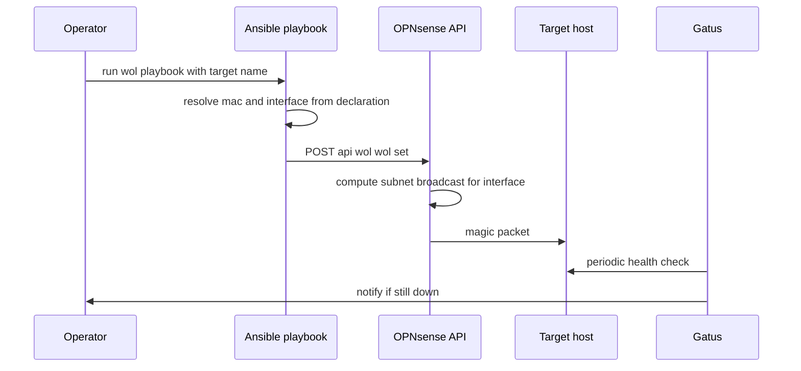
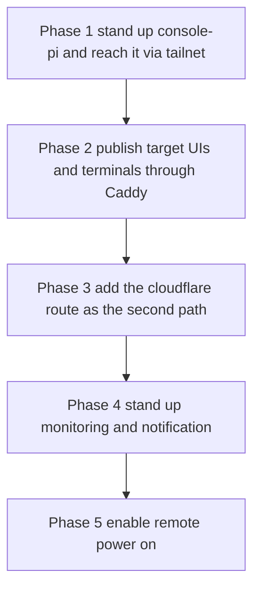

# Technical Design: admin-plane-rebuild

## Overview

本 spec は Console セグメントの管理用の足を、ラズベリーパイ 3 (`console-pi`) の上に作り直す。現行の管理用 PC (`akishima`) が抱えている機能を、宣言から再現できる形で用意する。

**機能を絞るのではなく代替する。**Guacamole の画面転送は HTTP のリバースプロキシとブラウザからの端末で置き換え、Console セグメントにある Web の管理画面と対話的な端末の双方へ、単一の起点から到達させる。cloudflared による外部からの到達は同型で引き継ぐ。監視は Prometheus と Grafana の代わりに、外形の死活を見る Gatus、各ホストの資源と記憶装置の状態を見る Beszel、その双方が備えない検査だけを担う `host_health` の 3 層で置き換える。**中央に時系列データベースを立てない。**

**現行の管理用 PC は本 spec の完了時点でも稼働したままとする。**撤去と転用、管理経路の認証の依存の解消、ネットワーク分離の回復はいずれも後続の `admin-plane-cutover` が扱う。したがって本 spec は既存の到達手段を停止させず、新しい足を並行して立ち上げるところまでを担う。

### Goals

- Console セグメントの足を宣言から再現できる状態にする
- 単一の起点から、Console セグメントの Web の管理画面と対話的な端末の双方へ到達させる
- 到達手段を 2 系統持ち、いずれか一方の障害で管理面を失わない
- 作業機に固有の設定を要求せず、非対話のクライアントからも到達できるようにする
- 中央に時系列データベースを持たない監視と、単一の通知経路を確立する
- 記憶装置の不良と記憶領域の劣化を、顕在化する前に検知する
- 停止している機器を遠隔から起動できるようにする

### Non-Goals

- **管理経路の認証の依存の解消。**認証は既存の Kanidm をそのまま用いる。循環は残ったままであり、`admin-plane-cutover` が扱う
- **`akishima` の転用・撤去・そこにある資産の引き継ぎ。**本 spec の完了時点でも稼働したままとする
- **ネットワーク分離の回復とファイアウォール規則の宣言化。**OPNsense の設定の適用は運用者の手作業であり、本 spec は必要な内容の記録に留まる
- 画面転送の回復。RDP と VNC は提供しない。端末とブラウザで到達できる Web UI に限る
- Console セグメント以外のホストへの Caddy の導入。`vps_proxy` には手を入れない

## Boundary Commitments

### This Spec Owns

- `console-pi` の構成と、その宣言
- Console セグメントの Web UI と対話的な端末への到達経路、およびその公開対象の列挙
- 外形の死活監視の定義と、状態を一望する画面
- 各ホストの資源・記憶装置・記憶領域の状態の監視の定義と、その画面
- ホスト内部の閾値監視の定義と、通知への接続。および自前で実装する検査の列挙とその理由
- 遠隔起動の対象の列挙と、起動の要求を発行する手段
- Console セグメントへの inbound として開放する経路の列挙
- 旧環境から読み取った設定のうち、再現するものと再現しないものの記録

### Out of Boundary

- **管理経路の認証の依存の向き。**既存の Kanidm による認証をそのまま用い、識別提供者を変更しない
- **`akishima` の停止・転用・撤去。**そこで稼働している Prometheus / Grafana / Guacamole / cloudflared の停止を含む
- **OPNsense の設定の適用。**ファイアウォール規則、host override、`os-wol` プラグインの導入はいずれも運用者の手作業であり、本 spec が持つのは適用すべき内容の記録に留まる
- ネットワーク分離の回復。Private から DMZ への経路に手を入れない
- `vps_proxy` role の責務の変更。Tailscale の抽出のみが接点
- 退避と検知の確立 (`backup-durability-and-alerting` が扱う)
- Proxmox の VM 105 とその占有デバイス

### Allowed Dependencies

- Infisical — 全ての秘匿値の単一の正
- Cloudflare (DNS / Tunnel / Access) — 到達経路 1 の基盤。認証は既存の Kanidm の識別提供者を用いる
- Tailscale — 到達経路 2 の基盤
- OPNsense の REST API — 遠隔起動の送出のみ
- 既存の `ssh_authorized_keys` / `systemd_failure_notify` role

### Revalidation Triggers

- Console セグメントへの inbound の追加 — 要件 1.7 の列挙が変わる
- 通知の宛先の変更 — `backup-durability-and-alerting` の通知経路と共有するため、双方の再確認が要る
- OPNsense のインタフェース名の変更 — 遠隔起動の宛先の解決が変わる
- `akishima` の停止 — `admin-plane-cutover` の着手条件であり、本 spec の成果物が代替として成立していることが前提になる

## Architecture

### Existing Architecture Analysis

- **宣言の外**: `akishima` は `ansible/inventory/inventory.yml` に存在せず、Console セグメント (`192.168.10.0/24`) を宣言する資産がリポジトリに 1 件も無い。
- **既存の到達経路**: `console.fickledev.com` → Cloudflare Tunnel (`guacamole`) → Guacamole → 画面転送。トンネルは `config_src = "cloudflare"` で ingress が Terraform 管理外、かつ `terraform/cloudflare_zero_trust.tf:75-77` が破棄と置換を禁じている。**本 spec はこれを破棄せず、新しいトンネルを追加する。**
- **保護されていない待受**: `akishima` の Guacamole は `0.0.0.0:8080`、Prometheus は 9090、Grafana は 3000 でいずれも全インタフェースに bind し、後者 2 つは無認証。**新しい足で同じ形を繰り返さない。**
- **平文の秘匿値**: cloudflared のトンネル token が `ExecStart=` に埋め込まれ、`ps aux` で全ユーザーから読める。**新しい足では `EnvironmentFile` から供給する。**

維持する統合点は 3 つ。Infisical による秘匿値の供給、`systemd_failure_notify` による通知、`ssh_authorized_keys` による公開鍵の配布。いずれもアーキテクチャ非依存で Console の足にそのまま適用できる。

### Architecture Pattern & Boundary Map

**選定したパターン**: 到達手段の集約点を 1 つ置き、外部からの 2 経路をそこへ合流させる。公開対象の列挙は集約点の設定 1 箇所に持つ。



**Architecture Integration**

- **選定パターン**: 単一の集約点 (Caddy) に到達手段を合流させ、公開対象の列挙をそこに一元化する。**両経路ともホスト名で対象が分かれ、Caddy はポートで受ける。**素の `tailscale serve` はノードの MagicDNS 名 1 つしか持てないが、Tailscale Services が対象ごとに独立した名前を生やすことでこの制約が外れる。
- **責務の分離**: 到達 (cloudflared / tailscaled)、振り分け (Caddy)、外形の監視 (Gatus)、資源と記憶装置の監視 (Beszel の hub)、端末 (ttyd) を別のプロセスに分ける。到達手段の一方が停止しても他方は Caddy 経由で成立する。
- **監視の担い手を 3 層に分ける**: Beszel が agent を置いたホストの資源・SMART・ZFS プールの health・failed ユニット・到達不能を、Gatus が外形と agent を置かない対象を、`host_health` がその双方が備えない検査だけを担う。**同じ事象を 2 つの層で見ない。**とりわけホストの到達不能は、**Beszel が agent を置いたホスト、Gatus がそれ以外**と分担し、同じホストを両方の対象に入れない (要件 3.15)。
- **維持する既存パターン**: DNS とトンネルの ingress を Terraform の locals マップで列挙する形、`vps_proxy` の「許可集合を defaults に列挙する」形、`systemd_failure_notify` の `OnFailure` による通知。
- **Steering への適合**: `tech.md` の Cluster Management 節が禁じるのは「クラスタ全体を素通しにするブラウザ管理 UI」であり、本設計が公開するのは OPNsense と AdGuard の管理画面、Gatus の状態一覧、および対象ホストの端末である。k3s の管理 UI を新設しない。

**依存の方向**: 宣言 (`inventory` / `group_vars` / `host_vars`) → role → 実機。Terraform (エッジ) と Ansible (ホスト構成) は互いに依存せず、双方が Infisical にのみ依存する。

### Technology Stack

| Layer | Choice / Version | Role in Feature | Notes |
|-------|------------------|-----------------|-------|
| Runtime / Host | Raspberry Pi 3, Debian 系 arm64 | Console セグメントの足 | microSD を boot 区画、USB 接続ドライブを root とする |
| Reverse Proxy | Caddy 2 系 (公式 apt / arm64 `.deb`) | 公開対象の列挙と振り分け、基本認証 | `basic_auth` は bcrypt。新規依存 |
| Web Terminal | ttyd (aarch64 静的バイナリ、約 1.37MB) | ブラウザからの対話的な端末 | 宛先ごとに 1 ユニット。新規依存 |
| Landing Page | Homer (ビルド済み `homer.zip` の静的ファイル) | 単一の起点となるリンク集 | 常駐プロセスを持たない |
| Monitoring / 外形 | Gatus (単一 Go バイナリ、arm64) | 外形の死活監視と状態一覧の画面 | `storage.type: memory`。新規依存 |
| Monitoring / 資源・記憶装置 | Beszel v0.19.0 (hub と agent、arm64 と x86_64 の公式バイナリ) | 各ホストの資源の画面、SMART と ZFS プールの health の検知 | hub は `console-pi`、agent は対象ホスト。PocketBase (SQLite) に最長 30 日。新規依存 |
| Tunnel | cloudflared (公式 apt、`cloudflared-linux-arm64.deb`) | 到達経路 1 の終端 | `akishima` のものとは別のトンネル |
| Overlay Network | Tailscale (tailscaled + Tailscale Services) | 到達経路 2 の終端。対象ごとに独立した MagicDNS 名 | GA、全プラン、上限 10 サービス。`tailscale_node` role を `vps` と共有 |
| Edge / Auth | Cloudflare Zero Trust, provider `cloudflare` v5 系 | 到達経路 1 の認証と DNS | **識別提供者は既存の Kanidm をそのまま用いる** |
| Notification | 既存 `systemd_failure_notify` role、Gatus の `alerting.custom`、Beszel の shoutrrr | 通知の単一の宛先 | いずれも `PORTFOLIO_DISCORD_WEBHOOK_URL` と同じ Discord の宛先。Beszel は `discord://token@id` で直送する |
| Remote Power | OPNsense `os-wol` プラグインの REST API | magic packet の送出 | 本 spec は利用側。プラグインの導入は手作業 |
| Config Management | Ansible >= 10.7.0 | 構成適用 | 既存の実行形態を維持 |
| Secrets | Infisical | 秘匿値の単一の正 | 既存の変数間接化層を踏襲 |

**新しい足で用意しないもの**: Prometheus、Grafana、デスクトップ環境。**中央の時系列データベースと、そこへ向けた exporter の群れを持たない** (要件 3.4)。監視は Gatus の外形、Beszel の資源と記憶装置、`host_health` の閾値検査で代替する。`akishima` 上のこれらは本 spec では停止させず、廃止の決定のみを記録する (要件 3.8)。

**`community.beszel` collection は採らない。**この repo が collection に依存するのはモジュール単位に限られ、ホストの外形の構成 (パッケージの導入、systemd ユニット、`EnvironmentFile`、待受の拘束) は全て `ansible/roles/` の自前実装が持つ。collection の role を採ると待受を `127.0.0.1` と内部アドレスに絞る拘束と秘匿値の供給の形が collection 側の実装に従属し、`console_proxy` / `web_terminal` と同じ形を保てない。加えてアラートを管理するモジュールが collection に無く、いずれにせよ `ansible.builtin.uri` を要する。**依存を 1 つ増やす見返りが、バイナリ 1 つとユニット 1 つの配置に見合わない。**

### 実行主体の到達経路

Ansible / Terraform / kubectl、およびそれらを呼ぶ非対話のクライアントは、いずれも作業機の上で動く。**本 spec は既存の経路に手を入れない。**新しく増えるのは `console-pi` への到達だけである。

| 実行主体 | 対象 | 経路 | 認証 |
|----------|------|------|------|
| Ansible | DMZ の 8 ホストと `vps` | **現状のまま。**DMZ は Private から直接、`vps` は tailnet | ED25519 鍵。`ANSIBLE_SSH_PRIVATE_KEY` を Infisical から ssh-agent へ |
| Ansible | **`console-pi`** | **tailnet。**通常の sshd で受ける | 同上 |
| Terraform / kubectl | 現状の対象 | **現状のまま** | 現状のまま |
| いずれの主体 | Console セグメントの Web UI | tailnet → `tailscale serve` → Caddy | Caddy の基本認証。資格情報は Infisical |

`console-pi` はタグを付与した auth key で tailnet に参加させる。**タグの目的は node key の期限の無効化 (要件 4.7) と ACL による到達範囲の限定であり、SSH の認証には用いない。**Tailscale SSH は有効にせず、既存の 9 ホストと同じ鍵による認証に揃える。

**インベントリへの追加が既存の適用を止めないようにする。**`refresh_known_hosts.yml` は接続対象のグループを総なめし、鍵の取得に失敗すると play ごと落とす。全ての playbook がこれを冒頭で import しているため、**`console-pi` が停止しているか tailnet に繋がっていないだけで、既存の 9 ホストへの適用が一切走らなくなる。**新しいホストについては到達不能を許容する形にする。

## File Structure Plan

### Directory Structure

```
ansible/
├── inventory/
│   ├── inventory.yml                     # console-pi を target_hosts と console グループへ追加
│   ├── group_vars/
│   │   ├── all/main.yml                  # wol_targets、OPNsense API 資格情報の束縛
│   │   └── console/main.yml              # console_proxy_targets ほか到達・端末・監視の宣言
│   └── host_vars/console-pi/
│       ├── main.yml                      # ansible_become_password ほかホスト固有値
│       └── vault.yml.example             # 追加する Infisical キー名の一覧
├── roles/
│   ├── tailscale_node/                   # tailnet への参加と serve の適用。console-pi と vps が共有
│   ├── console_proxy/                    # Caddy の導入と Caddyfile の生成
│   ├── console_firewall/                 # inbound の許可集合を専用 chain として適用
│   ├── web_terminal/                     # ttyd の導入。宛先ごとの systemd ユニット
│   ├── landing_page/                     # Homer の配置と assets/config.yml の生成
│   ├── gatus/                            # Gatus の導入と config.yaml の生成
│   ├── beszel_hub/                       # hub の導入、config.yml とアラートの適用
│   ├── beszel_agent/                     # agent の導入。対象ホストごとの systemd ユニット
│   ├── cloudflared_tunnel/               # cloudflared の導入とトンネルの常駐
│   ├── host_health/                      # 閾値監視の systemd タイマー群
│   └── rpi_boot/                         # boot 区画の読み取り専用運用と更新時の解除
└── playbooks/
    ├── console.yml                       # console-pi への適用のエントリポイント
    ├── host_health.yml                   # 閾値監視と Beszel の agent を各ホストへ適用
    └── wol.yml                           # 遠隔起動の要求を OPNsense へ発行

terraform/
├── cloudflare_zero_trust.tf              # console トンネル、ingress、Access application
└── cloudflare_dns.tf                     # tunnel_cnames への 1 エントリ追加

.kiro/specs/admin-plane-rebuild/
└── manual-operations.md                  # 物理作業と OPNsense 側の手作業の記録
```

`templates/` を持つのは `console_proxy` (Caddyfile)、`console_firewall` (許可集合の rules ファイル 2 つと適用スクリプトと unit)、`web_terminal` (宛先ごとの unit)、`landing_page` (Homer の `assets/config.yml`)、`gatus` (config.yaml)、`beszel_hub` (config.yml と EnvironmentFile と unit)、`beszel_agent` (EnvironmentFile と unit)、`cloudflared_tunnel` (EnvironmentFile と unit)、`host_health` (タイマーとチェックスクリプト)。

### Modified Files

- `ansible/inventory/inventory.yml` — `console-pi` の追加と `console` グループの新設
- `ansible/inventory/group_vars/all/main.yml` — 遠隔起動の対象と OPNsense API 資格情報の束縛を追加
- `ansible/playbooks/site.yml` — `console.yml` と `host_health.yml` を日常適用へ組み込む
- `ansible/roles/vps_proxy/tasks/main.yml` / `handlers/main.yml` / `defaults/main.yml` — Tailscale の配置を `tailscale_node` role に委ね、tailscaled のテンプレートを持たない。**再起動後に tailnet SSH の復帰を待つ挙動を保持する**
- `terraform/cloudflare_zero_trust.tf` — `console` トンネル、その ingress、新しい Access application と policy の追加。**識別提供者は既存の `kanidm` を参照する**
- `terraform/cloudflare_dns.tf` — `local.tunnel_cnames` への 1 エントリ追加
- `ansible/inventory/group_vars/all/vault.yml.example` — `PORTFOLIO_DISCORD_WEBHOOK_URL` の記載漏れを是正する

## System Flows

### 到達の 2 経路



経路 1 の認証は既存の Kanidm に依存する。**Kanidm が停止するとこの経路は成立しない。**その場合の到達は経路 2 が担う。経路 2 は tailnet のノード認証と ACL のみに依存し、k3s を参照しない。**この非対称は本 spec では解消せず、`admin-plane-cutover` が扱う。**

### 起点から端末までの流れ



要件 1.9 が求める「単一の起点から画面と端末の双方へ」を、この 1 ページが満たす。**リンクの一覧は公開対象と端末の宣言から生成し、二重管理しない。**

### 遠隔起動



OPNsense が対象の VLAN 上で送出するため、magic packet がルータを越える必要がない。**directed broadcast の転送を有効化しない。**起動の成否は Gatus の死活監視が判定する (要件 5.6)。

### 立ち上げの段階



**既存の到達手段を停止させない。**`akishima` は全段階を通じて稼働したままであり、要件 4.1 / 4.2 は構造的に満たされる。

## Requirements Traceability

| Requirement | Summary | Components | Interfaces | Flows |
|-------------|---------|------------|------------|-------|
| 1.1, 1.3, 1.4 | 到達手段と公開対象の列挙 | `console_proxy` | `console_proxy_targets` | 到達の 2 経路 |
| 1.2 | セグメント全体を広告しない | `tailscale_node` | `tailscale serve` の適用 | 到達の 2 経路 |
| 1.5 | 認証を要求する | `console_proxy`, Cloudflare Access | `basic_auth`, Access policy | 到達の 2 経路 |
| 1.6 | 停止時の第 2 経路 | `tailscale_node`, `cloudflared_tunnel` | 2 系統の独立 | 到達の 2 経路 |
| 1.7 | inbound の列挙 | `console_firewall` | `console_inbound_allow` | — |
| 1.8, 1.10 | 作業機に固有の設定を要求しない | `tailscale_node`, `console_proxy` | Tailscale クライアントのみ | 到達の 2 経路 |
| 1.9 | 単一の起点から画面と端末の双方へ | `landing_page`, `web_terminal` | Homer の `config.yml`, `console_proxy_targets`, `web_terminal_targets` | 起点から端末までの流れ |
| 1.11 | 非対話クライアントからの到達 | `tailscale_node` | 実行主体の到達経路の表 | 到達の 2 経路 |
| 2.1, 2.2 | インベントリと適用の前提 | インベントリ宣言 | `console` グループ, `ansible_become_password` | — |
| 2.3, 2.4 | 既存構成の再現と非再現の記録 | `manual-operations.md` | 旧環境から引き継ぐものの表 | — |
| 2.5, 2.6 | 秘匿値の扱い | `cloudflared_tunnel`, `web_terminal` | `EnvironmentFile` 0600 | — |
| 2.7 | 冪等性 | 全 role | Testing Strategy | — |
| 2.8 | 旧記憶装置の保持 | `manual-operations.md` | 手順の記録 | — |
| 3.1, 3.2, 3.10 | 通知 | `gatus`, `beszel_hub`, `host_health`, `systemd_failure_notify` | `alerting.custom`, shoutrrr の `discord://`, `OnFailure` | — |
| 3.3 | 到達の確認 | 検証手順 | Testing Strategy | — |
| 3.4 | 中央に時系列データベースを立てない | `gatus`, `beszel_hub` | `storage.type: memory`、PocketBase の保持量の実測 | — |
| 3.5 | 監視対象事象の列挙 | `gatus`, `beszel_hub`, `host_health` | `gatus_endpoints`, `beszel_alerts`, 自前の検査の表 | — |
| 3.6 | 一望できる画面 | `gatus` | 内蔵ダッシュボード | 起点から端末までの流れ |
| 3.7 | 資源に見合う | `gatus`, `beszel_hub`, `beszel_agent` | 全常駐が揃った状態での実測 | — |
| 3.8, 3.9 | 既存の収集機構の存廃 | 廃止の決定の記録 | 旧環境から引き継ぐものの表 | — |
| 3.11 | 記憶装置の不良の兆候 | `beszel_agent` | SMART デバイス状態の自動アラート | — |
| 3.12 | 冗長性を持たない記憶領域の劣化 | `beszel_agent`, `host_health` | ZFS プールの health の自動アラート、scrub のエラーと経過日数の検査 | — |
| 3.13 | 管理経路の遮断につながる事象 | `host_health`, `gatus` | fail2ban の jail と特定アドレスの ban の検査、外形の死活 | — |
| 3.14 | 資源の消費を確認できる画面 | `beszel_hub` | hub の Web UI。`console_proxy_targets` から公開 | 起点から端末までの流れ |
| 3.15 | 既製の検知を自前で実装しない | `host_health`, `beszel_agent` | 自前の検査の表。使用率と負荷を `host_health` から外す | — |
| 3.16 | 自前の検知の列挙と理由 | `host_health` | 自前で実装する検査とその理由の表 | — |
| 3.17 | 監視の停止の独立した検知 | `gatus`, `systemd_failure_notify` | Gatus が hub の外形を見る、`OnFailure` | — |
| 4.1, 4.2 | 到達手段を失わない | 立ち上げの段階 | `akishima` を停止しない | 立ち上げの段階 |
| 4.3, 4.4 | 所属変更の並行禁止、VM 105 | 実施上の制約 | — | — |
| 4.5, 4.6 | 承認と物理作業 | `manual-operations.md` | 手順の記録 | — |
| 4.7 | 期限の把握 | `tailscale_node` | タグ付与による node key expiry の無効化 | — |
| 5.1, 5.2, 5.3 | 遠隔起動 | `playbooks/wol.yml` | `wol_targets`, OPNsense API | 遠隔起動 |
| 5.4 | 起動要求の認証 | `playbooks/wol.yml` | OPNsense API key | 遠隔起動 |
| 5.5 | 対応の可否の確認 | `manual-operations.md` | 手順の記録 | — |
| 5.6 | 起動の失敗の判別 | `gatus` | `gatus_endpoints` | 遠隔起動 |

## Components and Interfaces

| Component | Domain/Layer | Intent | Req Coverage | Key Dependencies | Contracts |
|-----------|--------------|--------|--------------|------------------|-----------|
| `tailscale_node` | ホスト構成 | tailnet への参加と serve の適用 | 1.2, 1.6, 1.11, 4.7 | Tailscale 制御平面 (P0), Infisical (P0) | Service, State |
| `console_proxy` | ホスト構成 | 公開対象の列挙と振り分け、基本認証 | 1.1, 1.3, 1.4, 1.5 | Infisical (P0) | Service, State |
| `console_firewall` | ホスト構成 | Console セグメントへの inbound の許可集合の宣言と適用 | 1.7 | `tailscale_node` (P0) | Service, State |
| `web_terminal` | ホスト構成 | ブラウザからの対話的な端末 | 1.9, 2.5 | `console_proxy` (P0) | Service, State |
| `landing_page` | ホスト構成 | 単一の起点となるリンク集 | 1.9 | `console_proxy` (P0) | State |
| `gatus` | ホスト構成 | 外形の死活監視と状態一覧 | 3.1, 3.4, 3.5, 3.6, 3.13, 3.17, 5.6 | 通知の宛先 (P1) | Service, Event |
| `beszel_hub` | ホスト構成 | 資源の画面と、agent からの計測値の受けとアラートの発報 | 3.1, 3.4, 3.5, 3.7, 3.10, 3.14 | `console_proxy` (P0), 通知の宛先 (P1), Infisical (P0) | Service, API, Event, State |
| `beszel_agent` | ホスト構成 | 対象ホストの資源・SMART・ZFS プールの health・failed ユニットの計測 | 3.7, 3.11, 3.12, 3.15 | `beszel_hub` (P0) | Service, Event |
| `cloudflared_tunnel` | ホスト構成 | 到達経路 1 の終端 | 1.1, 1.6, 2.5, 2.6 | Cloudflare (P0), Infisical (P0) | Service |
| `host_health` | ホスト構成 | 既製の機構が備えない検査と通知への接続 | 3.1, 3.9, 3.10, 3.12, 3.13, 3.15, 3.16 | `systemd_failure_notify` (P0) | Batch, Event |
| `rpi_boot` | ホスト構成 | boot 区画の読み取り専用運用 | 2.7 | — | State |
| `playbooks/wol.yml` | 運用 | 遠隔起動の要求の発行 | 5.1, 5.2, 5.3, 5.4 | OPNsense API (P0), Infisical (P0) | Batch |

### ホスト構成

#### `console_proxy`

| Field | Detail |
|-------|--------|
| Intent | Console セグメントの Web UI と端末を、宣言された一覧に従って対象単位で公開する |
| Requirements | 1.1, 1.3, 1.4, 1.5 |

**Responsibilities & Constraints**

- 公開対象の一覧の唯一の保持者。この一覧に無い宛先へは到達できない (要件 1.3)
- 到達経路 1 と 2 の合流点。**両経路とも対象ごとの `caddy_port` へ向かう。**振り分けはポートで行い、`Host` ヘッダを見ない
- **待受を `127.0.0.1` に限定する。**`cloudflared` も `tailscale serve` も同一ホスト内から接続するため、外部のインタフェースに開く必要がない。`akishima` の Guacamole が `0.0.0.0:8080` で晒されていた形を繰り返さない
- 基本認証を掛ける。認証情報は Infisical から供給し、宣言に平文で置かない (要件 2.5)

**Dependencies**

- Inbound: `cloudflared_tunnel` / `tailscale_node` — 両経路からの転送 (P0)
- Outbound: OPNsense / AdGuard の Web UI (P0)、`gatus` / `beszel_hub` / `web_terminal` / `landing_page` (P1)
- External: Infisical — 基本認証の資格情報 (P0)

**Contracts**: Service [x] / API [ ] / Event [ ] / Batch [ ] / State [x]

##### Service Interface

`group_vars/console/main.yml` に置く宣言。**1 つのエントリが両経路の入口と転送先を同時に定める。**

```yaml
console_proxy_targets:
  - name: opnsense
    caddy_port: 8081            # Caddy が 127.0.0.1 で待ち受けるポート
    service_name: opnsense      # Tailscale Service の名前。svc:<service_name> になる
    public_hostname: opnsense   # Cloudflare 経路のホスト名のラベル部分
    upstream: "https://192.168.10.1:443"
    tls_insecure: true
    description: "ルータの管理画面。自己署名証明書のため tls_insecure が要る"
  - name: adguard
    caddy_port: 8082
    service_name: adguard
    public_hostname: adguard
    upstream: "http://192.168.10.1:3000"
    tls_insecure: false
    description: "DNS フィルタの管理画面。ルータと同じ機体で動く"
  - name: status
    caddy_port: 8083
    service_name: status
    public_hostname: status
    upstream: "http://127.0.0.1:8080"
    tls_insecure: false
    description: "Gatus の状態一覧。要件 3.6 の画面"
  - name: beszel
    caddy_port: 8084
    service_name: beszel
    public_hostname: beszel
    upstream: "http://127.0.0.1:8090"
    tls_insecure: false
    description: "Beszel の hub。各ホストの資源の状態を示す要件 3.14 の画面"
```

**両経路ともホスト名で分かれ、Caddy はポートで受ける。**tailnet 側は Tailscale Services が対象ごとに独立した MagicDNS 名を生やす。Caddy は `caddy_port` ごとに独立したサイトブロックを持ち、**`Host` ヘッダを一切見ない**。

| 経路 | 入口 | 経由 |
|------|------|------|
| tailnet | `https://<service_name>.<tailnet>.ts.net/` | `tailscale serve --service=svc:<service_name> --https=443` → `127.0.0.1:<caddy_port>` |
| Cloudflare | `https://<public_hostname>.<domain>/` | tunnel の ingress → `127.0.0.1:<caddy_port>` |

**いずれの経路でも URL にポートもパスも現れない。**転送先の Web UI が絶対パスを吐いても、`https://<Host>/path` の形で絶対 URL を組み立てても壊れない。パスで分ける方式 (`--set-path`) もポートで分ける方式 (`--https=<port>`) も採らない理由がこれである。

- **Preconditions**: `upstream` が Console セグメントの内側から到達可能であること。tailnet の Services の上限 (10) に収まること

**転送先をホスト名で指定しない。**DNS フィルタはルータと同じ機体で動いており、その管理画面の名前解決は、まさにその画面が管理する DNS の機構に依存する。**この機構が壊れたときに、直すための画面へ到達できなくなる。**転送先は名前ではなくアドレスで宣言する。
- **Postconditions**: 宣言した対象のみが応答し、それ以外は拒否される
- **Invariants**: `caddy_port` と `service_name` がそれぞれ重複しない。`description` の無いエントリを置かない

##### State Management

- 状態モデル: Caddyfile と基本認証のハッシュファイル。いずれも宣言から生成される
- 永続性: 設定に永続的な状態を持たない。TLS は `tailscale serve` と Cloudflare がそれぞれ終端するため、**Caddy 側では終端せず平文 HTTP を `127.0.0.1` で待ち受ける**
- 並行性: 単一プロセス。設定変更は reload で反映する

**Implementation Notes**

- Integration: 経路 1 と 2 の双方が同一の待受へ向かうため、**Caddy が停止すると両経路が同時に失われる**。最後の砦は tailnet 経由の SSH であり、これは Caddy を経由しない (要件 1.6)
- Validation: 一覧に無い宛先への要求が拒否されることを実測する
- Validation: `ss -ltnp` で Caddy が `127.0.0.1` 以外に bind していないことを確認する
- Risks: `tls_insecure` を要するのは Console セグメント内の自己署名証明書の宛先に限る。理由を `description` に残さないまま増やさない

#### `console_firewall`

| Field | Detail |
|-------|--------|
| Intent | Console セグメントへの inbound の許可集合を、専用の chain としてホストへ適用する |
| Requirements | 1.7 |

**Responsibilities & Constraints**

- `console_inbound_allow` の唯一の適用者。**宣言するだけで適用しない形にしない** (要件 1.7)
- 許可集合を `console_firewall_filter_chain` (`CONSOLE-FIREWALL-INPUT`) という専用 chain として構成し、chain ごと差し替える。`vps_proxy` の `vps_proxy_filter_chain` と同じ形を踏襲する
- **既定の chain を直接編集しない。**`INPUT` へはこの chain への jump を 1 本だけ挿し、`INPUT` 自体を flush しない。**tailscaled が実行時に積む `ts-input` / `ts-forward` を巻き込まない**
- **空の許可集合を適用しない。**`console_inbound_allow` が空のまま `INPUT` を `DROP` にすると、唯一の管理経路である tailnet 経由の SSH ごと落ちる。適用の前に 1 件以上が宣言されていることを検査する
- **`netfilter-persistent` が flush を伴う復元を行える状態を残さない。**素の復元は全テーブルを flush するため、この unit を無効化し停止しマスクする。apt のアップグレードが再起動を掛けた時点で素の復元が走る経路そのものを断つ
- **適用の後に tailnet 経由の SSH の到達性を検証する。**検証までを 1 回の適用に含める
- 適用先を Debian 系に限る

**Dependencies**

- Outbound: `tailscale_node` — 必須の許可の 1 本が `tailscale0` の存在を前提にする (P0)

**Contracts**: Service [x] / API [ ] / Event [ ] / Batch [ ] / State [x]

##### Service Interface

`group_vars/console/main.yml` に置く宣言。**この一覧が Console セグメントへの inbound の唯一の正である。**

```yaml
console_inbound_allow:
  - port: 22
    proto: tcp
    source: tailnet
    reason: "構成管理の適用と、到達手段が壊れたときの復旧"
```

**連鎖には、宣言の列挙とは別に次の 3 本を必ず含める。**これらを欠いた連鎖を差し替えると、適用したその接続ごと落ちる。`console-pi` は隔離されたセグメントにあり、物理的な作業以外の復旧の手段が無い。

- ループバックからの入力の許可
- 確立済みおよび関連する接続の許可
- tailnet のインタフェースからの入力の許可

`vps_proxy` の許可集合のテンプレートは同じ 3 本を明示的に持っている。同じ形を踏襲する。

**IPv4 と IPv6 の双方へ同じ許可集合を敷く。**片方で失敗しても他方の適用を試み、既定のポリシーが `ACCEPT` のまま残る側を作らない。ICMP は PMTUD のため、ICMPv6 は Neighbor Discovery と Router Advertisement が乗るため、いずれも許可する。**後者を落とすと IPv6 そのものが壊れる。**

`console_inbound_allow` に tailnet 側の待受を列挙しない。**Services は仮想 IP で待ち受けるため、ノード自身のポートを消費しない。**

- **Preconditions**: 適用先が Debian 系であること。`console_inbound_allow` が 1 件以上を宣言していること
- **Postconditions**: `INPUT` のポリシーが `DROP` になり、必須の 3 本と宣言した列挙のみが通る
- **Invariants**: `reason` の無い開放を残さない。tailnet 経由の SSH の許可を外さない

##### State Management

- 状態モデル: `/etc/iptables/rules.v4` と `/etc/iptables/rules.v6`、適用スクリプト、適用の systemd ユニット。いずれも宣言から生成される
- 永続性: 規則そのものはカーネルが持ち、再起動時は適用のユニットが敷き直す。**`netfilter-persistent` による復元には依らない**
- 並行性: 単一のユニット。宣言の変更はハンドラによるユニットの再実行で反映する

**Implementation Notes**

- Integration: **差し替えの順序を「連鎖を作る → 必須の 3 本が含まれることを検査する → 既定の連鎖へ挿す」に固定する。**検査を通らない連鎖を挿さない
- Integration: **どの段階で失敗しても `INPUT` のポリシーを変更せず、`tailscale0` からの入力を無条件に許可した状態で残す。**ポリシーを `DROP` にするのは jump を挿した後の最後の一手にする
- Integration: rules ファイルの配置時に `iptables-restore --test --noflush` と `ip6tables-restore --test --noflush` でドライランを行い、構文の通らない内容を実機へ持ち込まない
- Integration: `INPUT` への jump は挿し直しの前に既存のものを全て外す。**再適用のたびに jump が積み重ならないようにする** (要件 2.7)
- Integration: 適用のユニットを `network-pre.target` より前に走らせる。**tailscaled が実行時に積む chain より先に許可集合を敷く**
- Validation: 適用の直後に tailnet 経由の接続の復帰を待ち、到達性が保たれていることを確認する
- Validation: `console-pi` への実際の到達可否が `console_inbound_allow` の列挙と一致することを実測する (要件 1.7)
- Risks: `console-pi` の管理経路は tailnet のみであり、**適用に失敗して到達を失うと物理的な作業以外の復旧の手段が無い。**フェイルセーフと適用後の検証を role の一部として持つ理由がこれである

#### `web_terminal`

| Field | Detail |
|-------|--------|
| Intent | ブラウザから対象ホストの対話的な端末を開く。Guacamole の画面転送を代替する |
| Requirements | 1.9, 2.5 |

**Responsibilities & Constraints**

- 宛先ごとに 1 つの systemd ユニットを持つ。宛先は宣言から生成する
- **`127.0.0.1` にのみ bind する。**認証は Caddy に一任し、`ttyd` 自身の `-c` を使わない
- **資格情報をプロセスの引数に載せない。**`akishima` の cloudflared が `ExecStart=` に token を平文で持ち `ps aux` から読めた失敗様式を繰り返さない (要件 2.6)

**Dependencies**

- Inbound: `console_proxy` — 認証と公開 (P0)
- Outbound: 対象ホストの SSH (P0)

**Contracts**: Service [x] / API [ ] / Event [ ] / Batch [ ] / State [x]

##### Service Interface

```yaml
web_terminal_targets:
  - name: opnsense
    listen_port: 7681
    ssh_target: "192.168.10.1:2222"
    description: "ルータの端末。SSH の待受は 22 ではなく 2222"
  - name: console-pi
    listen_port: 7682
    ssh_target: "localhost"
    description: "Console の足自身の端末。ここから他ホストへ辿れる"
```

- **Preconditions**: 対象への SSH の資格情報が `console-pi` 上に用意されていること
- **Postconditions**: Caddy の認証を経た要求のみが端末に到達する
- **Invariants**: `listen_port` が重複しない。全エントリが `description` を持つ

**Implementation Notes**

- Integration: **既定は読み取り専用のため `-W` を付ける。**付けないと入力を受け付けない
- Integration: `-O` で origin の検査を有効にし、別 origin からの WebSocket 接続を拒否する
- Integration: **tailnet 経路と Cloudflare 経路の双方から使える。**Tailscale SSH Console は tailnet 経路でしか使えないため採らない
- Validation: 双方の経路から端末が開き、入力が通ることを確認する
- Risks: 対象への SSH の資格情報が `console-pi` 上に置かれる。**このホストが侵害されると対象へ横断される。**Caddy の認証と 2 経路の認証が前段の防御になる

#### `landing_page`

| Field | Detail |
|-------|--------|
| Intent | 公開している画面と端末への入口を 1 枚にまとめる |
| Requirements | 1.9 |

**Contracts**: Service [ ] / API [ ] / Event [ ] / Batch [ ] / State [x]

**Implementation Notes**

- Integration: Homer のビルド済み配布物を配置し、Caddy の `file_server` で配信する。**常駐プロセスを持たない**
- Integration: `assets/config.yml` を `console_proxy_targets` と `web_terminal_targets` の宣言から生成する。**リンクの一覧を二重管理しない**
- Integration: **経路によって URL が異なるため、1 枚のページに 2 つのグループを置く。**tailnet 経由のグループは `https://<service_name>.<tailnet>.ts.net/`、Cloudflare 経由のグループは `https://<public_hostname>.<domain>/`。いずれも同じ宣言から生成するため、対象の追加時に片方だけ漏れることがない
- Validation: `file://` では動作しないため、Caddy 経由での表示を確認する

#### `gatus`

| Field | Detail |
|-------|--------|
| Intent | 外形の死活を監視し、異常を通知し、状態を一望する画面を提供する |
| Requirements | 3.1, 3.4, 3.5, 3.6, 3.13, 3.17, 5.6 |

**Responsibilities & Constraints**

- 外形の監視対象事象の一覧の唯一の保持者 (要件 3.5)。`config.yaml` の記述がそのまま一覧を兼ねる
- 履歴を永続化しない。`storage.type` は `memory` を用いる (要件 3.4)
- 通知の本文に秘匿値と運用者個人を識別する情報を含めない (要件 3.10)
- 遠隔起動の成否の判定材料を提供する (要件 5.6)
- **Beszel の hub 自身の死活を、hub から独立した位置で見る** (要件 3.17)

**外形で見る対象は 4 種に限る。**

| 対象 | 見る理由 |
|------|----------|
| Console セグメントの Web 管理画面と公開している URL | 到達経路そのものの成立。管理面へ到達できなくなったことを、到達できなくなってから知る状態を作らない (要件 3.13) |
| `ldaps.kanidm.fickledev.com` の名前解決 | host override が壊れると経路 1 の認証が成立しない |
| Beszel の agent を置かない対象 (`opnsense`) | FreeBSD であり agent の公式バイナリの対象外。到達不能を見る担い手が他に無い |
| Beszel の hub のエンドポイント | 要件 3.17。監視の機構が自らの停止を通知することに依存しない |

**agent を置いたホストの到達不能は Gatus では見ない。**Beszel の `Status` アラートが同じ事象を担うため、双方に置くと 1 つの停止で 2 通の通知が飛ぶ。**ホストの到達不能の担い手は、agent の有無で一意に決まる。**

**Dependencies**

- Inbound: `console_proxy` — 状態一覧の画面の公開 (P1)
- Outbound: 監視対象のホストとサービス (P1)
- External: 通知の webhook 宛先 (P1)

**Contracts**: Service [ ] / API [ ] / Event [x] / Batch [ ] / State [x]

##### Event Contract

- **発行する事象**: 監視対象が閾値回数連続して失敗したとき、および復旧したとき
- **宛先**: `alerting.custom` により `PORTFOLIO_DISCORD_WEBHOOK_URL` へ HTTP POST。**この宛先は要件 3.2 に適合すると判断する。**3.2 が排除しているのは正常時を含む逐次の送信であり、状態が遷移したときにのみ送る本設計はこれに当たらない。既存の `systemd_failure_notify` と同じ宛先を用いることで、通知の経路が 1 つに保たれる
- **本文**: `[ENDPOINT_NAME]` と `[ALERT_STATUS]` のみを用いる。**`[RESULT_ERRORS]` と `[ALERT_DESCRIPTION]` は使わない。**応答本文や接続先の詳細が混入する経路を作らないため (要件 3.10)
- **配送保証**: なし。到達の確認は要件 3.3 の手順で行う
- **冪等性**: 状態の遷移時にのみ発行し、継続中の異常を繰り返し送らない (要件 3.2)

##### State Management

- 状態モデル: 監視結果はメモリ上のみ。プロセスの再起動で消える
- 永続性: 持たない。**これが Gatus における要件 3.4 の実現手段である**

**資源の上限値を設計で先に固定しない。**中央に時系列データベースを立てない構成を採った時点で常駐の総量は小さく収まる見込みであり、機体ごとの実測を待たずに数値を置くと根拠のない制約になる。要件 3.7 は、**Beszel の hub を含む全ての常駐が揃った状態**での実測値を記録し、その値をもって判断する形で満たす。実測の結果が機体の容量に対して過大であった場合は、端末の常駐数を減らすことが最初の調整点になる。

**Implementation Notes**

- Integration: `akishima` の Prometheus が収集していた 5 件 (自身 / OPNsense / VPS / hp-z440 / n100) と、収集対象外だった k3s の各ノード・NAS・PBS は、**いずれも Beszel の agent が担う。**Gatus はそれらを外形の死活の一覧に入れない。収集の停止が検知の後退にならない状態は、agent の導入をもって作る
- Integration: `ldaps.kanidm.fickledev.com` の名前解決を監視対象に含める。host override が壊れたときに検知できるようにする
- Integration: **hub の外形は `127.0.0.1` の待受に対して見る。**Caddy を経由すると Caddy の停止と hub の停止が区別できない。要件 3.17 が求めるのは監視の機構から独立した検知であり、hub と Gatus が別プロセスであることでこれを満たす。**Gatus と hub が同時に停止した場合は、Gatus のユニットの `OnFailure` が最後の砦になる**
- Integration: **公開している URL の外形は Console セグメントの外から見えない。**`console-pi` から見る限り、Cloudflare 経路の到達性は測れない。Gatus が見るのは Caddy の待受までであり、経路 1 の端から端までの到達は要件 3.3 の手順で確認する
- Validation: 意図的に対象を落として通知が届くことを確認する (要件 3.3)
- Validation: hub のプロセスを停止させ、Gatus からの通知が届くことを確認する (要件 3.17)
- Risks: 通知の宛先が `backup-durability-and-alerting` と共有される。**同じ事象を二重に通知しないよう、監視対象の分担を両 spec で確定する**

#### `beszel_hub`

| Field | Detail |
|-------|--------|
| Intent | 各ホストの資源・記憶装置・記憶領域の状態を集約し、画面として示し、閾値と状態の遷移で通知する |
| Requirements | 3.1, 3.4, 3.5, 3.7, 3.10, 3.14 |

**Responsibilities & Constraints**

- **待受を `127.0.0.1` に限定する。**公開は Caddy を通し、`console_proxy_targets` の 1 エントリとして両経路から到達させる。`akishima` の Prometheus と Grafana が全インタフェースに bind し無認証だった形を繰り返さない
- 資源のアラートの一覧の唯一の保持者 (要件 3.5)。閾値と継続分数を宣言から与える
- **通知の宛先を Gatus と `systemd_failure_notify` に揃える。**shoutrrr の `discord://token@id` で同じ Discord の宛先へ直送する
- **`ContainerHealth` のアラートを有効にしない。**このアラートだけは本文にコンテナのログ抜粋を最大 1800 文字埋め込む。ログの内容は制御できず、秘匿値と運用者個人を識別する情報が混入する経路になる (要件 3.10)。コンテナの異常は `SystemdFailed` と資源のアラートで間接的に現れる
- **システムに付ける名前に個人を識別する語を含めない。**Beszel の通知の本文はシステム名を含み、その文面は Go の固定フォーマットで変更できない。**名前が要件 3.10 の適合を左右する唯一の変数である**
- 自身の停止を自身で通知しない。**要件 3.17 の担い手は Gatus である**

**Dependencies**

- Inbound: `console_proxy` — 画面の公開 (P0)
- Outbound: `beszel_agent` — 各ホストの待受からの計測値の取得 (P0)
- Outbound: 通知の webhook 宛先 (P1)
- External: Infisical — superuser の資格情報、universal token、Discord の宛先 (P0)

**Contracts**: Service [x] / API [x] / Event [x] / Batch [ ] / State [x]

##### Service Interface

`group_vars/console/main.yml` に置く宣言。**システムの一覧とアラートの一覧を別に持つ。**前者は hub の `config.yml` に、後者は REST API に流し込む。

```yaml
beszel_systems:
  - name: hp-z440
    host: 192.168.1.2
    port: 45876
    description: "Proxmox ホスト。zfs-pool の単一 vdev と SMART の実体を持つ"
  - name: n100
    host: 192.168.1.10
    port: 45876
    description: "Proxmox ホスト。SATA SSD 1 本。ZFS プールを持たない"

beszel_alerts:
  - name: Status
    value: 0
    min: 5
    systems: all
    description: "到達不能。agent を置いたホストの死活はここが唯一の担い手"
  - name: Disk
    value: 85
    min: 10
    systems: all
    description: "root と追加ディスクと ZFS プールの使用率の最大値に対する単一の閾値"
  - name: SystemdFailed
    value: 1
    systems: all
    description: "failed ユニットの存在。継続時間の設定を持たない"
```

- **Preconditions**: `console-pi` から各 agent の待受へ到達できること。superuser が初回起動時に作られていること
- **Postconditions**: 宣言したシステムのみが hub に存在し、宣言に無いシステムは削除される
- **Invariants**: `name` が重複せず、**個人を識別する語を含まない**。全エントリが `description` を持つ。`beszel_alerts` に `ContainerHealth` を含めない。`beszel_systems` に列挙したホストが `gatus_endpoints` の死活の対象と重複しない

##### API Contract

**アラートは `config.yml` に含まれないため、REST API で適用する。**

- **認証**: `POST /api/collections/users/auth-with-password` で JWT を得る。資格情報は Infisical から供給する
- **適用**: `POST /api/beszel/user-alerts` に `{name, value, min, systems[], overwrite}`。**複数のシステムへ一括して upsert できる**ため、`beszel_alerts` の 1 エントリが 1 回の要求に対応する
- **削除**: `DELETE /api/beszel/user-alerts`。宣言から消えたアラートを残さない
- **冪等性**: `(user, system, name)` に UNIQUE index があり、`overwrite` を伴う upsert は繰り返し安全 (要件 2.7)
- **実装手段**: `ansible.builtin.uri`。**アラートを管理するモジュールは `community.beszel` にも存在しない**

##### Event Contract

- **発行する事象**: ユーザーが設定したアラートの閾値の超過と復帰、および常時有効の 2 つの自動アラート — **SMART デバイス状態の悪化**と **ZFS プールの health の悪化**。後者 2 つは悪化方向の遷移でのみ発報し、回復時は無通知
- **宛先**: shoutrrr の `discord://token@id`。**Gatus と `systemd_failure_notify` と同じ Discord の宛先であり、通知の経路は 1 つに保たれる**
- **本文**: システム名、メトリクス名、値、閾値、継続分数、`AppURL` + `/system/<id>` へのリンク。**IP アドレスとホスト名を含まない。**この構成が要件 3.10 に適合する。**テンプレートのカスタマイズ機能は無いため、適合はシステム名の付け方だけで担保する**
- **配送保証**: なし。到達の確認は要件 3.3 の手順で行う
- **冪等性**: 状態の遷移時にのみ発行する (要件 3.2)。継続時間は `alerts.min` で与え、`min > 1` では直近 min 分の 1 分足の平均と閾値を比較するため、**瞬間的なスパイクは平均に埋もれる**

##### State Management

- 状態モデル: PocketBase (SQLite)。システム、ユーザー、アラート、計測値の履歴を持つ
- 永続性: **履歴は最長 30 日で、この保持期間は無効化できない。**短周期のレコードを長周期へ平均化して削除するため、**1 システムあたり全チャートで 30 日分が約 400 レコードに収まる**
- 並行性: 単一プロセス。`config.yml` の同期は hub の起動時に行われる

**要件 3.4 との関係を明示する。**3.4 が禁じるのは中央に時系列データベースを立てることであり、**閲覧のための計測値の保持そのものは、機体の資源を圧迫しない量であれば認めている。**Beszel が持つのは自身の画面を描くための 30 日分であって、他の機構が問い合わせる汎用の時系列基盤ではない。量は上記の通り極小である。**したがって Gatus の `storage.type: memory` と Beszel の 30 日の保持は、いずれも要件 3.4 の実現手段として並立する。**実測した量は要件 3.4 の求めに従って記録する。

**Implementation Notes**

- Integration: **初期セットアップに Web UI での手作業を要さない。**`USER_EMAIL` / `USER_PASSWORD` を `EnvironmentFile` から与えると初回起動時に superuser が作られる。システムは `config.yml` が宣言し、agent は universal token (`GET /api/beszel/universal-token`) で自己登録する
- Integration: **`config.yml` に無いシステムは hub の起動時に削除される。**この破壊的な同期が、宣言を唯一の正に保つ手段でもある。宣言から外すことがそのまま削除を意味することを前提に扱う
- Integration: 秘匿値は `EnvironmentFile` (0600, root 所有) から供給し、`ExecStart=` に置かない (要件 2.6)
- Integration: **アラート種別ごとの通知先の振り分けはできない。**通知先はユーザー単位であり、そのユーザーの全アラートが全宛先へ飛ぶ。本設計は宛先を 1 つに集約するためこの制約が問題にならない
- Validation: メモリ 1GB の機体に hub の常駐が加わる。**Raspberry Pi 3 で hub を動かした報告は存在しない。**全ての常駐が揃った状態での実測値が要件 3.7 の判断材料になる
- Validation: PocketBase の実際の使用量を実測し、要件 3.4 が求める記録として残す
- Validation: `ss -ltnp` で hub が `127.0.0.1` 以外に bind していないことを確認する
- Validation: 通知を意図的に発生させ、本文にシステム名以外の識別情報が現れないことを確認する (要件 3.10)
- Risks: **hub が停止すると資源と記憶装置の検知が全て止まる。**Beszel が持つのは `HEARTBEAT_URL` という外向きの dead man's switch のみで、受け皿となる外部サービスを別に要する。**外部サービスを増やさず、Gatus が hub の外形を見る形で要件 3.17 を満たす**
- Risks: `Disk` のアラートは root と追加ディスクと ZFS プールの**使用率の最大値**に対する単一の閾値であり、ディスクごとの個別の閾値を持てない。**使用率の性質が異なるディスクを 1 つの閾値で見ることになる**

#### `beszel_agent`

| Field | Detail |
|-------|--------|
| Intent | 対象ホストの資源・記憶装置・記憶領域・failed ユニットを計測し、hub へ渡す |
| Requirements | 3.7, 3.11, 3.12, 3.15 |

**Responsibilities & Constraints**

- **待受を hub から到達できる 1 つのアドレスに絞る。**`0.0.0.0` で待ち受ける状態を作らない
- 計測のみを行い、判定と通知を持たない。**閾値と発報は hub 側の責務である**
- **自前の検査で代替しない対象を明確にする。**記憶領域の使用率と負荷は agent が担い、`host_health` はこれらを持たない (要件 3.15)

**この環境で agent が担うもの**

| ホスト | 担う対象 |
|--------|----------|
| `hp-z440` | 資源、SATA 3 本 (`sda` SSD 931.5G / `sdb` HDD 1.8T / `sdc` HDD 3.6T) の SMART、**`zfs-pool` の health**、failed ユニット |
| `n100` | 資源、`sda` SATA SSD 1 本の SMART、failed ユニット。**ZFS プールを持たない** |
| `console-pi` | 資源、failed ユニット。記憶装置は USB 接続ドライブと microSD であり、SMART の取得可否を実測で決める |
| `pbs` | **LXC コンテナであるため、コンテナ内から見える資源と failed ユニットに留まる。**SMART も ZFS プールも読めない |
| `k3s-server` / `k3s-agent-minipc` / `k3s-agent-z440` / `nas` / `gitea` | KVM ゲスト。資源と failed ユニット |
| `vps` | 資源、failed ユニット |

**`pbs` の記憶装置を `pbs` の agent で見ない。**`pbs` の `lsblk` が物理ディスクを列挙するのは LXC がホストのブロックデバイスを見せているためであり、`pbs` からは SMART もプールも読めない。**`zfs-pool` と SMART の実体は `hp-z440` にあり、その agent が担う。**

**Dependencies**

- Inbound: `beszel_hub` — 計測値の取得。`KEY` により hub 以外からの接続を受けない (P0)
- Outbound: `beszel_hub` — universal token による自己登録 (P0)

**Contracts**: Service [x] / API [ ] / Event [x] / Batch [ ] / State [ ]

##### Service Interface

設定は全て環境変数で与え、`EnvironmentFile` (0600, root 所有) から供給する。

| 変数 | 用途 |
|------|------|
| `KEY` | hub の公開鍵。hub 以外からの接続を受けない |
| `TOKEN` | 自己登録に用いる universal token。**秘匿値** |
| `LISTEN` | 待受のアドレスとポート。**全インタフェースに開かない** |
| `SMART_INTERVAL` | SMART の収集間隔。既定 1 時間 |
| `ZFS_INTERVAL` | ZFS プールの health の収集間隔。既定 1 時間 |
| `SERVICE_PATTERNS` | failed を見る systemd ユニットの範囲 |

- **Preconditions**: systemd 243 以上。SMART を見る対象では `smartctl` が導入され、対象デバイスから読めること
- **Postconditions**: 宣言したホストが hub のシステムの一覧に現れ、計測値が画面に出る
- **Invariants**: `LISTEN` が全インタフェースを指さない。`TOKEN` がプロセスの引数に現れない

##### Event Contract

- **発行する事象**: 計測値の提供のみ。**判定と発報は行わない**
- **SMART の判定基準** (hub 側で自動、閾値の設定は不可): `FAILED` は `smartctl` の overall-health が fail のとき。`WARNING` は **ATA 属性 ID 5 / 197 / 198 (Reallocated_Sector_Ct, Current_Pending_Sector, Offline_Uncorrectable) の raw 値が 0 より大きい**とき。**悪化方向の遷移でのみ発報する** (要件 3.11)
- **ZFS の判定基準**: ONLINE / DEGRADED / それ以外 (FAULTED, OFFLINE, UNAVAIL, REMOVED, SUSPENDED) の 3 段階。**悪化方向の遷移でのみ発報する** (要件 3.12)
- **systemd の failed**: agent が 10 分間隔でポーリングする。**継続時間の設定を持たず初回の観測で発報するため、10 分に満たない周期で failed と restart を繰り返すユニットは取りこぼす**

**Implementation Notes**

- Integration: agent を置くホストは、`host_health` の適用先と同じ `host_health.yml` で扱う。**記憶領域の使用率と負荷の検査を `host_health` から外した分をここが引き受ける**
- Integration: **表示できてもアラートを出せない対象がある。**ZFS の scrub の状態・進捗・エラー数、vdev ごとの read/write/cksum のカウンタ、swap の使用量がこれに当たる。**画面で読めることと通知が来ることは別であり、通知を要するものは `host_health` が担う**
- Integration: **待受のアドレスを経路に合わせて選ぶことで、どのホストでも許可集合を変更せずに hub から到達できる。**LAN 上のホスト (仮想化基盤の 2 ノード、クラスタの各ノード、ファイル共有、退避基盤、Gitea) はそのホストの LAN のアドレスで待ち受ける。**これらのホストは INPUT の連鎖に規則を持たない**ため、追加の許可を要さない。**`vps` は tailnet のアドレスで待ち受ける。**`vps` の許可集合は `tailscale0` からの入力を無条件に通しており、SSH の待受すら許可するポートの列挙に含まれずこの規則だけで到達している。**tailnet 側で待ち受ける限り、到達を司る許可集合に手を入れずに済む。**`vps` の許可集合はロールバックの経路を持たないため、触らずに成立する形を選ぶ
- Validation: **`pbs` は LXC コンテナである。**Proxmox は lxcfs を用いるため `/proc/meminfo` はコンテナの値になる見込みだが未確認であり、**agent が報告する資源の値がコンテナのものかホストのものかを実測で確認する。**ホストの値を報告する場合は `hp-z440` の agent と重複するため、その項目を対象から外す
- Validation: SMART を見る各ホストで、対象デバイスから実際に属性が読めることを確認する
- Validation: `ss -ltnp` で agent が `LISTEN` で指定したアドレス以外に bind していないことを確認する
- Risks: **`console-pi` の `sda` は USB 接続だが SMART を読める。**ブリッジが透過するため `-d sat` の指定を要さず、overall-health と属性の双方が取得できる。**USB-SATA ブリッジにはパススルーに対応しないものがあり、この機体を交換する場合はこの前提が崩れる。**読めない機体に載せ替えるときは SMART の対象から外し、その旨を `manual-operations.md` に記録する
- Risks: `console-pi` の `mmcblk0` は microSD であり SMART を持たない。**eMMC 向けの情報は Beszel が扱えるが microSD では取れない見込みであり、この機体の boot 区画の劣化は検知の対象外になる。**`rpi_boot` による読み取り専用の運用が、検知ではなく予防としてこれに当たる
- Risks: **この環境の記憶装置に NVMe は 1 本も無い** (接続方式は SATA / USB / MMC のみ)。Beszel が NVMe に属性ベースの `WARNING` の判定を持たず overall-health しか見ない制限は、現状では影響しない。**NVMe を持つ機体を追加する場合はこの前提が崩れる**

#### `cloudflared_tunnel`

| Field | Detail |
|-------|--------|
| Intent | 到達経路 1 を終端し、Caddy へ転送する |
| Requirements | 1.1, 1.6, 2.5, 2.6 |

**Contracts**: Service [x] / API [ ] / Event [ ] / Batch [ ] / State [ ]

**Implementation Notes**

- Integration: トンネルは `config_src = "cloudflare"` で作成し、ingress を Terraform に宣言する。**`config_src = "local"` と `cloudflare_zero_trust_tunnel_cloudflared_config` は排他であるため、両方を指定しない**
- Integration: ingress は `console_proxy_targets` の各エントリについて 1 行を持ち、`public_hostname` を `http://127.0.0.1:<caddy_port>` へ向ける。末尾に catch-all を置く
- Integration: **既存の `guacamole` トンネルは破棄も置換もしない。**新規のトンネルを追加する
- Integration: token を `EnvironmentFile` (0600, root 所有) から供給する。旧環境は `ExecStart=` に平文で持っていた (要件 2.6)
- Validation: `ps aux` と `~/.bash_history` に token が現れないことを確認する
- Risks: 旧環境の token は露出していたが、本 spec で作るのは別のトンネルであり新しい token を発行する

#### `tailscale_node`

| Field | Detail |
|-------|--------|
| Intent | ホストを tailnet に参加させ、`tailscale serve` の設定を適用する |
| Requirements | 1.2, 1.6, 1.11, 4.7 |

**Responsibilities & Constraints**

- セグメント全体を広告しない。**subnet router として動作させない** (要件 1.2)
- **Tailscale Services を対象ごとに 1 つ用意する。**`console_proxy_targets` の各エントリについて `tailscale serve --service=svc:<service_name> --https=443 127.0.0.1:<caddy_port>` を適用する。**`--set-path` も非標準ポートも使わない**
- **タグを事前付与した auth key でノードを参加させる。**これにより node key の期限が既定で無効化される (要件 4.7)

**Contracts**: Service [x] / API [ ] / Event [ ] / Batch [ ] / State [x]

**Implementation Notes**

- Integration: **新規に作る。「既存からの抽出」ではない。**`vps_proxy` が持つのは `/etc/default/tailscaled` のテンプレート (FLAGS と待受ポート) とハンドラ 2 つのみで、パッケージの導入・`tailscale up`・認証キー・タグの付与はいずれも存在しない。実機の tailscaled は宣言の外で導入されている
- Integration: **VPS を新しいロールへ移すことを本 spec の範囲に含める。**同じ責務のロールが 2 つ並存する状態を残さない。ただし独立した段階として扱い、単独で実行でき単独で戻せる状態にする。`vps_proxy_tailscaled_port` は `/etc/default/tailscaled` と iptables の許可集合の**両方が参照する単一の値**であり、片方だけを移すと UDP の待受が塞がって VPS への direct 接続が落ちる。VPS の管理経路は tailnet のみで復旧の手段が無い
- Integration: 移す場合は、ポート値の唯一の保持者をどちらにするかを先に決める。両ロールが同じ変数を読む形にするのが最小の変更になる
- Integration: **Tailscale SSH を有効にしない。**SSH は通常の sshd で受け、既存の 9 ホストと同じ鍵による認証に揃える。`ansible.cfg` の `host_key_checking` と `refresh_known_hosts.yml` が前提とする host key の扱いを崩さない
- Validation: `tailscale status` が広告している経路を持たないことを確認する
- Validation: 非対話のクライアントから、人手の操作を経ずに SSH と HTTP が通ることを確認する (要件 1.11)
- Integration: **Tailscale Services は 2026-02-19 に GA。全プランで利用でき、1 つの tailnet あたり最大 10 サービス、追加課金は無い。**本 spec で使うのは 3 つ前後で上限に余裕がある
- Integration: サービスの MagicDNS 名はノードのホスト名とは独立しており、ノードを入れ替えても名前が変わらない。**将来 `console-pi` を別の機体へ置き換えても、利用者が覚える URL が変わらない**
- Risks: `tailscale serve` の設定はファイルから流し込めない。**適用するコマンドを role のタスクとして持つことで、宣言としての再現性を確保する**
- Risks: 上限は 10 サービス。対象を増やし続ける場合はここが天井になる。超える場合はパス分割か非標準ポートへ退避する (どちらも `serve` 側に制限は無いことを確認済み)

#### `host_health`

| Field | Detail |
|-------|--------|
| Intent | Beszel と Gatus が備えていない検査だけを周期的に行い、超過時に既存の通知経路へ乗せる |
| Requirements | 3.1, 3.9, 3.10, 3.12, 3.13, 3.15, 3.16 |

**Responsibilities & Constraints**

- 時系列を保持しない。**都度取得して閾値を判定するのみ** (要件 3.4)
- 通知を自前で送らない。**ユニットを failed にすることだけを行い、通知は `systemd_failure_notify` に委ねる** (要件 3.2 の単一経路)
- **既製の機構が備えている検知を再実装しない** (要件 3.15)。記憶領域の使用率と負荷は Beszel が担い、この role は持たない
- **自前で行う検査を漏れなく列挙し、それぞれに既製の機構で賄えない理由を持つ** (要件 3.16)。理由を書けない検査を足さない

##### 自前で実装する検査とその理由

**この表がここで行う検査の全てである** (要件 3.16)。

| 検査 | 適用先 | 既製の機構で賄えない理由 |
|------|--------|--------------------------|
| TLS 証明書の残存期間 (外部公開のホスト名を含む) | 全ホスト | Beszel に証明書のアラートが無い。Gatus は外形の応答を見るが、期限切れの前に知らせる手段を持たない |
| inode の使用率 | 全ホスト | Beszel の `Disk` は容量の使用率のみを見る。**容量に余裕があっても inode を使い切れば書き込みが止まる** |
| 時刻同期のずれ (chrony の offset) | 全ホスト | Beszel に時刻同期のアラートが無い。ずれは証明書の検証と認証を静かに壊す |
| ルートファイルシステムの read-only への転落 | 全ホスト | Beszel の `Disk` は使用率を見るのみで、書き込み可能かを見ない。**転落しても使用率は正常のまま推移する** |
| OOM killer の発動 | 全ホスト | Beszel の `Memory` は使用率の閾値であり、**発動そのものを見ない。**使用率が閾値未満のまま個別のプロセスが殺される場合を取りこぼす |
| swap の使用率 | 全ホスト | **Beszel は swap の使用量を表示するがアラートを持たない。**表示だけでは通知にならない |
| Raspberry Pi の under-voltage / throttling フラグ | `console-pi` | `vcgencmd get_throttled` の値を読む機構が Beszel に無い。**電源の不足はこの機体に固有の失敗様式であり、資源の使用率には現れない** |
| fail2ban の jail が空でないこと、および**特定のアドレス (tailnet のアドレスと自宅のグローバルアドレス) が ban されたこと** | `vps` | Beszel に fail2ban の検知が無い。**管理経路の遮断そのものであり、遮断されてから知る状態を作らない** (要件 3.13) |
| ZFS の scrub のエラーと、最終 scrub からの経過日数 | `hp-z440` | **プールの health は Beszel が見るが、scrub のエラー数は表示のみでアラートが無い。**最終 scrub の日時は Beszel がパースしていないため、scrub が止まっていることを検知できない |

**この表に無い検査を行わない。**とりわけ記憶領域の使用率と負荷は Beszel の `Disk` / `LoadAvg` が担うため、ここでは扱わない (要件 3.15)。

**Contracts**: Service [ ] / API [ ] / Event [ ] / Batch [x] / State [x]

##### Batch / Job Contract

- **起動**: systemd タイマー。周期は宣言で与える
- **入力と検証**: 上表の検査と閾値を宣言から与える。適用先はホストごとに異なり、`vps` と `hp-z440` と `console-pi` にのみ適用する検査がある
- **出力**: 閾値内なら終了コード 0、超過なら非 0。**標準出力に測定値を出さない** (要件 3.10)
- **冪等性と回復**: 大半の検査は状態を持たず、次回の実行で独立に判定する。**例外は OOM killer の検知で、`/proc/vmstat` の `oom_kill` を前回値と比較するため状態ファイルを 1 つ持つ。**この値は起動時に 0 に戻るため、前回値を上回った場合にのみ発火させる

##### State Management

- 状態モデル: OOM killer の検知が持つ `oom_kill` の前回値 1 つのみ
- 永続性: ローカルのファイル。**失われても次回の実行で現在値を基準に取り直すため、検知の欠落は 1 回に留まる**

**Implementation Notes**

- Integration: 対象ユニットに `OnFailure=notify-failure@%n.service` を宣言する。既存の `mail_backup` と同じ形
- Integration: 適用先は `console-pi` に限らず、Proxmox の 2 ノード、k3s の各ノード、NAS、PBS、VPS を含む。**`beszel_agent` と同じ `host_health.yml` で適用する**
- Integration: **`vps` の fail2ban の検査で、自身の実行が ban を招かないようにする。**ログイン用のユーザーを誤ると管理経路そのものを失う
- Validation: 閾値を一時的に下げて通知が届くことを確認する (要件 3.3)
- Validation: 上表に無い検査がスクリプトに含まれていないことを確認する (要件 3.15)
- Risks: `PORTFOLIO_DISCORD_WEBHOOK_URL` がどの `vault.yml.example` にも記載されていない既存の不整合がある。**適用の範囲を広げる本 spec で是正する**
- Risks: `hp-z440` の scrub の検査は `zpool status` の出力の書式に依存する。**書式が変わると静かに検知が止まる**ため、パースに失敗した場合を成功として扱わない

#### `rpi_boot`

| Field | Detail |
|-------|--------|
| Intent | boot 区画を読み取り専用で運用し、更新時にのみ書き込みを許す |
| Requirements | 2.7 |

**Contracts**: Service [ ] / API [ ] / Event [ ] / Batch [ ] / State [x]

**Implementation Notes**

- Integration: `/etc/fstab` の `/boot/firmware` の行に `ro` を付す。実装は raspi-config の *Write-protect Boot Partition* と同じ
- Integration: **カーネルとファームウェアの更新の前後で `rw` に戻す手順を持つ。**`raspi-firmware` の postinst は `set -e` の下で `/boot/firmware` へ書き込むため、読み取り専用のままだとパッケージ設定がエラー終了する
- Integration: **読み取り専用への切り替えは、必要なパッケージの導入が全て終わった後に行う。**先に切り替えると、以後の導入がカーネルやファームウェアの更新を巻き込んだ時点で失敗し、パッケージ管理が壊れた状態で残る
- Integration: `root=PARTUUID=` と `rootwait` を使う。どちらも出荷時の既定である
- Validation: 適用を 2 回続けて行い、2 回目で変更が生じないことを確認する (要件 2.7)
- Risks: **OTP の書き込みは行わない。**OTP が制御するのはブートローダの起動元であって `root=` の向き先ではない。SD に boot 区画を残す構成では不要という理解に公式の明文が無いため、Phase 1 で実機の起動をもって確認する

### 運用

#### `playbooks/wol.yml`

| Field | Detail |
|-------|--------|
| Intent | 宣言された対象へ magic packet の送出を要求する |
| Requirements | 5.1, 5.2, 5.3, 5.4 |

**Responsibilities & Constraints**

- 対象の一覧の唯一の保持者 (要件 5.2)。OPNsense 側に MAC を登録しない
- 送出そのものは行わない。OPNsense の API に委ねる (要件 5.3)

**Contracts**: Service [ ] / API [ ] / Event [ ] / Batch [x] / State [ ]

##### Batch / Job Contract

- **起動**: 運用者が対象名を指定して実行する
- **入力**: `group_vars/all/main.yml` の `wol_targets`。各エントリは `name` / `mac` / `interface` / `description` を持つ。**MAC アドレスは秘匿値として扱わない**
- **出力と宛先**: `POST /api/wol/wol/set` に `{"wake": {"interface": ..., "mac": ...}}`。**config に保存されない形式を用いる**
- **冪等性と回復**: magic packet の送出は繰り返し安全。既に稼働している対象へ送っても影響しない

**Implementation Notes**

- Integration: 認証は API key / secret の HTTP Basic。値は Infisical から供給する (要件 5.4)
- Integration: 対象のインタフェースの IPv4 が静的でないと OPNsense 側が `Incorrect IPv4 configuration on interface` で失敗する
- Validation: 起動の成否は Gatus の死活監視で判定する (要件 5.6)
- Risks: **`os-wol` プラグインの導入は OPNsense 側の手作業。**`manual-operations.md` に記録する
- Risks: 対象側で `ethtool` の設定が再起動をまたいで保持されない既知の問題がある。systemd-networkd の `.link` に `WakeOnLan=magic` を置いて恒久化する。**S5 からの起動可否は BIOS / UEFI 設定と機体次第であり、実機で確認する** (要件 5.5)

## Data Models

本 spec が導入するのは宣言のデータ構造であり、永続的なデータストアを持たない。

| 一覧 | 保持場所 | 満たす要件 | 不変条件 |
|------|----------|-----------|----------|
| `console_proxy_targets` | `group_vars/console/main.yml` | 1.3, 1.4 | `caddy_port` と `service_name` が重複しない。全エントリが `description` を持つ |
| `console_inbound_allow` | `group_vars/console/main.yml` | 1.7 | 全エントリが `reason` を持つ。tailnet 側の待受は Services の仮想 IP のため列挙しない |
| `web_terminal_targets` | `group_vars/console/main.yml` | 1.9 | `listen_port` が重複しない |
| `gatus_endpoints` | `group_vars/console/main.yml` | 3.5, 3.17 | 通知の要否がエントリから読み取れる。**`beszel_systems` に列挙したホストの死活を含まない。**Beszel の hub のエンドポイントを含む |
| `beszel_systems` | `group_vars/console/main.yml` | 3.14 | `name` が重複せず、個人を識別する語を含まない。列挙したホストが `gatus_endpoints` の死活の対象と重複しない |
| `beszel_alerts` | `group_vars/console/main.yml` | 3.5, 3.11, 3.12 | 閾値と継続分数がエントリから読み取れる。**`ContainerHealth` を含まない** |
| `wol_targets` | `group_vars/all/main.yml` | 5.2 | 全エントリが `description` を持つ |

**秘匿値の供給**: ロール本体は一般名の変数のみを参照し、`group_vars` / `host_vars` の右辺だけを `lookup('env', 'VAR_NAME')` に束縛する。既存の変数間接化層を踏襲する。

**追加する Infisical のキー**: `console-pi` の become パスワード、Caddy の基本認証の資格情報、cloudflared のトンネル token、OPNsense の API key と secret、Tailscale のタグ付き auth key、Beszel の hub の superuser の資格情報 (`USER_EMAIL` / `USER_PASSWORD`)、agent が用いる universal token、shoutrrr の `discord://` の宛先。いずれも該当する `vault.yml.example` に名前を列挙する。

## Error Handling

### Error Strategy

**到達手段を失う失敗と、検知を失う失敗を区別する。**前者は即座に復旧経路が要り、後者は静かに進行するため通知の対象にする。

### Error Categories and Responses

- **到達手段の喪失**: Caddy の停止で経路 1 と 2 の双方が失われる。復旧経路は tailnet 経由の SSH で、これは Caddy を経由しない。tailscaled も停止した場合は Cloudflare 経路のブラウザから端末を開く。**両方が失われた場合の最終手段は運用者による物理的な作業**であり、要件 4.6 に従って `manual-operations.md` に記録する
- **認証基盤の停止**: Kanidm が停止すると経路 1 が成立しない。経路 2 は tailnet のノード認証のみに依存するため残る。**この非対称は本 spec では解消しない**
- **通知の不達**: `systemd_failure_notify` は webhook が 2xx を返さない場合に自身を failed にする。既存の実装がこの区別を持つ
- **監視の停止**: **監視の機構が自らの停止を通知することに依存しない** (要件 3.17)。Beszel の hub の停止は Gatus が外形で見る。Gatus の停止は自身のユニットの `OnFailure=notify-failure@%n.service` が systemd 経由で通知する。agent の停止は hub の `Status` アラートに到達不能として現れる。**3 者が互いに別のプロセスであり、1 つの停止が他の 2 つの検知を巻き込まない**
- **検知の空白**: Gatus と hub が同時に停止した場合、外形と資源の双方の検知が同時に失われる。この場合に残るのは `systemd_failure_notify` による systemd 経由の通知のみである。**両者を同一の機体に置いた帰結であり、機体そのものの停止を検知する手段を `console-pi` の内側に持たない**
- **適用の失敗**: boot 区画が読み取り専用のままカーネル更新を行うと、パッケージ設定が `set -e` で失敗する。`rpi_boot` が更新の前後で `rw` に戻す

### Monitoring

異常の検知は 3 層で行う。外形の死活は Gatus が、各ホストの資源・記憶装置・記憶領域は Beszel が、その双方が備えない検査は `host_health` が担う。**3 者とも通知の宛先は 1 つに集約する。**ログの蓄積は行わない。**同じ事象を 2 つの層で見ない** (要件 3.15)。

## Testing Strategy

### 適用の検証

1. `console.yml` を 2 回続けて適用し、2 回目で変更が生じないことを確認する (要件 2.7)
2. `ansible-lint` と `terraform validate` が CI で通ることを確認する
3. `console-pi` が `refresh_known_hosts.yml` と `ping.yml` の総なめで到達可能なことを確認する

### 到達性の検証

1. **経路 2 (tailnet)**: 公開対象の全ホスト名と全ての端末へ、端から端まで到達する
2. **経路 1 (Cloudflare)**: 既存の Kanidm の認証を経て同様に到達する
3. **起点の 1 ページから、公開している全ての画面と全ての端末へ到達できることを確認する** (要件 1.9)
4. **非対話のクライアントから、人手の操作を経ずに SSH と管理画面の双方へ到達できることを確認する** (要件 1.11)
5. 作業機に Tailscale のクライアント以外の設定を加えずに到達できることを確認する (要件 1.8)
6. 公開対象の一覧に無い宛先への要求が拒否されることを確認する (要件 1.3)
6.1 **転送先の Web UI が、どちらの経路でも崩れずに表示されることを確認する。**URL にポートもパスも現れない形にしたのは、絶対パスと絶対 URL の双方で壊れないようにするためである
7. Console セグメントへの inbound が `console_inbound_allow` の列挙のみであることを実測する (要件 1.7)

### 通知の検証

1. 監視対象を意図的に落とし、Gatus からの通知が届くことを確認する (要件 3.3)
2. 閾値を一時的に下げ、`host_health` からの通知が届くことを確認する
3. Beszel の閾値を一時的に下げ、hub からの通知が届くことを確認する (要件 3.3)
4. 通知の本文に秘匿値と運用者個人を識別する情報が含まれないことを確認する (要件 3.10)
5. hub のプロセスを停止し、Gatus からの通知が届くことを確認する (要件 3.17)
6. agent を停止し、hub の `Status` アラートが発報することを確認する。**同じホストについて Gatus からも通知が届く場合は、監視対象の分担が守られていない**
7. webhook の宛先を誤った値にして、`systemd_failure_notify` が自身を failed にすることを確認する

### 資源の実測

1. 全ての常駐 (Caddy / ttyd / Gatus / Beszel の hub / cloudflared / tailscaled) が揃った状態で `console-pi` のメモリの使用量を実測し、記録する (要件 3.7)
2. Beszel の PocketBase の実際の使用量を実測し、記録する (要件 3.4)
3. `pbs` の agent が報告する資源の値が、コンテナのものかホストのものかを確認する

### 遠隔起動の検証

1. 対象を停止し、`wol.yml` の実行で起動することを確認する (要件 5.1)
2. 起動しない対象について、Gatus が引き続き異常を報告することを確認する (要件 5.6)
3. 対象の再起動後も `ethtool` の設定が保持されることを確認する

## Security Considerations

- **待受を全インタフェースに開かない**。`akishima` では Guacamole・Prometheus・Grafana がいずれも全インタフェースに bind し、後者 2 つは無認証だった。Gatus・ttyd・Homer・Beszel の hub はいずれも `127.0.0.1` に絞り、公開は Caddy を通す
- **Beszel の agent の待受も対象ホストの内部に絞る**。hub からのみ到達できる 1 つのアドレスで待ち受け、`0.0.0.0` で開かない。agent は各ホストの資源と記憶装置の状態を晒すため、hub 以外から読める状態を作らない
- **秘匿値をプロセスの引数に置かない**。cloudflared の token、Beszel の hub の superuser の資格情報、agent の universal token はいずれも `EnvironmentFile` (0600) から供給し、`ttyd` の `-c` を使わない
- **`console-pi` が対象ホストへの SSH の資格情報を持つ**。`web_terminal` が対象へ接続するために必要であり、このホストの侵害が横断につながる。Caddy の認証と 2 経路の認証を前段の防御とする
- **通知の本文に journal とログの抜粋を載せない**。既存の `systemd_failure_notify` の設計を Gatus の通知にも適用する。Beszel の本文は Go の固定フォーマットでテンプレートを変更できないため、**ログ抜粋を最大 1800 文字埋め込む `ContainerHealth` のアラートを有効にしないことで同じ拘束を満たす**
- **Beszel のシステム名に個人を識別する語を含めない**。本文に入るのはシステム名・メトリクス・値・閾値・hub へのリンクのみで IP アドレスとホスト名は含まれないため、**要件 3.10 の適合を左右するのはこの名前だけである**
- **管理経路の認証は既存の Kanidm に依存したままである**。循環は解消されておらず、Kanidm の停止時に経路 1 が使えない。これは既知の未解決事項であり `admin-plane-cutover` が扱う

## 立ち上げの段階と完了条件

| Phase | 完了条件 | 巻き戻しの契機 |
|-------|----------|----------------|
| 1 立ち上げ | `console-pi` が tailnet 経由で SSH でき、`console.yml` が冪等に適用できる | 起動しない場合は OTP の要否を再判定する |
| 2 公開 | tailnet 経路で公開対象の全画面と全端末へ到達でき、起点の 1 ページから辿れる | 到達できない場合は Phase 1 へ戻す |
| 3 予備経路 | Cloudflare 経路でも同じ対象へ到達できる | トンネルが確立しない場合は Phase 2 の状態で運用する |
| 4 監視 | Gatus・Beszel・`host_health` の 3 層が揃い、意図的な事象でそれぞれから通知が届くことを確認できる。資源の実測値を記録できる | 届かない場合は宛先と経路を見直す。実測値が機体の容量に対して過大な場合は端末の常駐数を減らす |
| 5 遠隔起動 | 宣言した対象が `wol.yml` で起動する | 起動しない対象は要件 5.5 に従って理由を記録する |

**`akishima` は全段階を通じて稼働したままとする。**要件 4.1 / 4.2 が求める「新しい到達手段が成立してから既存を停止する」は、既存を停止しないことで構造的に満たされる。停止と転用は `admin-plane-cutover` が扱う。

### 旧環境から引き継ぐもの

要件 2.3 / 2.4 が求める記録。

| 旧環境の機能 | 本 spec での扱い |
|--------------|------------------|
| Guacamole の画面転送 | **代替する。**Caddy 経由の Web UI への到達と `web_terminal` によるブラウザからの端末 |
| cloudflared | **同型で引き継ぐ。**別のトンネルを新設し、token の供給を保護された形に改める |
| Prometheus による計測値の収集 | **中央の時系列データベースとしては再現しない。**収集していた 5 件 (自身 / OPNsense / VPS / hp-z440 / n100) のうち、OPNsense の死活は Gatus が、残りの資源は Beszel の agent が代替し、外形は Gatus、既製の機構が備えない検査は `host_health` が担う。廃止の判断 (要件 3.8) を本 spec で記録し、**実際の停止と、停止に先立つ「収集していた対象ごとの通知の要否の判断」(要件 3.9) は `admin-plane-cutover` が担う。**本 spec の完了時点では稼働したままであるため、検知が失われる局面が発生しない |
| Grafana による可視化 | **再現しない。**外形の状態一覧は Gatus の内蔵ダッシュボードが、各ホストの資源の状態は Beszel の hub の画面が代替する (要件 3.6 / 3.14)。**閲覧のための保持は Beszel の 30 日分に限られ、中央に時系列データベースを立てない** (要件 3.4) |
| LXQt デスクトップと Chrome | **再現しない。**OPNsense と AdGuard の管理画面は Caddy 経由で到達する |
| USB シリアルコンソール | **本 spec では移設しない。**`akishima` に接続されたまま残る。引き継ぎ先の決定は `admin-plane-cutover` が扱う |

## Supporting References

- 発見の詳細、候補の比較、採否の根拠は `research.md` を参照
- 既存資産との差分の全体像は `gap-analysis.md` を参照。**要件の番号は本 spec のスコープ縮小前のものであり、現行の番号とは対応しない**
- 物理作業と OPNsense 側の手作業は `manual-operations.md` に記録する (本 spec で新設)
