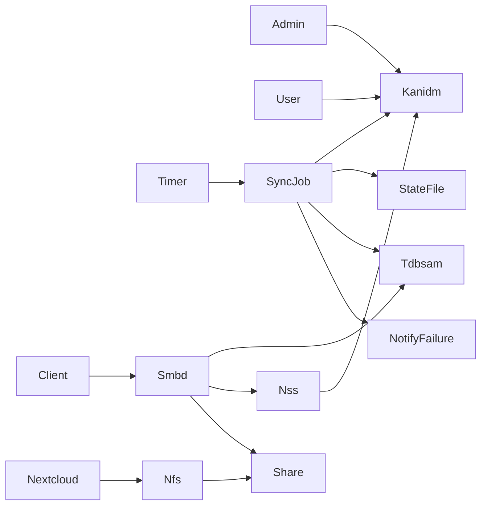
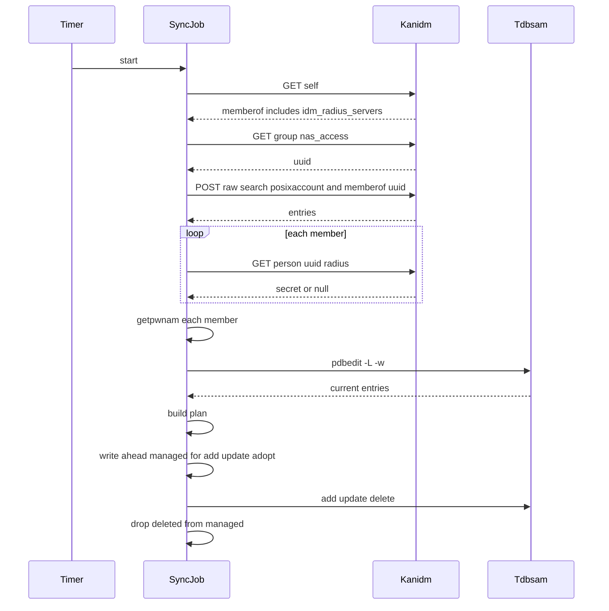

# Design Document

## Overview
**Purpose**: NAS(192.168.1.201)の SMB 共有 `smb` に、Kanidm の `nas_access` のメンバーが自分の Kanidm アカウント名で接続できるようにする。パスワードには、Kanidm が利用者ごとに発行する RADIUS 秘密を使う。

**Users**: `nas_access` のメンバーは、Windows や macOS から `\\192.168.1.201\smb` に接続する。管理者は Kanidm のグループと秘密を操作するだけで、NAS 上では手作業をしない。

**Impact**: NAS の Samba が `nextcloud` 以外のユーザーも受け付けるようになる。NAS 上の systemd timer が定期的に Kanidm の API から秘密を読み、tdbsam へ反映する。共有内の操作は、誰が接続しても `nextcloud` の権限で行う。

### Goals
- `nas_access` のメンバーが、Kanidm のアカウント名と RADIUS 秘密で SMB に接続できる(1.1)
- Kanidm 上の所属と秘密の変化が、15 分の周期内に tdbsam へ反映される(2.1〜2.4)
- Nextcloud の NFS と `nextcloud` の SMB 接続が、従来どおり動く(3.1〜3.4)
- 同期の失敗が既存の Discord 通知に届く(5.2)

### Non-Goals
- Kanidm のログインパスワードによる SMB 認証(Kanidm 1.11.1 では成立しない)
- 利用者ごとのファイル所有者の区別(共有内の操作はすべて `nextcloud` の権限で行う)
- `smb` 以外の共有、SMB1、平文認証

## Boundary Commitments

### This Spec Owns
- NAS 上の同期ジョブ `nas-smb-sync`(スクリプト、service、timer、env ファイル、状態ファイル)
- smb.conf の `[global]` での認証方式の明示と、`[smb]` 共有の `valid users` / `force user` / `force group`
- Kanidm のサービスアカウント `nas_smb_sync` と、その `idm_radius_servers` への所属
- 同期が登録した tdbsam のエントリ(状態ファイルに記録された名前に限る)

### Out of Boundary
- `nas_access` への利用者の追加・削除と、RADIUS 秘密の発行(Kanidm 上での運用。Terraform は人間の利用者と所属を宣言しない)
- tdbsam の `nextcloud` エントリ(既存の `smb_share.yml` が管理する)
- NFS のエクスポート、`kanidm_unixd` の設定、`systemd_failure_notify` の中身

### Allowed Dependencies
- Kanidm の HTTP API(`https://kanidm.fickledev.com`。host_vars の `kanidm_unixd_uri` を使う)
- NAS の NSS(kanidm-unixd)による、利用者名とグループの解決
- `systemd_failure_notify` role の `notify-failure@.service`
- Infisical(Ansible の適用時に `lookup('env')` で値を受け取る)

### Revalidation Triggers
- Kanidm のメジャーアップデート。`/v1/person/{id}/_radius` と `/v1/raw/search` の応答の形、および `idm_acp_radius_servers` の読める属性が変わりうる
- kanidm-unixd の `uid_attr_map` / `gid_attr_map` の変更。SMB のユーザー名とグループ名が変わる
- NFS の `anonuid` / `anongid`、または `nas_smb_user` の変更
- `systemd_failure_notify` のユニット名の変更

## Architecture

### Existing Architecture Analysis
- `ansible/roles/nas/tasks/smb_share.yml` が、Samba、ローカルユーザー `nextcloud`、smb.conf、NFS のエクスポートを構成する。tdbsam には `nextcloud` だけが登録されている。
- `kanidm_unixd` role が NSS と PAM を構成している。`nas_access` は POSIX グループとして NSS で解決できる。
- `systemd_failure_notify` は `host_health.yml` によって NAS に配置済み。ただし `nas.yml` はこの role を当てていない。

### Architecture Pattern & Boundary Map



- **Selected pattern**: NAS からの定期 pull 同期。Kanidm 1.11.1 には変更を外へ知らせる仕組みが無い。
- **Domain boundaries**: 同期ジョブが書くのは tdbsam と状態ファイルだけ。smb.conf は Ansible が書く。Kanidm への書き込みはしない(トークンは読み取り専用)。
- **Existing patterns preserved**: oneshot の service と timer、`OnFailure=notify-failure@%n.service`、0600 の env ファイル(`no_log`)、`lookup('env')` による Infisical からの供給、`kanidm_group_members` による組み込みグループへの所属。
- **New components rationale**: 同期ジョブは、Kanidm と tdbsam の間の資格情報の変換を担う唯一の部品である。
- **Dependency direction**: 型 → 計画(純関数)→ 入出力(Kanidm クライアント、tdbsam の操作、状態ファイル)→ 実行(main)。計画の関数は入出力を呼ばない。

### Technology Stack

| Layer | Choice / Version | Role in Feature | Notes |
|-------|------------------|-----------------|-------|
| 同期ジョブ | Python 3.11(NAS の Debian 12 の python3、標準ライブラリのみ) | Kanidm の API の呼び出しと tdbsam の更新 | ホストに Python のスクリプトを置くのは新規。jq が無く、JSON の処理と NT ハッシュの比較が要るため |
| NT ハッシュ | OpenSSL 3(`openssl dgst -md4 -provider legacy`) | 秘密と tdbsam の値の比較 | Python の hashlib は md4 を使えない(実機で確認) |
| SMB | Samba 4.17.12(tdbsam) | 認証と共有 | 既存 |
| 実行基盤 | systemd 252(service + timer) | 15 分ごとの実行と、失敗の通知 | 既存の host_health と同じ形 |
| IdP | Kanidm 1.11.1 / provider seanlatimer/kanidm 0.1.10 | 秘密の供給源と、サービスアカウントの宣言 | 既存 |

## File Structure Plan

### New Files
```
ansible/roles/nas/
├── files/nas-smb-sync.py              # 同期ジョブ本体。設定は env から読む
├── tasks/smb_kanidm_sync.yml          # スクリプト・env・unit の配置と timer の有効化
└── templates/
    ├── nas-smb-sync.service.j2        # oneshot、EnvironmentFile、OnFailure
    └── nas-smb-sync.timer.j2          # OnCalendar=*:0/15
terraform-kanidm/nas.tf                # サービスアカウント nas_smb_sync と idm_radius_servers への所属
scripts/test_nas_smb_sync.py           # 計画の関数と応答の解釈の単体テスト
```

### Modified Files
- `ansible/roles/nas/tasks/main.yml`: smb_share の後に、既存と同じ `import_tasks` + `when` の形で `smb_kanidm_sync.yml` を取り込む(tag `smb_kanidm_sync`)
- `.github/workflows/ci.yml`: ruff check / format の対象に `ansible/roles/nas/files/nas-smb-sync.py` を加える(既存の対象は `scripts/` だけ)
- `ansible/roles/nas/templates/smb.conf.j2`: `[global]` に認証方式を明示し、`[smb]` に `valid users` / `force user` / `force group` を追加する
- `ansible/roles/nas/defaults/main.yml`: 同期ジョブの変数を追加する
- `ansible/playbooks/nas.yml`: `nas` role より前に `systemd_failure_notify` を当てる
- `ansible/inventory/group_vars/all/vault.yml.example`: `vault_nas_smb_sync_kanidm_token` を追加する
- `terraform-kanidm/README.md`: トークンの発行手順を追記する

## System Flows



- **収集の段階(Kanidm の読み取り)で全体に関わる失敗が起きたら、tdbsam に触れずに中止する。** 全体に関わる失敗とは、接続・TLS・401・403・自分が `idm_radius_servers` に所属していない・グループが `null`・応答の形が不正の場合をいう(5.1)。
- 自分の所属を最初に確かめる。`_radius` は ACP によって `RadiusSecret` が見えないときも `null` を返すため、権限を失ったときに「未発行」と誤認して全員を削除しないようにするためである。
- 状態ファイルは先に記録する。ADD / UPDATE / ADOPT の名前は tdbsam を書き込む前に managed に加え、DELETE の名前は `pdbedit -x` の成功後に managed から除く。途中で落ちても、managed が tdbsam の実態より狭くなることはない。
- 利用者ごとの取得の失敗は、その利用者の既存のエントリを変更しない「保留」として扱い、残りを続ける(5.3)。
- 計画の適用は利用者ごとに独立して行う。1 件の失敗が他に波及しない。

## Requirements Traceability

| Requirement | Summary | Components | Interfaces | Flows |
|-------------|---------|------------|------------|-------|
| 1.1 | メンバーの接続許可 | SmbConfig, SyncJob | `valid users`, tdbsam | 同期フロー |
| 1.2 | 誤った秘密の拒否 | Smbd(既存) | tdbsam | — |
| 1.3 | 非メンバーの拒否 | SmbConfig, SyncJob | `valid users = nextcloud @nas_access` | — |
| 1.4 | SMB2 以降・平文の拒否 | SmbConfig | `[global]` の明示値 | — |
| 1.5 | ゲストの拒否 | SmbConfig | `map to guest = never`(既存)、`guest ok = no` | — |
| 2.1 | 追加の反映 | SyncJob, Timer | `build_plan` → add | 同期フロー |
| 2.2 | 秘密の再発行の反映 | SyncJob | NT ハッシュの比較 → update | 同期フロー |
| 2.3 | 除外の反映 | SyncJob, StateFile | 状態ファイルにあり、メンバーでない → delete | 同期フロー |
| 2.4 | 秘密の削除の反映 | SyncJob | `_radius` が `null` → delete | 同期フロー |
| 2.5 | 未発行のメンバーを飛ばす | SyncJob | `_radius` が `null` で未登録 → 何もしない | — |
| 2.6 | `nextcloud` に触れない | SyncJob, StateFile | 削除の候補を状態ファイルに限る、ローカルユーザー名の除外 | — |
| 2.7 | 変化が無ければ変更しない | SyncJob | NT ハッシュの一致 → 何もしない | — |
| 3.1 | `nextcloud` の接続を維持 | SmbConfig | `valid users` に `nextcloud` を残す | — |
| 3.2, 3.3 | NFS との相互の読み書き | SmbConfig | `force user` / `force group = nextcloud` | — |
| 3.4 | SSH・NFS を変えない | 全体 | 変更しないファイルの一覧 | — |
| 4.1 | 最小権限 | KanidmServiceAccount | `idm_radius_servers`、読み取り専用トークン | — |
| 4.2 | トークンは Infisical から | SyncTasks | `lookup('env')` | — |
| 4.3 | 秘密を出力しない | SyncJob, SyncTasks | 標準入力での受け渡し、`no_log` | — |
| 4.4 | TLS の検証 | SyncJob | urllib の既定の検証(OS の trust store) | — |
| 5.1 | 到達不能時は変更しない | SyncJob | 収集の段階での中止 | 同期フロー |
| 5.2 | 失敗の通知 | Timer, NotifyFailure | `OnFailure=notify-failure@%n.service` | — |
| 5.3 | 部分的な失敗 | SyncJob | 保留と、終了コード 1 | — |
| 6.1 | Kanidm の宣言 | KanidmServiceAccount | `terraform-kanidm/nas.tf` | — |
| 6.2 | Ansible の構成 | SyncTasks, SmbConfig | `roles/nas` | — |
| 6.3 | 冪等性 | SyncTasks | template / copy / systemd モジュール | — |

## Components and Interfaces

| Component | Domain/Layer | Intent | Req Coverage | Key Dependencies | Contracts |
|-----------|--------------|--------|--------------|------------------|-----------|
| SyncJob | NAS / 同期 | Kanidm の秘密を tdbsam へ反映する | 1.1, 2.1–2.7, 4.3, 4.4, 5.1, 5.3 | Kanidm API (P0), smbpasswd / pdbedit (P0), openssl (P0) | Service, Batch, State |
| SmbConfig | NAS / Samba | 認証方式と共有の許可を宣言する | 1.1, 1.3–1.5, 3.1–3.3 | Samba (P0), NSS (P0) | — |
| SyncTasks | Ansible | 同期ジョブを配置し、定期化する | 4.2, 5.2, 6.2, 6.3 | systemd_failure_notify (P1) | — |
| KanidmServiceAccount | Terraform | 同期用の主体と権限を宣言する | 4.1, 6.1 | provider 0.1.10 (P0) | — |

### NAS / 同期

#### SyncJob(`/usr/local/sbin/nas-smb-sync`)

| Field | Detail |
|-------|--------|
| Intent | `nas_access` のメンバーの RADIUS 秘密を tdbsam のエントリへ反映する |
| Requirements | 1.1, 2.1, 2.2, 2.3, 2.4, 2.5, 2.6, 2.7, 4.3, 4.4, 5.1, 5.3 |

**Responsibilities & Constraints**
- 書き込み先は tdbsam と状態ファイルだけ。Kanidm には書き込まない。
- 削除の候補は、状態ファイルに記録された名前に限る。
- `/etc/passwd` に存在する名前(ローカルユーザー)は、Kanidm 側に同名がいても対象にしない(2.6)。kanidm-unixd は `/etc/passwd` を先に引くため、同名の Kanidm の利用者で SMB に登録すると、ローカルユーザーのパスワードを書き換えることになる。
- NSS(getpwnam)で解決できないメンバーは、tdbsam に登録できない。失敗ではなく「解決不能」として SKIP し、ログに残す。
- 計画の前に、同期対象のグループ(`nas_access`)を NSS(getgrnam)で引く。引けなければ kanidm-unixd が使えない状態とみなして Fatal とし、tdbsam に触れない。kanidm-unixd が止まると全メンバーが解決不能に見え、規則 3 によって managed の全員を削除してしまうためである。
- 秘密はプロセスの引数・ログ・ファイルに出さない。smbpasswd と openssl へは標準入力で渡す。ログに出すのは、利用者名と操作の種別(add / update / delete / skip / hold)だけにする。

**Dependencies**
- External: Kanidm HTTP API — 秘密と所属の読み取り(P0)
- External: `smbpasswd` / `pdbedit` — tdbsam の読み書き(P0)
- External: `openssl dgst -md4 -provider legacy` — NT ハッシュの計算(P0)

**Contracts**: Service [x] / Batch [x] / State [x]

##### Service Interface
```python
from dataclasses import dataclass
from enum import Enum

@dataclass(frozen=True)
class Member:
    name: str          # Kanidm の name。NSS の uid_attr_map = name と一致する
    uuid: str

class SecretState(Enum):
    PRESENT = "present"
    ABSENT = "absent"      # _radius が null
    UNKNOWN = "unknown"    # 取得に失敗(保留)

@dataclass(frozen=True)
class Desired:
    member: Member
    state: SecretState
    nt_hash: str | None    # PRESENT のときだけ。大文字 16 進に正規化する
    resolvable: bool       # getpwnam で解決できるか

class Action(Enum):
    ADD = "add"
    UPDATE = "update"
    ADOPT = "adopt"        # tdbsam は書かず managed にだけ加える
    DELETE = "delete"
    SKIP = "skip"
    HOLD = "hold"

@dataclass(frozen=True)
class Step:
    name: str
    action: Action

class FatalSyncError(Exception): ...   # 収集の段階での全体の失敗。tdbsam に触れない

def build_plan(
    desired: list[Desired],
    current_hashes: dict[str, str],   # pdbedit -L -w の 名前 → NT ハッシュ
    managed: set[str],                # 状態ファイルの名前
    local_users: set[str],            # /etc/passwd の名前
) -> list[Step]: ...
```
- `build_plan` は純関数で、入出力を持たない。上から順に評価し、最初に当てはまった規則を採る。
  1. local_users に含まれる名前 → SKIP
  2. desired の UNKNOWN → HOLD
  3. desired の ABSENT、または resolvable でない → managed に含まれれば DELETE、含まれなければ SKIP
  4. desired の PRESENT で未登録 → ADD
  5. desired の PRESENT で、登録済みかつ NT ハッシュが異なる → UPDATE
  6. desired の PRESENT で、NT ハッシュが一致し、managed に含まれない → ADOPT
  7. desired の PRESENT で、NT ハッシュが一致し、managed に含まれる → SKIP
  8. managed に含まれ、desired に含まれない → DELETE
- DELETE の対象が tdbsam に無い(current_hashes に含まれない)場合は、`pdbedit -x` を呼ばず、managed から除くだけにする。先行記録の後に登録が失敗した名前や、手作業で消された名前で、存在しないエントリの削除が毎周期失敗し続けないようにするためである。
- 不変条件: managed に含まれない名前に DELETE を出さない。HOLD の名前の登録には触れない。状態ファイルが欠けても、次の周期で ADOPT によって managed が復元する。
- 解決不能かつ managed に含まれる名前の DELETE は、`pdbedit -x` が getpwnam を要さずに tdbsam から消せることを前提にする。消せなかった場合は適用の失敗として通知する。

##### API Contract(Kanidm への呼び出し)

| Method | Endpoint | Request | Response | Errors |
|--------|----------|---------|----------|--------|
| GET | `/v1/self` | `Authorization: Bearer <token>` | UAT(`memberof` に `idm_radius_servers`) | 含まれない・401/403 → Fatal |
| GET | `/v1/group/nas_access` | 同上 | `Option<ProtoEntry>`(`attrs.uuid`)。存在しなければ 200 で `null` | `null`・401/403/5xx → Fatal |
| POST | `/v1/raw/search` | `{"filter": {"and": [{"eq": ["class","person"]}, {"eq": ["class","posixaccount"]}, {"eq": ["memberof","<group uuid>"]}]}}` | `{"entries": [ProtoEntry]}`(`attrs.name`, `attrs.uuid`) | 401/403/5xx → Fatal |
| GET | `/v1/person/<uuid>/_radius` | 同上 | 文字列か `null` | 404/5xx → その利用者は UNKNOWN |

- 接続・TLS の失敗、タイムアウト(10 秒)、JSON の形の不正は、収集の段階では Fatal とする。
- グループは名前で引き、メンバーの検索にはその UUID を使う。名前の解決失敗が 0 件の結果に化けないようにするためである。グループの存在を確かめたうえでの 0 件は、正常な状態として扱う。
- `posixaccount` を検索の条件に入れる。POSIX でない person は kanidm-unixd の NSS で引けず、tdbsam に登録できないためである。
- `_radius` の `null` は、ACP で `RadiusSecret` が見えない場合にも返る。`/v1/self` で所属を確かめたうえでのみ、`null` を「未発行」と解釈する。

##### Batch / Job Contract
- **Trigger**: `nas-smb-sync.timer`(`OnCalendar=*:0/15`、`RandomizedDelaySec=1m`、`Persistent=true`)
- **Input**: env の `KANIDM_URL`、`KANIDM_TOKEN`、`NAS_SMB_SYNC_GROUP`(`nas_access`)
- **Output**: tdbsam の変更と状態ファイルの更新。終了コードは、全件成功なら 0、Fatal か HOLD か適用の失敗があれば 1
- **Idempotency & recovery**: 変化が無ければ何も書かない。失敗しても次の周期で同じ計画を作り直すので、再実行で収束する。

##### State Management
- **State model**: `/var/lib/nas-smb-sync/managed`。同期が登録したユーザー名を 1 行に 1 つ書く。root:root 0600。秘密もハッシュも書かない。
- **Persistence & consistency**: ADD / UPDATE / ADOPT の名前は tdbsam を書き込む前に加え、DELETE の名前は `pdbedit -x` の成功後に除く(先行記録)。書き込みは一時ファイルに書いてから rename で置き換える。managed が tdbsam の実態より広い分は、その名前が DELETE になった時点で、tdbsam に触れずに managed から除かれる。
- **Concurrency strategy**: oneshot の service なので、systemd が多重起動を防ぐ。

**Implementation Notes**
- Integration: tdbsam の操作は、`smbpasswd -a -s <name>`(標準入力に秘密を 2 行)と `pdbedit -x -u <name>` を使う。NT ハッシュは `openssl dgst -md4 -provider legacy` に UTF-16LE の秘密を標準入力で渡して計算する。openssl の出力は `MD4(stdin)= ` の接頭辞付きの小文字なので、接頭辞を除き大文字に正規化してから比べる。
- Validation: Kanidm の応答は、使うフィールドの存在と型を確かめてから使う。名前は `^[a-z0-9][a-z0-9_.-]*$` に合わないものを UNKNOWN とする。
- Risks: kanidm-unixd がオフラインでキャッシュも無い場合、smbpasswd の getpwnam が失敗する。これは適用の失敗として扱う。

### NAS / Samba

#### SmbConfig(`smb.conf.j2`)
要約のみ記載する。新しい境界は持たない。

- `[global]` に `server min protocol = SMB2_02`、`ntlm auth = ntlmv2-only`、`lanman auth = no` を明示する。いずれも 4.17 の既定値だが、要件 1.4 の根拠を設定に残すため明示する。
- `[smb]` は次のとおりにする。
  - `valid users = {{ nas_smb_user }} @{{ nas_smb_kanidm_group }}`
  - `force user = {{ nas_smb_user }}`
  - `force group = {{ nas_smb_user }}`
  - `guest ok = no`
  - 既存の `create mask 0640` / `directory mask 0750` は維持する。NFS 側も同じ所有者に潰されるため、所有者の権限だけで足りる。
- 共有ディレクトリの所有者と mode(`nextcloud:nextcloud 0750`)は変えない。

### Ansible

#### SyncTasks(`tasks/smb_kanidm_sync.yml`)
要約のみ記載する。

- スクリプトを `/usr/local/sbin/nas-smb-sync`(root:root 0700)へ copy する。
- `/etc/nas-smb-sync.env`(root:root 0600)を、`no_log: true` の `copy content=` で置く。中身は `KANIDM_URL`(`kanidm_unixd_uri`)、`KANIDM_TOKEN`(`nas_smb_sync_kanidm_token`)、`NAS_SMB_SYNC_GROUP`。
- `/var/lib/nas-smb-sync` を root:root 0700 で作る。
- service と timer を template で置き、timer を enabled / started にする。service は `OnFailure=notify-failure@%n.service` を持つ。
- トークンが空なら assert で止める。`smb_share.yml` の資格情報の assert と同じ形にする。
- `playbooks/nas.yml` は `systemd_failure_notify` → `nas` → `kanidm_unixd` の順で role を当てる。`mail_backup.yml` と同じく、ハンドラのユニットを先に置く。

### Terraform

#### KanidmServiceAccount(`terraform-kanidm/nas.tf`)
- `kanidm_service_account "nas_smb_sync"`: `entry_managed_by = "idm_admins"`、`generate_api_token = false`。provider が発行するトークンは読み書き可能で無期限なので、ここでは使わない。
- `kanidm_group_members "idm_radius_servers"`: `members = [kanidm_service_account.nas_smb_sync.name]`。
- トークンは CLI で発行する(読み取り専用。下記の手作業を参照)。

## Error Handling

### Error Strategy
- 収集の段階を先に終わらせ、全体に関わる失敗が無いことを確かめてから適用に進む。適用の段階に入ったら、利用者ごとに独立して適用する。
- 失敗の種類によらず、最後に終了コード 1 を返し、OnFailure で通知させる。

### Error Categories and Responses
- **全体に関わる失敗**(接続・TLS・401・403・グループが無い・応答の形の不正): 変更なしで中止する(5.1)
- **利用者ごとの取得の失敗**: HOLD として既存の登録を維持する(5.3)
- **利用者ごとの適用の失敗**(smbpasswd / pdbedit の非ゼロ終了): その利用者の状態ファイルを更新せず、残りを続ける(5.3)
- **秘密の未発行**: 失敗ではない。SKIP、または(managed に含まれる場合は)DELETE(2.4, 2.5)

### Monitoring
- journal には、利用者名・操作の種別・失敗の分類を出す。秘密、トークン、NT ハッシュは出さない。
- 通知は `notify-failure@.service` が Discord に送る。Beszel の `SystemdFailed` からも同じ失敗が通知される(既存の重複で、この spec では変えない)。
- 失敗が続く間は、15 分ごとに通知が届く。原因が解消するまで止まらないことを許容する。秘密の未発行と NSS での解決不能は失敗に含めないので、平常の運用では通知は来ない。
- NAS を作り直した初回の適用では、`nas` role が timer を有効にした後で `kanidm_unixd` role が NSS を構成する。その間に timer が動くと 1 回失敗して通知が届きうる。これは許容し、次の周期で収束させる。

## Testing Strategy

### Unit Tests(`scripts/test_nas_smb_sync.py`、CI の pytest)
- `build_plan` が、ADD / UPDATE / ADOPT / SKIP / DELETE / HOLD を規則の順序どおりに出すこと
- managed に無い名前(`nextcloud` を含む)に DELETE を出さないこと。local_users の名前を常に SKIP にすること
- 状態ファイルが空で、tdbsam にハッシュの一致する登録がある場合に ADOPT になり、その後グループから外すと DELETE になること
- 解決不能なメンバーが、managed に無ければ SKIP、あれば DELETE になること
- 同期対象のグループを getgrnam で引けない場合に Fatal になり、tdbsam を書かないこと
- managed にあり tdbsam に無い名前の DELETE が、pdbedit を呼ばずに managed から除かれ、終了コード 0 になること
- 自分の所属に `idm_radius_servers` が無い場合、グループが `null` の場合、`entries` の形が不正な場合に、Fatal になること
- NT ハッシュの計算が既知のベクトルと一致すること(`MD4(UTF-16LE("password"))` = `8846F7EAEE8FB117AD06BDD830B7586C`)
- Kanidm の応答の解釈で、`null` → ABSENT、文字列 → PRESENT、形の不正 → 例外になること

### Integration Tests(実機、適用後)
- `nas_access` のメンバーが秘密を発行し、15 分以内に `smbclient //192.168.1.201/smb -U <name>` で接続できること(1.1, 2.1)。kanidm の NSS モジュールは `initgroups_dyn` を持たないため、`valid users = @nas_access` の判定がグループの列挙で通ることを、この試験で確かめる
- 誤った秘密と、`nas_access` 以外の利用者が拒否されること(1.2, 1.3)
- 秘密の再発行の後、古い秘密が拒否され、新しい秘密が通ること(2.2)
- グループから外すと、15 分以内に接続できなくなり、tdbsam からエントリが消えること(2.3)
- 変化の無い 2 回目の実行で、tdbsam に変更が生じないこと(2.7)。`pdbedit -v` の Password last set が変わらないことで確かめる
- Kanidm に到達できない状態で実行すると、tdbsam が変わらず、unit が failed になり、Discord に通知が届くこと(5.1, 5.2)
- Kanidm の利用者が SMB で作ったファイルを Nextcloud で編集でき、逆もできること(3.2, 3.3)
- `nextcloud` の SMB 接続と、Nextcloud の外部ストレージが動くこと(3.1)
- `ansible-playbook playbooks/nas.yml` の 2 回目の実行で changed が 0 になること(6.3)

## Security Considerations
- トークンは読み取り専用で、`idm_radius_servers` 以外の権限を持たない。全 person の RADIUS 秘密を読めるが、このラボでは RADIUS 秘密を SMB 以外に使わない。
- トークンは、NAS 上の root だけが読める 0600 の env ファイルに置く(既存の `notify-failure.env` などと同じ扱い)。
- RADIUS の ACP からはアカウントの有効期限を判定できない。kanidm-unixd の NSS も、期限切れのアカウントを解決する。そのため、期限切れの利用者も SMB で認証できる。利用者の失効は、グループからの除外か、秘密の削除で行う。
- 共有内の操作はすべて `nextcloud` の権限で行う。利用者の間で、共有内の権限は区別しない。

## 手作業(Git 外の操作)
1. `terraform-kanidm` の apply の後、`entry_managed_by` の主体で `kanidm service-account api-token generate nas_smb_sync nas-smb-sync` を実行して、読み取り専用で無期限のトークンを発行する。値はファイルに書き出し、標準出力には出さない。
2. その値を、Infisical の `prod` に `NAS_SMB_SYNC_KANIDM_TOKEN` として登録する。
3. 利用者は、Kanidm の Web UI の RADIUS 画面(`https://kanidm.fickledev.com/ui/radius`、再認証の後)で秘密を発行し、表示された値を SMB のパスワードに使う。Kanidm 1.11.1 の組み込みの ACP(`idm_acp_self_read` / `idm_acp_self_write`)が、本人による RADIUS 秘密の読み書きを許可している。
