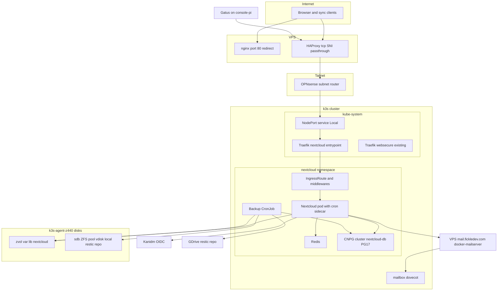
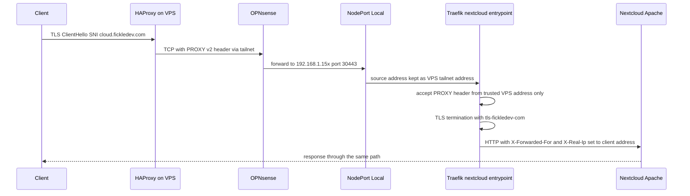
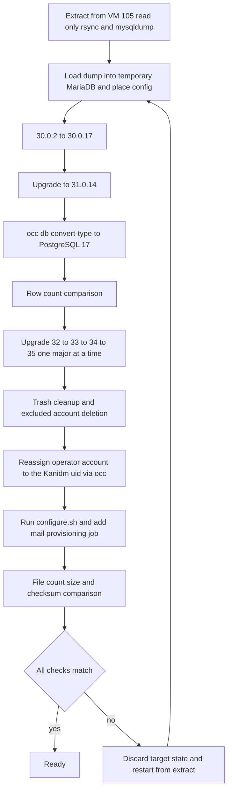
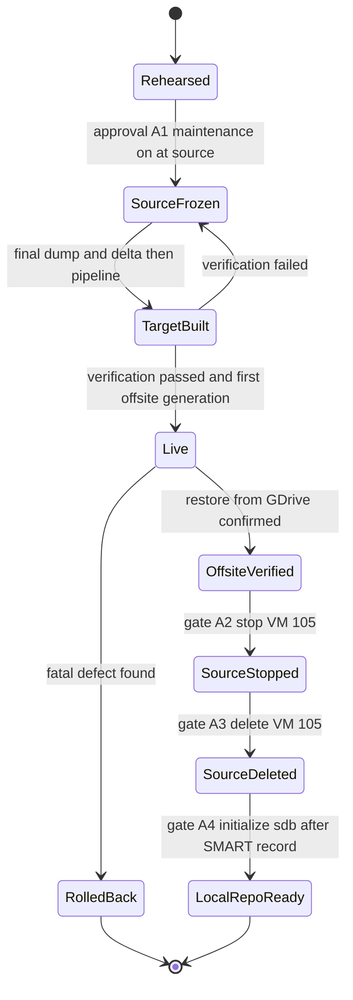
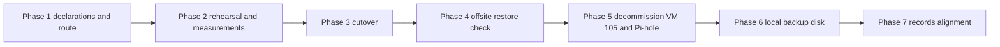

# Technical Design: nextcloud-k3s-migration

## Overview

本 spec は、宣言の外で動いている VM 105 の Nextcloud を k3s へ移し、GitOps の宣言下に置く。移行にあわせて 30.0.2 から保守期間内の 35 へ 1 メジャーずつ上げ、データベースを MariaDB から Nextcloud 専用の CNPG Cluster (PostgreSQL 17) へ移す。アップグレードと変換はすべて移行先で行い、移行元のデータと設定には読み取り以外の操作を加えない (関門 A1 での保守モードの切り替えと `trusted_domains` への追加を除く)。

公開経路は `cloud.fickledev.com` 1 本にする。VPS の HAProxy が TLS を復号せずに SNI で振り分け、tailnet 経由で k3s の Traefik の専用エントリポイントへ PROXY protocol v2 付きで渡す。Cloudflare Tunnel は本文と応答時間の上限があるため使わない。ログインは Kanidm の OIDC に集約し、ローカルパスワードによる Web ログインは入口で拒否する。Web メールは Nextcloud Mail のプロビジョニングと Dovecot の master user により、利用者がパスワードを入力せずに接続する。

退避は 3 つの複製で構成する。本体 (専用 zvol)、宅内 (VM 105 撤去後の `/dev/sdb`)、宅外 (GDrive) で、道具は restic に統一する。毎晩の短い保守の時間に宅内へ整合した 1 世代を取り、利用を戻した後で宅外へ差分だけを写す。宅外の最初の世代だけは、切り替えの停止時間の中で移行先から直接取る。移行先が本番になった後、宅外からの復元を確かめてから VM 105 を撤去し、その `/dev/sdb` を hp-z440 上の単一ディスクの ZFS プールにして VM 152 へ仮想ディスクとして渡し、宅内の退避先に転用する。

### Goals

- Nextcloud を k3s-agent-z440 の専用ディスク上で、保守期間内の 35 で稼働させ、構成をすべて `gitops-apps` と本リポジトリに宣言する
- 移行元のファイル・共有・カレンダー・連絡先・アプリの利用者データを欠落なく移し、件数・大きさ・内容の一致を記録する
- `cloud.fickledev.com` を、ファイルの大きさによらず 1 つの経路で、中継で復号せず、利用者の送信元 IP を保ったまま提供する
- Kanidm の OIDC だけで Web にログインさせ、移行元のアカウントへ設定だけで結びつける
- 本体と物理的に異なる宅内と宅外の 2 か所に、整合した時点の世代を退避し、失敗・応答停止・使用率超過を既存の通知経路へ流す
- 切り替えと切り戻しの手順、VM 105 と同居サービスの撤去の手順を、前提を確かめる関門付きで定める

### Non-Goals

- 旧ドメイン `tochiweb.mydns.jp` の VPS 側の残置物 (証明書更新、DDNS 更新) の撤去
- 退避基盤全体の設計と、k3s の Job の失敗を通知へつなぐ共通の仕組み (`backup-durability-and-alerting` が扱う)
- ストレージへの冗長性の付与
- ノードのアドレスの記述の食い違いと、VM 110 と VM 105 の IP 重複の解消 (Risks に記録するのみ)
- Pi-hole の代替の新設

## Boundary Commitments

### This Spec Owns

- `gitops-apps/apps/nextcloud/` 一式 (Nextcloud、Redis、Nextcloud 専用 CNPG Cluster、退避の CronJob、移行中だけ置く一時 MariaDB、静的 PV)
- Traefik の `nextcloud` エントリポイントと、それを出す追加 Service の宣言 (`gitops-apps/apps/traefik-config/`)
- VPS の HAProxy の `cloud.fickledev.com` の SNI 振り分けと、80 番の HTTPS 転送
- `cloud.fickledev.com` の DNS レコード
- Kanidm の OAuth2 クライアント `nextcloud`
- Nextcloud のデータの restic リポジトリ 2 つ (宅内・宅外) と、その世代の方針
- 移行・切り替え・切り戻し・撤去の手順と、各段の検証の記録
- VM 105 の撤去、同居する Pi-hole の撤去、samba の NAS による代替 (`ansible/roles/nas` の samba)、`/dev/sdb` の転用 (hp-z440 の ZFS プール、Proxmox ストレージの登録、VM 152 の仮想ディスク、scrub 対象への追加)
- メール基盤への master 用 passdb の追加 (k3s の Dovecot と VPS の docker-mailserver)、通知メール用の passwd-file passdb の追加、Nextcloud Mail のプロビジョニング設定の Job
- 移行後の steering・PBS の除外宣言・乖離検出の記述の更新

### Out of Boundary

- `backup-durability-and-alerting` が定めるオフサイト複製の総量の上限 (4 TB) そのものと、他の対象の退避
- 既存の `websecure` / `web` エントリポイントと、Cloudflare Tunnel 経由の既存経路の設定
- Kanidm のアプリケーションパスワードの仕組みと、メールクライアントの既存の認証方式 (Kanidm の LDAP passdb。本 spec は master 用と通知用の passdb を足すだけで、これには触れない)
- メール基盤 (`mailbox`、docker-mailserver) の構成のうち、上記の passdb の追加以外
- 退避の失敗の通知 (`backup-durability-and-alerting` の共通の仕組み)
- Gatus・Beszel の仕組み自体 (本 spec は監視対象の宣言を足すだけ)
- VM 110 の IP の重複と、steering のノードのアドレスの食い違いの是正

### Allowed Dependencies

- Infisical — 全シークレットの単一の正 (InfisicalStaticSecret 経由)
- Kanidm — OIDC の IdP。Nextcloud は `kanidm.fickledev.com` (Cloudflare Tunnel 経由) の発見文書・トークンエンドポイントを参照する
- cert-manager のワイルドカード証明書 `tls-fickledev-com` と reflector
- CNPG オペレーター v1.30.0 (稼働中)
- Tailscale と OPNsense の subnet routing — VPS から 192.168.1.0/24 への到達
- メール基盤 — IMAP は `mail.fickledev.com:993` (VPS が k3s の Dovecot へ TLS のまま中継する既存経路)、送信は VPS の docker-mailserver
- GDrive — 既存の外部の記憶領域。rclone で接続する
- Gatus・Beszel — 既存の通知経路
- `backup-durability-and-alerting` — 要件 4.15 (k3s の CronJob と Job の失敗を定めた通知先へ送る)、4.7 (容量の閾値の通知)、2.3 (宅外の 4 TB の上限)。本 spec の 8.10・8.12・8.13 はその完了に依存する。4.15 の完了は関門 A1 (切り替え) の前提とし、それまで VM 105 を本番のまま保つ

### Revalidation Triggers

- Traefik の chart の更新 (k3s の更新に伴うもの) — `ports` / `additionalServices` / `proxyProtocol` の値の形が変わりうる
- VPS の tailnet アドレスの変更 — `proxyProtocol.trustedIPs` の唯一の値
- Traefik の Pod が載るノードの集合の変更 — HAProxy の振り分け先
- Nextcloud のメジャー更新 — アプリの対応範囲、PHP・PostgreSQL の対応範囲
- `backup-durability-and-alerting` の共通の通知の仕組みの変更 — BackupJob の失敗の検知経路 (8.10) が変わる
- Dovecot または docker-mailserver の更新 — master 用・通知用 passdb の記法と環境変数の展開
- Nextcloud Mail のメジャー更新 — プロビジョニングの REST API
- `gatus_endpoints` と Beszel の監視対象の変更 — `admin-plane-rebuild` が定めた監視の分担に触れる

## Architecture

### Existing Architecture Analysis

- **移行元は宣言の外。**VM 105 は Terraform にも Ansible のインベントリにも無い。`scripts/check_host_address_drift.py` は `nextcloud` を `STATIC_UNMANAGED_HOSTS` に入れて判定から外している。
- **移行先の予約は済んでいる。**`terraform/locals.tf` の `zfs_pools.nextcloud` (1000G、scsi2、`backup = false`) と `host_vars/k3s-agent-z440` の `agent_data_disks` (`/var/lib/nextcloud`、xfs) がある。PBS は `backup_excluded_disks: [scsi2]` で空であることを理由に除外している。
- **Traefik は k3s 同梱のまま。**HelmChartConfig は無い。既存の LoadBalancer Service は svclb が ClusterIP へ転送するため、Traefik から見える接続元は利用者でも VPS でもない。
- **VPS の 443 番は HAProxy の TCP パススルー。**既定の振り分け先は nginx のキャッチオール (403)。80 番は nginx が受け、`*.fickledev.com` を 403 で返す。
- **`*.fickledev.com` はトンネルへの CNAME。**`cloud` の A レコードを明示すれば、そちらが返る。
- **静的 hostPath PV (Retain) + nodeSelector + `Prune=false,Delete=false` の前例**は Garage にある。Recreate の前例は kanidm・mailbox にある。専用の CNPG Cluster の前例は `devplatform-db` にある。
- **k3s の CronJob の失敗を通知へつなぐ仕組みは無い。**Garage の容量検査は Job を失敗させるだけ。

### Architecture Pattern & Boundary Map

**選定したパターン**: 公開経路は「VPS で SNI パススルー → tailnet → Traefik の専用エントリポイントで TLS 終端」。既存の公開経路 (Cloudflare Tunnel → `websecure`) とはエントリポイントの段で分け、互いの送信元の扱いに触れない。Nextcloud 本体は 1 Pod (Apache 版の公式イメージ + cron の副コンテナ) で、状態は専用ディスク (ファイル・コード・設定) と専用 CNPG Cluster (DB) にだけ置く。退避は本体の Pod から独立した CronJob が担い、本体は宅内の退避先をマウントしない。



**Architecture Integration**

- **公開経路の分離**: Nextcloud の IngressRoute は `nextcloud` エントリポイントだけに付け、`websecure` には付けない。Tunnel のワイルドカード経路から `cloud.fickledev.com` へは到達しない (4.8)。
- **状態の置き場所**: ファイル・コード・設定は HDD の zvol、DB は SSD (local-path) に置く (steering の役割別の使い分け)。Redis は永続化しない。
- **退避の独立**: 退避の CronJob は本体の Pod を経由せず、同じディスクを別 Pod からマウントし、DB へはクラスタ内の Service で接続する。宅内の退避先は CronJob だけがマウントする (8.6)。
- **維持する既存パターン**: 静的 hostPath PV + Retain + `Prune=false,Delete=false` + nodeSelector (Garage)、Recreate (kanidm・mailbox)、専用 CNPG Cluster に継続的退避を持たせない (devplatform-db)、InfisicalStaticSecret、`vps_hosts` マップでの DNS 宣言、`vps_proxy` の HAProxy テンプレート、`terraform-kanidm` の `kanidm_oauth2_basic`、`gatus_endpoints` の宣言。
- **Steering への適合**: シークレットは Infisical のみ。Web の管理 UI を新設しない (Nextcloud の管理は Nextcloud 自身の画面と kubectl の occ)。

**依存の方向**: Infisical / Kanidm の宣言 → クラスタの宣言 (`traefik-config` → `nextcloud`) → エッジの宣言 (DNS → HAProxy)。エッジは Traefik の NodePort の番号にだけ依存し、クラスタはエッジに依存しない。

### Technology Stack

| Layer | Choice / Version | Role in Feature | Notes |
|-------|------------------|-----------------|-------|
| アプリ | Nextcloud 公式イメージ `nextcloud:<版>-apache` (到達先 35.0.2、PHP 8.5) | 本体 | 段ごとに 30.0.17 / 31.0.14 / 32.0.15 / 33.0.10 / 34.0.5 / 35.0.2 を使う。ダイジェストで固定する |
| 認証 | user_oidc 8.11.0 | Kanidm との OIDC | 29〜35 に対応 |
| DB | CNPG v1.30.0、`ghcr.io/cloudnative-pg/postgresql:17.11-system-trixie` | Nextcloud 専用 Cluster `nextcloud-db` | オペレーターの既定は PG 18 のため `imageName` を明示する |
| 一時 DB | `mariadb:10.11` | ダンプの受け皿と 30→31 の段 | 変換の完了後に宣言ごと撤去する |
| キャッシュ | `redis:7` 系 (仮、実装時にダイジェスト固定) | ファイルロックと分散キャッシュ | 永続化しない。APCu をローカルキャッシュに使う |
| 入口 | Traefik 3.6.7 (k3s 同梱、chart 38.0.2) | `nextcloud` エントリポイントで TLS 終端 | HelmChartConfig で追加 |
| エッジ | HAProxy (VPS、`vps_proxy` role) | SNI パススルーと PROXY protocol v2 | 新しい backend を足す |
| 退避 | restic 0.19.1、rclone (Garage と同じ系列) | 宅内・宅外のリポジトリ | rclone は別イメージから実行ファイルを取り込む |
| 宅内退避先 | ZFS (単一ディスクのプール)、`proxmox_storage_zfspool` | `/dev/sdb` を VM 152 の仮想ディスクとして渡す | プールは hp-z440 で Ansible が 1 回だけ作る |
| メール UI | Nextcloud Mail 5.12.6 | Web メール | 5.9.x は NC 35.0.2 の有効化時の DB 移行が `TypeError` で失敗し、stable5.9 に修正の backport が無い。修正 (上流 b5283cf1、`Table\|ITable`) は 5.10.14 以降・5.11.0 以降・5.12.0 以降にある。5.12.6 は Nextcloud 32〜35、PHP 8.1〜8.5 に対応 |
| メール認証 | Dovecot の master user (k3s: 2.4.0、VPS の docker-mailserver v16.0.0: 2.4.1) | Nextcloud Mail の接続 | k3s の Dovecot と VPS の docker-mailserver の両方に足す |
| 監視 | Gatus、Beszel agent 0.19.0 | 外形・容量 | 宣言を足す |

## File Structure Plan

### Directory Structure

```
gitops-apps/
├── apps/nextcloud/                    # 新設。Kustomize
│   ├── kustomization.yaml
│   ├── namespace.yaml
│   ├── storage.yaml                   # 専用ディスクの静的 PV/PVC (Retain、Prune=false/Delete=false)
│   ├── backup-storage.yaml            # 宅内の退避先の静的 PV/PVC。/dev/sdb の初期化後に足す
│   ├── deployment.yaml                # Nextcloud + cron 副コンテナ。Recreate、nodeSelector z440
│   ├── service.yaml
│   ├── redis.yaml                     # Deployment + Service
│   ├── database.yaml                  # CNPG Cluster nextcloud-db
│   ├── ingressroute.yaml              # IngressRoute、Middleware、ServersTransport
│   ├── networkpolicy.yaml             # Redis への到達を namespace 内に限る (DB には掛けない。CNPG のオペレーターが cnpg-system から TCP 8000 で各インスタンスに届く必要がある)
│   ├── infisical-secrets.yaml         # アプリ用と退避用の InfisicalStaticSecret
│   ├── php-apache-config.yaml         # PHP と Apache の上限の明示 (ConfigMap)
│   ├── configure-configmap.yaml       # Configure の段の冪等スクリプト configure.sh (ConfigMap)
│   ├── scripts/reassign-account.sh    # Reassign の段のスクリプト。occ を順に呼ぶ (configure.sh と同じ置き場所・同じ実行)
│   ├── mail-provisioning-job.yaml     # Nextcloud Mail のプロビジョニング設定を REST API に投入する Job (jq を含むイメージ)。Job は不変のため、名前に連番を付けて足し直す
│   ├── backup-cronjob.yaml            # 退避の CronJob と手順スクリプトの ConfigMap
│   └── migration-mariadb.yaml         # 一時 MariaDB。変換の完了後に削除する
└── apps/traefik-config/               # 新設。kube-system の HelmChartConfig traefik
    ├── kustomization.yaml
    └── helmchartconfig.yaml

my-home-network/
├── terraform-kanidm/                  # 既存ファイルへの追記のみ
├── terraform/                         # 既存ファイルへの追記のみ
├── ansible/                           # 既存ファイルへの追記と、ZFS プール作成の play の新設
└── .kiro/specs/nextcloud-k3s-migration/
    ├── manual-operations.md           # 移行・切り替え・切り戻し・撤去の手順と、関門の前提の確認結果と実施の記録
    └── migration-records.md           # 突き合わせの結果、アプリの継続可否、所要時間の実測
```

### Modified Files

- `gitops-apps/apps/cluster-issuer/wildcard-certificate.yaml` — reflector の複製先 2 つの一覧に `nextcloud` を足す
- `gitops-apps/apps/mailbox/configmap.yaml` と Dovecot の Deployment — master 用 passdb (`master_static`)、`auth_master_user_separator`、`import_environment`。master パスワードは環境変数 `MASTER_PASSWORD` として Secret から渡す。`10-mailbox.conf` に特別用途のフォルダ (NextcloudMail)
- `terraform/cloudflare_dns.tf` — `vps_hosts` に `cloud` (`proxied = false`、`aaaa = false`) を足す
- `terraform/locals.tf` — `zfs_pools.nextcloud` の注記を「PBS ではなく restic で別媒体へ退避する」に改める。k3s-agent-z440 に `datastore_disks.restic_local = { datastore = "zfs-backup", size = <関門 A4 で作ったプールの `zpool list` の FREE の 90% を 100G 単位で切り捨てた値 (試算上 1600 前後)>, scsi = 4, backup = false }` を宣言する
- `terraform/modules/vm/main.tf`、`variables.tf` — データストアをエントリごとに指定する map 変数 `datastore_disks` (`{ datastore, size, scsi, backup }`、既定は空) と、それを回す `dynamic "disk"` を既存の `lvm_disks` のブロックの後ろに足す。`zfs_pools` と `lvm_disks` は変えない
- `terraform/` — 新プールを `proxmox_storage_zfspool` で Proxmox ストレージとして登録する
- `terraform-kanidm/oauth2_clients.tf` — `kanidm_oauth2_basic.nextcloud`
- `terraform-kanidm/outputs.tf` — `nextcloud_client_secret`
- `ansible/roles/vps_proxy/templates/haproxy.cfg.j2`、`defaults/main.yml` — `cloud.fickledev.com` の SNI 振り分けと `bk_nextcloud`
- `ansible/roles/vps_proxy/templates/fickledev.com.conf.j2` — 80 番で `cloud.fickledev.com` を HTTPS へ転送する server ブロック
- `ansible/roles/beszel_agent/templates/agent.env.j2`、`defaults/main.yml` — ホストごとの `EXTRA_FILESYSTEMS`
- `ansible/inventory/host_vars/hp-z440/main.yml` — `host_health_zfs_pools` に新プールを足して scrub 対象にする
- `ansible/` の hp-z440 向けの新しい play — `/dev/sdb` に単一ディスクの ZFS プールを作る (BackupDiskPool)
- `ansible/roles/mailserver/templates/dovecot.cf.j2`、`compose.yaml.j2` — 通知メール用の passwd-file passdb、master 用 passdb (`master-static`)、`import_environment`、compose の environment の `MASTER_PASSWORD`。passwd-file を生成して配置するタスク
- `ansible/inventory/host_vars/k3s-agent-z440/main.yml` — Beszel の追加ファイルシステム。関門 A4 の実施後に `agent_data_disks` の退避先
- `ansible/inventory/group_vars/console/main.yml` — `gatus_endpoints` に `nextcloud`
- `ansible/inventory/host_vars/pbs/main.yml` — `scsi2` の除外理由の改訂と、退避先ディスクの除外
- `ansible/roles/nas/` と `host_vars/nas` — samba の共有とローカル利用者、同じディレクトリの k3s-agent-z440 向け NFS export
- `ansible/inventory/host_vars/k3s-agent-z440/main.yml` — NFS のクライアント (`nfs-common`)
- `scripts/check_host_address_drift.py`、`scripts/test_check_host_address_drift.py` — VM 105 撤去後に `nextcloud` を `STATIC_UNMANAGED_HOSTS` から外す
- `.kiro/steering/tech.md`、`product.md` — Nextcloud の所在、移行先の予約、PBS の除外、Proxmox Guests 表の記述

## System Flows

### 公開経路の 1 リクエスト



- HAProxy は 3 ノードの 192.168.1.150〜152 を `check` 付きで並べる。`externalTrafficPolicy: Local` により Traefik の Pod が載るノードだけが応答し、他のノードは死活確認で外れる。
- Traefik は外から届いた `X-Forwarded-*` を信頼しない (`forwardedHeaders.trustedIPs` を空にする)。利用者が送信元を偽れない。

### 移行のパイプライン



- このパイプラインは同じ手順で 2 回走らせる。1 回目は移行元を動かしたままのリハーサルで、各段の所要時間を実測し、公開経路・認証・大きなファイルの実測 (5.8、7.4) もこの状態で行う。2 回目は切り替えで、移行元を保守モードにして取り直したダンプと差分から走らせる。
- 各段の後に `cron.php` を 2〜3 回実行して背景の移行を終わらせてから次の段へ進む。
- パイプラインは切り替え時に移行元の DB ダンプと `config.php` から移行先を作り直すため、移行先で足した設定 (user_oidc の provider、appconfig、files_external の接続先、Mail のプロビジョニング、管理者のアプリパスワード、`config.php` の値) は残らない。Configure はこれらを毎回入れ直す段で、Reassign の後・Verify の前に置く。内容は MigrationRunbook に定める。
- Reassign は運用者の移行元アカウントを Kanidm の人のアカウント名と同じ uid の新しいアカウントへ付け替える段で、Clean と Configure の間に置く。中身は `occ` を順に呼ぶスクリプト `reassign-account.sh` (gitops-apps の `apps/nextcloud/scripts/`) で、`configure.sh` と同じく `kubectl exec` で `app` コンテナ内 (www-data) に `runuser` で実行し、リハーサルでも切り替えでも同じものを流す。Configure より前に置くのは、`configure.sh` (e) が「admin グループの唯一のメンバー」を前提にするため。内容は MigrationRunbook に定める。
- Configure は冪等な 1 本のスクリプト `configure.sh` で、`apps/nextcloud/` の ConfigMap に置く。他の段と同じく `kubectl exec` で `app` コンテナ内 (www-data) で実行し、リハーサルでも切り替えでも同じものを実行する。
- `mail-provisioning` Job は不変のため、Configure の後に Job 名に連番を付けた新しい Job を commit して投入する (リハーサル用と切り替え用で別名)。
- どの段で失敗しても、移行先の DB とコードを捨てて Stage からやり直す。移行元には再度の書き込みを要しない (12.6)。

### 切り替えから撤去まで



- **関門**: 運用者は A0〜A4 を事前に一括で承認している。各関門は下記の前提をコマンドの結果で確かめ、満たせば実行し、満たさなければ止まって報告する。前提の確認結果と、対象・影響範囲・元に戻す手順を `manual-operations.md` に記録する (1.3、8.7、9.3)。
  - A0 (移行元への一時の ssh 公開鍵の追加、リハーサルの前): Phase 1 の宣言が済んでいる。
  - A1 (移行元を保守モードにし、`trusted_domains` に `192.168.1.11` を足して切り替える): `backup-durability-and-alerting` の 4.15 が完了し、リハーサルの検証 (要件 2、5.8、7.4) が通っている。
  - A2 (VM 105 の停止): 移行の検証 (要件 2) と宅外からの全量復元 (8.2) が済み、Pi-hole を参照している所が無い (または 10.2 で既存の DNS へ切り替え済み)。
  - A3 (VM 105 の削除): A2 が完了し、VM 105 の設定から `/dev/sdb` を外してある。
  - A4 (`/dev/sdb` の初期化): A3 が完了し、SMART の結果を記録してある (結果で採否を分けない)。
- **Live の定義**: 宅外の最初の世代の後に移行先の保守モードを解除し、利用者が `cloud.fickledev.com` を使い始めた時点 (CutoverRunbook の手順 7)。移行元は保守モードのまま残る。
- **RolledBack**: 移行元の保守モードを解除し、宅内の LAN から直接使える状態に戻す。外部公開は戻さない (9.2)。

## Requirements Traceability

| Requirement | Summary | Components | Interfaces | Flows |
|-------------|---------|------------|------------|-------|
| 1.1 | spec 確定まで読み取りのみ | MigrationRunbook | 関門 A0 以前の手順は読み取りのみ | 移行のパイプライン |
| 1.2 | `/dev/sdb` に書かず、取り出しは読み取りのみ | MigrationRunbook | ゲストからの rsync / mysqldump。ホストからマウントしない | 移行のパイプライン |
| 1.3 | 状態を変える操作は関門の前提を確かめ、記録してから実行 | MigrationRunbook, CutoverRunbook | 関門 A0 / A1 | 切り替えから撤去まで |
| 1.4 | 8.2 の完了まで消去しない | DecommissionRunbook | 関門 A2 / A3 の前提条件 | 切り替えから撤去まで |
| 1.5 | 切り替え前に VM 105 を止めず、同居サービスに影響させない | CutoverRunbook | 保守モードは Nextcloud だけに効く | 切り替えから撤去まで |
| 2.1 | 運用者のアカウントだけを移し、対象外を削除して残存を確かめる | MigrationRunbook | `occ user:delete` と残存の照会 | 移行のパイプライン |
| 2.2 | バージョン履歴を引き継がない | MigrationRunbook | Reassign の `occ user:delete` で旧 uid の `files_versions` が消える | 移行のパイプライン |
| 2.3 | ゴミ箱を除き、移行先は空で始める | MigrationRunbook | rsync の除外と `occ trashbin:cleanup --all-users` | 移行のパイプライン |
| 2.4 | 共有・カレンダー・連絡先・アプリのデータ | MigrationRunbook | DB のダンプ全体を移し、Reassign の `occ` で新 uid へ付け替える (アドレス帳は移せない) | 移行のパイプライン |
| 2.5 | 件数と合計サイズの突き合わせ | MigrationVerification | 件数・サイズの記録 | 移行のパイプライン |
| 2.6 | 内容の一致 | MigrationVerification | SHA-256 の一覧の突き合わせ | 移行のパイプライン |
| 2.7 | 差異があれば切り替えない | MigrationVerification, CutoverRunbook | 関門の判定 | 移行のパイプライン |
| 2.8 | アプリの継続可否とデータの扱いの記録 | MigrationRecords | アプリの分類表 | — |
| 2.9 | `secret` / `passwordsalt` を引き継ぐ | NextcloudApp, NextcloudSecrets | config.php の移送と `NC_secret` / `NC_passwordsalt` | — |
| 3.1 | gitops-apps で宣言し ArgoCD で同期 | NextcloudApp, NextcloudDatabase, TraefikEntrypoint | `apps/nextcloud`、`apps/traefik-config` | — |
| 3.2 | 専用ディスクに置く | NextcloudStorage | 静的 PV `/var/lib/nextcloud` | — |
| 3.3 | prune・削除で消えない | NextcloudStorage, NextcloudDatabase | Retain + `Prune=false,Delete=false` | — |
| 3.4 | シークレットは Infisical | NextcloudSecrets | InfisicalStaticSecret | — |
| 3.5 | 空き資源に収める | NextcloudApp, NextcloudDatabase, NextcloudCache | requests / limits の表 | — |
| 3.6 | 保守期間内のメジャー | NextcloudApp | 35.0.2 | 移行のパイプライン |
| 3.7 | 背景ジョブの定期実行と最終時刻 | NextcloudApp | cron 副コンテナ、`backgroundjobs_mode=cron` | — |
| 4.1 | `cloud.fickledev.com` を HTTPS で公開 | PublicDnsRecord, EdgeSniRoute, TraefikEntrypoint, NextcloudIngress | A レコード、SNI、TLS 終端 | 公開経路の 1 リクエスト |
| 4.2 | リバースプロキシ・ホスト名の警告を残さない | NextcloudApp, NextcloudIngress | `trusted_proxies` ほか、HSTS | — |
| 4.3 | 同期クライアントから接続 | NextcloudApp, NextcloudAuth | ログインフロー v2、アプリパスワード | — |
| 4.4 | HTTP を HTTPS へ転送 | EdgeSniRoute | nginx 80 番の server ブロック | — |
| 4.5 | 旧ドメインを引き継がない | NextcloudApp | `trusted_domains` は `cloud.fickledev.com` のみ | — |
| 4.6 | VPS で復号しない | EdgeSniRoute | HAProxy `mode tcp` | 公開経路の 1 リクエスト |
| 4.7 | 送信元 IP の識別 | EdgeSniRoute, TraefikEntrypoint, NextcloudApp | PROXY v2、NodePort Local、`trustedIPs` | 公開経路の 1 リクエスト |
| 4.8 | 既存経路に影響させない | TraefikEntrypoint, NextcloudIngress | 専用エントリポイント、`websecure` は不変 | — |
| 5.1 | Kanidm の OIDC | NextcloudAuth, KanidmClient | user_oidc の provider | — |
| 5.2 | クライアントとグループを宣言 | KanidmClient | `terraform-kanidm` | — |
| 5.3 | 短い名前と uid の照合、運用者のアカウントの付け替え | NextcloudAuth, KanidmClient, MigrationRunbook | `prefer_short_username`、`mapping-uid=preferred_username`、Reassign (`reassign-account.sh`) | — |
| 5.5 | Kanidm 障害時は kubectl から occ | NextcloudApp, MigrationRunbook | `kubectl --context default exec` | — |
| 5.6 | アプリパスワードで同期 | NextcloudAuth | `token_auth_enforced=true` | — |
| 5.7 | ローカルパスワードの Web ログインを拒否 | NextcloudAuth, NextcloudIngress | `/login` POST の拒否ほか | — |
| 5.8 | 結びつきを切り替え前に実測 | MigrationVerification | リハーサルでのログインと照会 | 移行のパイプライン |
| 6.1 | Nextcloud Mail で提供 | NextcloudApp | mail アプリ | — |
| 6.2 | メール基盤に TLS で接続 | NextcloudMail | IMAPS `mail.fickledev.com:993` / SMTPS `mail.fickledev.com:465` | — |
| 6.3 | プロビジョニングでパスワード入力なしに接続、既存の認証方式は残す | NextcloudMail, MailMasterAuth | Mail のプロビジョニング (`%USERID%*mailmaster`、masterPasswordEnabled)、Dovecot の master passdb | — |
| 6.4 | 通知メールをメール基盤から送る | NextcloudMail, NoreplyAuth, NextcloudSecrets | `mail_smtp*`、passwd-file passdb | — |
| 7.1 | 49GB 以上を Web と同期クライアントで | 全経路 | 上限の表 | — |
| 7.2 | 大きさで経路を変えない | EdgeSniRoute, NextcloudIngress | 単一のホスト名 | — |
| 7.3 | 各段の上限を明示 | EdgeSniRoute, TraefikEntrypoint, NextcloudIngress, NextcloudApp | 上限の表 | — |
| 7.4 | 宅外から実測 | MigrationVerification | リハーサルでの実測 | 切り替えから撤去まで |
| 8.1 | 本体・宅内・宅外 | BackupJob, NextcloudStorage | 3 つの置き場所 | — |
| 8.2 | 撤去前に宅外から復元確認 | BackupJob, DecommissionRunbook | 復元の手順 | 切り替えから撤去まで |
| 8.3 | 既存の GDrive | BackupJob | rclone の remote | — |
| 8.4 | 提供元が読めない形 | BackupJob | restic の暗号化 | — |
| 8.5 | 鍵を Infisical と別の場所に | DecommissionRunbook | 復元確認で控えの鍵を使う (控えの保管はリポジトリ外で、本設計は扱わない) | — |
| 8.6 | `/dev/sdb` を宅内の退避先に、本体はマウントしない、鍵を失わない | BackupJob, NextcloudStorage, BackupDiskPool | `--insecure-no-password`、退避先の PV は CronJob だけ、ZFS プール上の仮想ディスク | — |
| 8.7 | 初期化は検証と復元確認の完了後に、記録してから実行 | DecommissionRunbook, BackupDiskPool | 関門 A4 でプールを作る | 切り替えから撤去まで |
| 8.8 | 退避先とする前に診断し、結果を記録 | DecommissionRunbook, BackupDiskPool | SMART の診断 | 切り替えから撤去まで |
| 8.9 | 同一の時点で取得 | BackupJob | 保守モード中にダンプと取得 | — |
| 8.10 | 失敗を通知 | BackupJob | Job の失敗終了。通知は `backup-durability-and-alerting` の共通の仕組み (依存) | — |
| 8.11 | 応答停止を通知 | ExternalProbe | Gatus の `nextcloud` | — |
| 8.12 | 使用率の閾値超過を通知 | CapacityMonitor | Beszel `EXTRA_FILESYSTEMS`、GDrive の使用量 | — |
| 8.13 | 4 TB の内数 | BackupJob, CapacityMonitor | `gdrive:backup` の使用量 | — |
| 8.14 | 複数世代、差分のみ、750GB/日 | BackupJob | `restic copy`、`RCLONE_DRIVE_STOP_ON_UPLOAD_LIMIT=true` | — |
| 8.15 | 最初の世代は移行先から直接 | InitialOffsiteBackup, CutoverRunbook | 切り替えの停止時間の中で宅外へ直接 `restic backup` | 切り替えから撤去まで |
| 8.16 | 初期化までは宅外と移行元で保護 | DecommissionRunbook | 期間の明示 | 切り替えから撤去まで |
| 9.1 | 書き込みを止めて最終差分を移す | CutoverRunbook | 関門 A1、最終ダンプと差分 | 切り替えから撤去まで |
| 9.2 | 切り戻しの手順 | CutoverRunbook | 移行元の保守モードの解除 | 切り替えから撤去まで |
| 9.3 | 8.2 の確認後に停止と削除をそれぞれ関門の前提を確かめて実行 | DecommissionRunbook | 関門 A2 / A3 | 切り替えから撤去まで |
| 9.4 | 切り戻しで失われる範囲の提示 | CutoverRunbook | 事前の説明 | — |
| 10.1 | Pi-hole の参照が無いことを確認 | DecommissionRunbook | DHCP・リゾルバ設定・問い合わせ記録 | — |
| 10.2 | 参照があれば既存の DNS へ | DecommissionRunbook | 参照元の設定変更 | — |
| 10.3 | 代替を新設しない | DecommissionRunbook | — | — |
| 10.4 | samba を NAS で代替 | NasSmbShare | NAS の samba、ローカル利用者 | — |
| 10.5 | 外部ストレージの接続先は NAS | NextcloudApp, NasSmbShare | files_external の `/SMB` を、NAS の共有ディレクトリを NFS でマウントした Local に替える | — |
| 11.1 | steering の更新 | RecordsAlignment | `tech.md`、`product.md` | — |
| 11.2 | 退避除外の見直し | RecordsAlignment | `host_vars/pbs`、`locals.tf` | — |
| 11.3 | 乖離検出への反映 | RecordsAlignment | `check_host_address_drift.py` | — |
| 12.1 | 保守期間内のメジャー | NextcloudApp | 35.0.2 | 移行のパイプライン |
| 12.2 | メジャーを飛ばさない | MigrationRunbook | 6 段の経路 | 移行のパイプライン |
| 12.3 | 移行先でのみ行う | MigrationRunbook | 移行元は読み取りのみ | 移行のパイプライン |
| 12.4 | 専用 CNPG Cluster、継続的退避なし | NextcloudDatabase | `nextcloud-db` | — |
| 12.5 | 主要テーブルの行数の突き合わせ | MigrationVerification | 変換前後の行数の記録 | 移行のパイプライン |
| 12.6 | 失敗したら取り出した状態からやり直す | MigrationRunbook | Stage からの再実行 | 移行のパイプライン |
| 12.7 | 非対応または分類に無いアプリは無効にして記録 | MigrationRecords | アプリの分類表 | — |
| 12.8 | PostgreSQL を退避に含める | BackupJob | `pg_dump` | — |
| 12.9 | 各段を公式の対応範囲に | MigrationRunbook | 版の組み合わせの表 | 移行のパイプライン |
| 12.10 | 一時 MariaDB を撤去し宣言に残さない | MigrationMariaDB | `migration-mariadb.yaml` の削除 | 移行のパイプライン |

## Components and Interfaces

| Component | Domain/Layer | Intent | Req Coverage | Key Dependencies (P0/P1) | Contracts |
|-----------|--------------|--------|--------------|--------------------------|-----------|
| NextcloudStorage | クラスタ | 専用ディスクと宅内の退避先を静的 PV で渡す | 3.2, 3.3, 8.1, 8.6 | storage_disk role (P0) | State |
| NextcloudApp | クラスタ | Nextcloud 本体と背景ジョブ | 2.9, 3.1, 3.5〜3.7, 4.2, 4.3, 4.5, 5.5, 6.1, 7.1, 7.3, 10.5, 12.1 | NextcloudDatabase (P0), NextcloudCache (P1), NextcloudSecrets (P0) | Service, State |
| NextcloudAuth | クラスタ | OIDC のログインとパスワードログインの拒否 | 4.3, 5.1, 5.3, 5.6, 5.7 | KanidmClient (P0) | Service |
| NextcloudMail | クラスタ | Web メールと通知メールの接続先、プロビジョニングの設定 | 6.2〜6.4 | MailMasterAuth (P0), NoreplyAuth (P0) | Service |
| NextcloudDatabase | クラスタ | 専用 CNPG Cluster | 3.3, 12.4, 12.8 | CNPG (P0) | State |
| NextcloudCache | クラスタ | Redis | 3.5 | — | State |
| NextcloudSecrets | クラスタ | Infisical からのシークレット | 2.9, 3.4, 6.3, 6.4, 10.5 | Infisical (P0) | State |
| NextcloudIngress | クラスタ | ルーティング、ヘッダ、拒否ルート | 4.1, 4.2, 4.8, 5.7, 7.2, 7.3 | TraefikEntrypoint (P0) | API |
| TraefikEntrypoint | クラスタ | 専用エントリポイントと NodePort | 4.1, 4.7, 4.8, 7.3 | k3s Traefik (P0) | Service |
| MigrationMariaDB | クラスタ | 一時 MariaDB | 12.9, 12.10 | — | State |
| BackupJob | クラスタ | 毎晩の取得と宅外への複製 | 8.1〜8.4, 8.6, 8.9, 8.10, 8.13, 8.14, 12.8 | NextcloudStorage (P0), NextcloudDatabase (P0), GDrive (P0), backup-durability-and-alerting (P0) | Batch |
| InitialOffsiteBackup | クラスタ | 宅外のリポジトリの作成と最初の世代 | 8.2〜8.4, 8.9, 8.15 | NextcloudStorage (P0), NextcloudDatabase (P0), GDrive (P0) | Batch |
| PublicDnsRecord | エッジ | `cloud` の A レコード | 4.1 | Cloudflare (P0) | State |
| EdgeSniRoute | エッジ | SNI 振り分け、PROXY v2、80 番の転送 | 4.1, 4.4, 4.6, 4.7, 7.2, 7.3 | TraefikEntrypoint (P0), tailnet (P0) | Service |
| KanidmClient | 認証 | OAuth2 クライアント | 5.2〜5.3 | Kanidm (P0) | State |
| ExternalProbe | 監視 | 外形監視 | 8.11 | Gatus (P0) | Event |
| CapacityMonitor | 監視 | ディスクと GDrive の使用率 | 8.12, 8.13 | Beszel (P0), BackupJob (P1) | Event |
| MigrationRunbook | 手順 | 取り出しからアップグレード・変換まで | 1.1〜1.3, 2.1〜2.4, 5.5, 12.2, 12.3, 12.6, 12.9 | VM 105 (P0) | Batch |
| MigrationVerification | 手順 | 突き合わせと実測 | 2.5〜2.7, 5.8, 7.4, 12.5 | MigrationRunbook (P0) | Batch |
| CutoverRunbook | 手順 | 切り替えと切り戻し | 1.3, 1.5, 2.7, 8.15, 9.1, 9.2, 9.4 | MigrationVerification (P0) | State |
| DecommissionRunbook | 手順 | VM 105・Pi-hole の撤去と `/dev/sdb` の転用 | 1.4, 8.2, 8.5, 8.7, 8.8, 8.16, 9.3, 10.1〜10.3 | BackupJob (P0), BackupDiskPool (P0) | State |
| MailMasterAuth | メール基盤 | Dovecot の master user | 6.3 | mailbox (P0), docker-mailserver (P0), Infisical (P0) | Service |
| NoreplyAuth | メール基盤 | 通知メールの送信アカウント | 6.4 | docker-mailserver (P0), Infisical (P0) | Service |
| BackupDiskPool | ホスト構成 | `/dev/sdb` の ZFS プールと VM 152 の仮想ディスク | 8.1, 8.6, 8.7, 8.8 | Proxmox VE (P0) | State |
| NasSmbShare | ホスト構成 | samba の代替 | 10.4, 10.5 | nas role (P0) | Service |
| MigrationRecords | 記録 | アプリの分類、実測、突き合わせの結果 | 2.8, 12.7 | — | State |
| RecordsAlignment | 記録 | steering・除外宣言・乖離検出の更新 | 11.1〜11.3 | — | State |

### クラスタ

#### NextcloudStorage

| Field | Detail |
|-------|--------|
| Intent | 専用ディスクと宅内の退避先を、実体が消えない形で Pod に渡す |
| Requirements | 3.2, 3.3, 8.1, 8.6 |

**Responsibilities & Constraints**

- 専用ディスク `/var/lib/nextcloud` を hostPath の静的 PV 1 つで渡す。`persistentVolumeReclaimPolicy: Retain`、`storageClassName: ""`、`claimRef` 固定、PV と PVC の双方に `argocd.argoproj.io/sync-options: Prune=false,Delete=false` (Garage と同じ)。
- ディスク内の配置は次の 3 つに固定する。

  | ディスク内のパス | コンテナでのパス | 中身 |
  |-----|-----|-----|
  | `html/` | `/var/www/html` | コード・`config/`・`custom_apps/`・`themes/` |
  | `data/` | `/media/hdd0` | `datadirectory`。移行元と同じパスにして `oc_storages` の識別子を変えない |
  | `dump/` | (退避の CronJob のみ) | `pg_dump` の出力の置き場 |

- 宅内の退避先は、`/dev/sdb` の ZFS プール上の仮想ディスクを k3s-agent-z440 に渡して初期化した後に、別の静的 PV (`/var/lib/nextcloud-backup`、Retain、Prune=false/Delete=false) として足す。この PVC を参照するのは BackupJob だけで、NextcloudApp の Pod 定義には現れない (8.6)。
- hostPath はスケジューラにノードを伝えないため、これらを使う全 Pod に `nodeSelector: kubernetes.io/hostname: k3s-agent-z440` を付ける。

**Contracts**: State [x]

**Implementation Notes**

- Integration: `agent_data_disks` の `nextcloud` (xfs、`/var/lib/nextcloud`) は既存。退避先は関門 A4 の実施後に `agent_data_disks` へ足す (名前は xfs のラベルに使われ 12 文字以内、既存の `nextcloud` と重ならない名前にする)。関門 A4 の前に足すと `setup_agent_storage.yml` の実行で初期化される。
- Validation: ArgoCD から Application を削除しても PV と実体が残ることを、宣言の段で確認する (Garage と同じ注記の有無)。
- Risks: 退避先は空の仮想ディスクとして VM 152 に現れ、既存のファイルシステムのラベルを持たないため、`storage_disk` による `nextcloud` の探索を乱さない。

#### NextcloudApp

| Field | Detail |
|-------|--------|
| Intent | Nextcloud 本体を 1 Pod で動かし、背景ジョブを定期実行する |
| Requirements | 2.9, 3.1, 3.5, 3.6, 3.7, 4.2, 4.3, 4.5, 5.5, 6.1, 7.1, 7.3, 10.5, 12.1 |

**Responsibilities & Constraints**

- Deployment `nextcloud`、`strategy: Recreate` (同じディスクを新旧の Pod が同時に掴まない)。`replicas` は宣言で切り替える (ApplicationSet は `selfHeal: true` のため `kubectl scale` は戻される)。`config/config.php` が無い状態で起動するとエントリポイントがコードを展開し、公開経路に未設定のインストーラが出るため、Stage で `config.php` を置くまでは `replicas: 0` にする。
- Job (InitialOffsiteBackup、`mail-provisioning`) に `ttlSecondsAfterFinished` を付けない。TTL で消えると selfHeal が作り直して再実行する。
- コンテナは 2 つ。`app` は公式イメージの Apache 版、`cron` は同じイメージで `/cron.sh` を実行する。両者は同じ `html` と `data` をマウントする。`backgroundjobs_mode=cron`。最終実行時刻は管理画面の基本設定に表示される (3.7)。
- 段階更新はイメージのタグの差し替えだけで進める。公式イメージのエントリポイントが 1 メジャー差の `occ upgrade` を実行し、2 メジャー以上離れたイメージでは起動を拒否する。
- 最初の段 (30.0.17) は空の `html/` に移行元の `config/config.php` だけを置いて起動する。エントリポイントはコードを展開し、`config/` が空でないため触らない。`version.php` が無いため自動導入は試みない (管理者の環境変数を与えない)。続けて `occ upgrade` を手で実行して 30.0.2 → 30.0.17 を済ませる。
- `config/` には公式イメージの `apps.config.php` を置き、`custom_apps/` を書き込み可能なアプリの置き場にする。移行元で App Store から入れたアプリ (mail、calendar、contacts など) のコードは移さず、移行先の `custom_apps/` に入れ直す。アプリのデータは DB とデータディレクトリにあり、コードを入れ直しても失われない。最初の段の `occ upgrade` の前に、継続するアプリ (calendar、contacts、deck、tasks、mail、user_oidc) を `occ app:install` で入れる。コードの無いアプリは `occ upgrade` で互換が無いものとして自動で無効になり (30.0.17 `lib/private/Updater.php:349-357`)、31 の変換 (`db:convert-type --all-apps`) はコードのあるアプリのテーブルだけを移すため。以降の段は `occ upgrade` が導入済みのアプリを App Store のその版の最新の対応版へ自動で上げる (`Updater.php:243`)。版は固定せず App Store に任せ、版の表 (MigrationRecords) は動作を確かめた下限として扱う。
- config.php の主な値 (Nextcloud の管理画面の警告に効くもの):

  | キー | 値 | 理由 |
  |-----|-----|-----|
  | `trusted_domains` | `cloud.fickledev.com` のみ | 4.5。旧ドメインを含めない |
  | `overwrite.cli.url` | `https://cloud.fickledev.com` | cron・通知メールのリンク |
  | `overwriteprotocol` | `https` | Traefik で TLS を終端するため |
  | `trusted_proxies` | `10.42.0.0/16` | Traefik の Pod のアドレス帯。空だと警告になる |
  | `forwarded_for_headers` | `HTTP_X_FORWARDED_FOR` | 既定値を明示する |
  | `htaccess.RewriteBase` | `/` | `/index.php` を含まない URL |
  | `maintenance_window_start` | 退避の時間帯と重ならない UTC の時 (仮: 13 = 22:00〜02:00 JST) | 重い背景ジョブを夜間に寄せる |
  | `token_auth_enforced` | `true` | 5.6 / 5.7 (NextcloudAuth) |

- 公式イメージの `remoteip` 設定 (`X-Real-IP` を私設アドレス帯から信頼) はそのまま使う。Traefik は `X-Real-Ip` を利用者のアドレスで上書きする。
- Kanidm が使えないときの管理は `kubectl --context default -n nextcloud exec deploy/nextcloud -c app -- runuser -u www-data -- php occ ...` で行う。パスワードでログインできる Web の非常口は作らない (5.5)。
- 外部ストレージ (files_external) は継続し、移行元の SMB マウント (`/SMB`) を、NAS の共有ディレクトリ (`/srv/nas-data/smb`) を NFS でマウントした Local のストレージに替える (10.5)。公式イメージには SMB のクライアント (`smbclient` / `php-smbclient`) が無い。samba は Windows の機器のための共有で、Nextcloud は同じディレクトリを NFS で見る。Pod の NFS ボリューム (サーバー `192.168.1.201`、パス `/srv/nas-data/smb`) を app と cron の両コンテナの `/mnt/smb` にマウントする。

**Dependencies**

- Outbound: NextcloudDatabase — DB (P0)、NextcloudCache — ロック (P1)、Kanidm — OIDC (P0)、mailbox / docker-mailserver — メール (P1)
- External: 公式イメージ、App Store (アプリの入れ直し) (P1)

**Contracts**: Service [x] / State [x]

##### Service Interface

| 項目 | 値 |
|-----|-----|
| Service | `nextcloud.nextcloud.svc`、ポート 80 (HTTP) |
| 正常性 | readiness は `status.php` の HTTP 200。liveness は置かない (段階更新の `occ upgrade` の最中に再起動させない) |
| 資源 (仮) | `app`: requests cpu 200m / memory 3Gi、limits memory 3Gi (仮)。`cron`: memory 512Mi。Apache の `MaxRequestWorkers` を 4 (仮) にし、PHP の `memory_limit` 512M との積 (2Gi) に、同じコンテナで `kubectl exec` する `occ` (`upgrade`、`db:convert-type`) の 512M と Apache 本体の分を足して limits に収まるようにする |

**Implementation Notes**

- Integration: 段階更新の各段で、イメージのタグを変える commit を 1 つずつ積む。各段の後に `cron.php` を 2〜3 回実行してから次の commit に進む。
- Validation: 35 に到達した時点で管理画面の「セキュリティと設定の警告」を記録し、リバースプロキシとホスト名に起因するものが無いことを確かめる (4.2)。
- Risks: z440 のメモリの limits の合計が割当可能量を超える (requests は収まる)。リハーサルで実測して値を見直す (3.5)。

#### NextcloudAuth

| Field | Detail |
|-------|--------|
| Intent | Web ログインを Kanidm の OIDC だけにし、同期クライアントをアプリパスワードで通す |
| Requirements | 4.3, 5.1, 5.3, 5.6, 5.7 |

**Responsibilities & Constraints**

- user_oidc の provider を 1 つ登録する。発見文書は `https://kanidm.fickledev.com/oauth2/openid/nextcloud/.well-known/openid-configuration`。provider の設定は `mapping-uid=preferred_username`、`unique-uid=0`、`mapping-email=email`、スコープに `email`。Kanidm の人のアカウント名と同じ uid のアカウントが Reassign で作られているため、初回のログインは user_oidc の `ProvisioningService` がそのアカウントを先に使って結びつき、`disable_account_creation` の判定には届かず、利用者は増えない。
- システム設定: `user_oidc.auto_provision` と `soft_auto_provision` は既定 (true)、`disable_account_creation=true`。照合に失敗したら空のアカウントを作らずログインを拒否する。
- `allow_multiple_user_backends=0` で Kanidm へ自動転送する。`hide_login_form=true`、`lost_password_link=disabled`。
- パスワードログインの受け付けは NextcloudIngress で止める (`?direct=1` は本体の設定では止められない)。DAV と OCS への利用者パスワードでの基本認証は `token_auth_enforced=true` で止める。
- 同期クライアントはログインフロー v2 でブラウザを開き、Kanidm で認証したうえでアプリパスワードを受け取る。

**Contracts**: Service [x]

##### Service Interface

| 経路 | 結果 |
|-----|-----|
| `GET /login` | Kanidm へ転送 |
| `GET /apps/user_oidc/login/<id>`、`GET /apps/user_oidc/code` | OIDC のログイン。照合に成功すれば既存の利用者でセッションを作る |
| `POST /login`、`POST /index.php/login` (`?direct=1` を含む) | 403 (NextcloudIngress) |
| `/login/v2/*`、`/login/flow*` | ログインフロー。ブラウザ側の認証は OIDC |
| `/remote.php/dav/*` に利用者パスワード | 拒否 (`token_auth_enforced`) |
| `/remote.php/dav/*` にアプリパスワード | 許可 |

**Implementation Notes**

- Integration: OIDC のクライアントシークレットは `terraform-kanidm` の出力から Infisical に登録し、`occ user_oidc:provider` の実行時にだけ使う (値は DB に暗号化されて保存される)。
- Validation: 5.8 の実測で `oc_users` の件数が増えないこと、`oc_user_oidc` に行が増えないこと、ログイン後のファイルが移行したものであることを確かめる。`?direct=1` での POST が 403 になること、利用者パスワードでの WebDAV が拒否されることを確かめる。
- Risks: 初回のログインで user_oidc が既存の利用者の Nextcloud の email と表示名を Kanidm の値で上書きする。email は NextcloudMail の `emailTemplate` (`%EMAIL%`) が参照する。

#### NextcloudMail

| Field | Detail |
|-------|--------|
| Intent | Web メールの接続先と認証、本体の通知メールの送信経路を定める |
| Requirements | 6.2, 6.3, 6.4 |

**Responsibilities & Constraints**

- 受信は `mail.fickledev.com:993` (IMAPS) へ接続する。VPS が TLS のまま k3s の Dovecot へ中継する既存の経路で、`docs/mail-client-setup.md` のメールクライアントと同じ接続先。証明書は `*.fickledev.com` と一致するため、検証を有効のままにできる。
- 送信は `mail.fickledev.com` の 465 (暗黙の TLS) へ接続する。
- 認証は Nextcloud Mail のプロビジョニングと Dovecot の master user による。利用者は Mail を開いた時点でアカウントが自動作成され、パスワードを入力しない (OIDC でログインした利用者はパスワードを持たない)。

  | プロビジョニングの項目 | 値 |
  |-----|-----|
  | provisioningDomain | `*` |
  | emailTemplate | `%EMAIL%` |
  | IMAP の接続先 | `mail.fickledev.com`、993、SSL (imapHost / imapPort / imapSslMode) |
  | SMTP の接続先 | `mail.fickledev.com`、465、SSL (smtpHost / smtpPort / smtpSslMode) |
  | imapUser / smtpUser | `%USERID%*mailmaster` (`*` は Dovecot の `auth_master_user_separator`) |
  | masterPasswordEnabled | true |
  | masterPassword | Infisical の値 (`MAIL_MASTER_PASSWORD`) |

- `emailTemplate` を `%EMAIL%` にするのは、アドレスを uid から組み立てず Nextcloud の email から取るため。`%EMAIL%` は Reassign が移行元から新 uid に移した email を使い、ログイン時に user_oidc が Kanidm の email claim で上書きする。Kanidm に mail 属性が無い利用者では `%EMAIL%` がリテラルのまま入る (エラーにならない)。メールボックスを持つ利用者は docker-mailserver の宛先照合 `(&(mail=%s)(class=person))` のため必ず mail 属性を持つので、該当しない。
- Dovecot の userdb が `lower` を適用するため、uid の大文字小文字に関わらず同じメールボックスに入る。
- Mail は送信済みフォルダが割り当てられていないアカウントの送信を、SMTP に接続する前に止める (`Configuration error: Cannot send message without sent mailbox.`)。Mail は IMAP 上の既存の `\Sent` フォルダを割り当てるだけで、自分では作らない。そのため k3s の Dovecot の `10-mailbox.conf` で、特別用途のフォルダを宣言してメールボックスに必ず存在させる。Mail は次の同期で割り当てる。

  ```
  namespace inbox {
    mailbox Drafts {
      special_use = \Drafts
      auto = subscribe
    }
    mailbox Junk {
      special_use = \Junk
      auto = subscribe
    }
    mailbox Trash {
      special_use = \Trash
      auto = subscribe
    }
    mailbox Sent {
      special_use = \Sent
      auto = subscribe
    }
  }
  ```

  組み合わせは Dovecot が同梱する設定例と同じ 4 つ。`auto = subscribe` は、ないときに作って購読状態にする。イメージ既定の `namespace inbox` (`inbox = yes`、`separator = /`) に合成されることを、稼働中のイメージ (2.4.0) の `doveconf -n` で確認済み。VPS の docker-mailserver はメールボックスを持たないため変更しない。
- Mail はアカウントを利用者が初めて開いた時点で作る。プロビジョニングの作成後は、OIDC でない既存の利用者 (管理者など) にもアカウントが作られる。

- プロビジョニングの設定は gitops-apps の Job `mail-provisioning-<連番>` として宣言し、Mail の管理者用 REST API に投入する。Job は不変のため、Configure の後に連番を進めた名前で足し直す (リハーサル用と切り替え用で別名)。Job のイメージには `jq` が要る。
  - 認証は管理者のアプリパスワードによる Basic 認証。アプリパスワードは Configure が `occ user:auth-tokens:add` で発行し、実装する側が値を表示せずに Infisical に登録する (MigrationRunbook)。ヘッダ `OCS-APIRequest: true` で CSRF を通す (無いと 412)。`requesttoken` は要らない。資格情報は Infisical から供給する。
  - body は `{"data":{...}}` で、フィールドを `data` キーの下に置く (フラットだと 400)。必須は provisioningDomain、emailTemplate、imapUser、imapHost、imapPort、imapSslMode、smtpUser、smtpHost、smtpPort、smtpSslMode。
  - 冪等: `GET /apps/mail/api/settings/provisioning` の一覧から `provisioningDomain=="*"` の id を引き、あれば `POST /apps/mail/api/settings/provisioning/{id}` で更新、無ければ `POST /apps/mail/api/settings/provisioning` で作成する。一覧は `masterPassword` を伏せ字で返すため、更新のたびに `masterPassword` へ実値を送る。
- 移行元で利用者が手作業で作った Mail のアカウント設定は DB ごと移り、`secret` を引き継ぐため暗号化された資格情報も読める (2.9)。接続先がメール基盤以外を指している場合は、利用者の操作で差し替える (移行元の接続先は未確認)。
- 本体の通知メールは NoreplyAuth の送信アカウントを使う。`mail_smtpmode=smtp`、`mail_smtphost=mail.fickledev.com`、`mail_smtpport=587`、`mail_smtpsecure=tls`、`mail_smtpauth=true`、`mail_smtpname=noreply@fickledev.com`、`mail_from_address=noreply`、`mail_domain=fickledev.com`。パスワードは `NC_mail_smtppassword` として Infisical から与える。

**Contracts**: Service [x]

**Implementation Notes**

- Validation: Web メールで受信・閲覧・送信ができること。管理画面の「メールを送信してテスト」が届くこと。メールクライアントが従来のアプリケーションパスワードで接続できること。Mail 5.12.6 を NC 35.0.2 で有効化でき、DB 移行が成功すること。

#### MailMasterAuth

| Field | Detail |
|-------|--------|
| Intent | Dovecot に master user `mailmaster` を足し、Nextcloud が利用者名義でメールボックスに入れるようにする |
| Requirements | 6.3 |

**Responsibilities & Constraints**

- k3s の Dovecot (`gitops-apps/apps/mailbox/configmap.yaml`) と VPS の docker-mailserver (`ansible/roles/mailserver/templates/dovecot.cf.j2`、`compose.yaml.j2`) の両方に次を足す。IMAP は k3s の Dovecot が、submission の認証は VPS の Dovecot が受けるため、どちらにも要る。

  | 設定 | 値 |
  |-----|-----|
  | `auth_master_user_separator` | `*` |
  | master 用 passdb | `driver = static`、`master = yes`、`username_filter = mailmaster`、`passdb_static_password = {PLAIN}%{env:MASTER_PASSWORD}`。k3s の名前は `master_static`、VPS の名前は `master-static` |
  | `import_environment` | `MASTER_PASSWORD = %{env:MASTER_PASSWORD}` |
  | パスワード | Infisical の `MAIL_MASTER_PASSWORD` を環境変数 `MASTER_PASSWORD` として渡す。k3s は Secret から、VPS は compose の environment から |

- k3s の Dovecot (2.4.0) の確定形:

  ```
  auth_master_user_separator = *
  passdb master_static {
    driver = static
    master = yes
    username_filter = mailmaster
    passdb_static_password = {PLAIN}%{env:MASTER_PASSWORD}
  }
  import_environment {
    MASTER_PASSWORD = %{env:MASTER_PASSWORD}
  }
  ```

- 名前付き passdb で `password =` を使うと `Unknown setting` で起動しない。`import_environment` が無いと `%{env:MASTER_PASSWORD}` が空に展開され、照合に失敗する。
- VPS の passdb 名がハイフンなのは、fail2ban の dovecot フィルタが passdb 名に `[a-z\-]+` しか許さず、アンダースコアだと失敗行を拾わないため (実測)。k3s 側は fail2ban を使わないので `master_static` のまま。VPS の配置順は NoreplyAuth に記す。
- 実測 (VPS): submission 587 の STARTTLS で `alice*mailmaster` が AUTH PLAIN / LOGIN とも成功する。master で認証したとき Postfix の `sasl_username` はログイン先の利用者名 (`alice`) になる。

- 既存の Kanidm のアプリケーションパスワードの LDAP passdb は残す。メールクライアントは従来どおり接続する。
- docker-mailserver 標準の master アカウント機能は LDAP 構成で未サポートのため使わない。

**Contracts**: Service [x]

#### NoreplyAuth

| Field | Detail |
|-------|--------|
| Intent | 通知メールの送信元 `noreply@fickledev.com` を VPS の docker-mailserver で認証する |
| Requirements | 6.4 |

**Responsibilities & Constraints**

- VPS の Dovecot (docker-mailserver v16.0.0、Dovecot 2.4.1) の `dovecot.cf.j2` に passwd-file の passdb を足す。順序が意味を持つ。

  ```
  passdb noreply {
    driver = passwd-file
    passwd_file_path = /etc/dovecot/noreply.passwd
    username_filter = noreply@fickledev.com
    default_password_scheme = SHA512-CRYPT
    result_failure = return-fail
  }
  passdb ldap { 既存のまま }
  auth_master_user_separator = *
  passdb master-static {
    driver = static
    master = yes
    username_filter = mailmaster
    passdb_static_password = {PLAIN}%{env:MASTER_PASSWORD}
  }
  import_environment { MASTER_PASSWORD = %{env:MASTER_PASSWORD} }
  ```

- noreply の passdb は LDAP より前に置き、`result_failure = return-fail` を付ける。そうしないと noreply の誤パスワード 1 回で LDAP への照会も走り、fail2ban の dovecot フィルタが 2 回数える (fail2ban-regex で実測)。passdb の名前とファイルのパス (`/etc/dovecot/noreply.passwd`) は docker-mailserver のものと別にする。
- パスワードファイルは `root:dovecot`、`0640`。auth プロセスは dovecot ユーザーで動くため、`0600 root:root` では認証サーバーとの接続断で失敗する。
- パスワードとハッシュの salt は Infisical から供給し、Ansible の `password_hash('sha512', salt)` でファイルを生成して配置する。salt を固定するため、再実行してもファイルの内容は変わらない (`openssl passwd -6 -salt` と同じ出力)。
- 実測: submission 587 の STARTTLS で noreply が AUTH PLAIN / LOGIN とも成功する。
- Kanidm の service account は使わない。アプリケーションパスワードは person 専用で、送信の認証に使えない。

**Contracts**: Service [x]

#### NextcloudDatabase

| Field | Detail |
|-------|--------|
| Intent | Nextcloud 専用の PostgreSQL 17 |
| Requirements | 3.3, 12.4, 12.8 |

**Responsibilities & Constraints**

- CNPG `Cluster` `nextcloud-db` を `nextcloud` namespace に置く。`instances: 1`、`imageName: ghcr.io/cloudnative-pg/postgresql:17.11-system-trixie` (オペレーターの既定は 18)。`storage.storageClass: local-path` (SSD)、`affinity.nodeSelector` で k3s-agent-z440 に固定、`Prune=false,Delete=false`。
- `bootstrap.initdb` で `database: nextcloud`、`owner: nextcloud`、`secret` に Infisical 由来の basic-auth Secret を与える。CNPG が乱数で作る資格情報を使わない (作り直しても config.php と食い違わない)。
- `backup:` は設定しない (12.4)。退避は BackupJob の `pg_dump` だけ。
- 資源 (仮): requests cpu 100m / memory 1Gi、limits memory 1Gi。

**Contracts**: State [x]

#### NextcloudCache

- Deployment `nextcloud-redis` と Service。永続化しない (`--save ""`、`--appendonly no`)。資源 (仮) memory 256Mi。NetworkPolicy で `nextcloud` namespace 内からの接続だけを許す (パスワードを持たない)。
- `memcache.locking` と `memcache.distributed` を Redis、`memcache.local` を APCu にする (移行元と同じ組み合わせ)。

#### NextcloudSecrets

| Field | Detail |
|-------|--------|
| Intent | Infisical のシークレットを Secret として与える |
| Requirements | 2.9, 3.4, 6.3, 6.4, 10.5 |

**Responsibilities & Constraints**

- InfisicalStaticSecret は `components/infisical-common` を取り込んで projectId 等を補う。値の参照はキー名だけで、リポジトリに値を置かない。
- Infisical のキー (名前のみ):

  | キー | 用途 | 供給先 |
  |-----|-----|-----|
  | `NEXTCLOUD_SECRET` | `secret` | `NC_secret` |
  | `NEXTCLOUD_PASSWORDSALT` | `passwordsalt` | `NC_passwordsalt` |
  | `NEXTCLOUD_DB_PASSWORD` | DB の利用者 `nextcloud` (変換後の PostgreSQL と一時 MariaDB で共用) | CNPG の initdb Secret、`NC_dbpassword`、一時 MariaDB の利用者 `nextcloud` のパスワード |
  | `NEXTCLOUD_OIDC_CLIENT_SECRET` | Kanidm のクライアントシークレット | `configure.sh` の provider の登録時のみ |
  | `NEXTCLOUD_MAIL_SMTP_PASSWORD` | 通知メールの送信アカウント `noreply@fickledev.com` のパスワード | `NC_mail_smtppassword`、VPS の passwd-file の生成 (Ansible) |
  | `NEXTCLOUD_MAIL_SMTP_SALT` | 同アカウントのハッシュの salt | VPS の passwd-file の生成 (Ansible) のみ |
  | `MAIL_MASTER_PASSWORD` | Dovecot の master user `mailmaster` のパスワード | k3s の Dovecot (Secret から環境変数 `MASTER_PASSWORD`)、VPS の compose の環境変数 `MASTER_PASSWORD`、プロビジョニングの Job |
  | `NEXTCLOUD_MAIL_PROVISIONING_AUTH` | プロビジョニングの REST API を呼ぶ管理者の Basic 認証の資格情報。値は `<管理者の uid>:<アプリパスワード>` (公開リポジトリに利用者名を書かないため uid も Infisical に置く) | `mail-provisioning-<連番>` Job (`curl --user` に渡す)。値は `configure.sh` が `<uid>:<アプリパスワード>` の形で標準出力に出し、実装する側が値を表示せずに登録する |
  | `NEXTCLOUD_SMB_USER` / `NEXTCLOUD_SMB_PASSWORD` | NAS の samba のローカル利用者 | NAS の samba の設定 (Nextcloud は使わない) |
  | `NEXTCLOUD_BACKUP_RESTIC_PASSWORD` | 宅外のリポジトリの鍵 | BackupJob |
  | `NEXTCLOUD_BACKUP_RCLONE_CONFIG` | GDrive の rclone 設定。既存のキー `GARAGE_BACKUP_RCLONE_CONFIG` (gitops-apps の `apps/garage` が `gdrive:backup/garage` へ送るのに使う) の値を、実装する側が表示せずに写して登録する。ブラウザでの OAuth は行わない | BackupJob |

- `secret` と `passwordsalt` は移行した config.php にも残る。Infisical の値と同一にし、環境変数が優先されることで正を Infisical に置く。値は移行元の config.php にしか無いため、リハーサルの取り出しで実装する側が値を表示せずに Infisical に登録する。それまで Deployment は `replicas: 0` で、両キーを読む Pod は起動しない。
- 宅外のリポジトリの鍵の控え (8.5) の保管はリポジトリ外の運用で、本設計では扱わない。

**Contracts**: State [x]

#### NextcloudIngress

| Field | Detail |
|-------|--------|
| Intent | `cloud.fickledev.com` を Nextcloud へ渡し、パスワードログインを拒否する |
| Requirements | 4.1, 4.2, 4.8, 5.7, 7.2, 7.3 |

**Responsibilities & Constraints**

- IngressRoute を 2 つ置く。どちらも `entryPoints: [nextcloud]` だけで、`websecure` を含めない。TLS は `secretName: tls-fickledev-com` (reflector で `nextcloud` namespace へ複製する)。

  | ルート | match | 優先 | 行き先 |
  |-----|-----|-----|-----|
  | パスワードログインの拒否 | `Host(cloud.fickledev.com) && Method(POST) && (Path(/login) \|\| Path(/index.php/login))` | 高 | `ipAllowList` の Middleware (`sourceRange: [127.0.0.1/32]`) で 403。空の `sourceRange` は Traefik v3.6.7 がエラーで Middleware を作らず、そのルーターごと捨てられて本体のルートに落ちるため、到達しえない値を明示する |
  | 本体 | `Host(cloud.fickledev.com)` | 既定 | `nextcloud` Service:80 |

- 本体のルートの Middleware: HSTS (`stsSeconds: 15552000`、`stsIncludeSubdomains: false`)。`.well-known` の CalDAV / CardDAV の転送は公式イメージの `.htaccess` が担う。
- ServersTransport `nextcloud`: `forwardingTimeouts.responseHeaderTimeout: 0s`、`dialTimeout: 30s`、`idleConnTimeout: 90s` を明示する (既定値と同じ値を明示して 7.3 を満たす)。

**Contracts**: API [x]

##### API Contract

| Method | Endpoint | Response |
|--------|----------|----------|
| POST | `/login`、`/index.php/login` | 403 |
| ANY | それ以外 | Nextcloud の応答 |

#### TraefikEntrypoint

| Field | Detail |
|-------|--------|
| Intent | VPS からの PROXY protocol 付きの接続だけを受ける専用エントリポイントを足す |
| Requirements | 4.1, 4.7, 4.8, 7.3 |

**Responsibilities & Constraints**

- `gitops-apps/apps/traefik-config/helmchartconfig.yaml` に `kube-system` の HelmChartConfig `traefik` を置く。k3s はこれを追加の値ファイルとして同梱の chart に渡す。
- 足す値の契約:

  | 値 | 設定 |
  |-----|-----|
  | `ports.nextcloud.port` | 8444 |
  | `ports.nextcloud.expose` | `default: false`、`nextcloud: true` |
  | `ports.nextcloud.nodePort` | 30443 (既存の割当と重ならないことを確認済み) |
  | `ports.nextcloud.tls.enabled` | true |
  | `ports.nextcloud.proxyProtocol.trustedIPs` | `100.109.6.7/32` (VPS の tailnet アドレス) |
  | `ports.nextcloud.forwardedHeaders.trustedIPs` | 空 |
  | `ports.nextcloud.transport.respondingTimeouts` | `readTimeout: 0`、`writeTimeout: 0`、`idleTimeout: 180s` |
  | `service.additionalServices.nextcloud` | `type: NodePort`、`spec.externalTrafficPolicy: Local` |
  | `logs.access.enabled` | true (全エントリポイントに効く。送信元の検証に使う。出力先は標準出力のみ) |

- 既存の `web` / `websecure` と既存の LoadBalancer Service には値を足さない (4.8)。

**Contracts**: Service [x]

**Implementation Notes**

- Integration: 適用で Traefik が再起動し、Tunnel 経由の全経路が短時間止まる。適用は利用の少ない時間に行う。
- Validation: VPS から `192.168.1.150〜152:30443` へ接続し、Traefik の Pod が載るノードだけが応答することを確かめる。Traefik のアクセスログで送信元が利用者のアドレスになっていることを確かめる。`websecure` の経路 (例: `argocd.fickledev.com`) の応答と、そのアクセスログの送信元の扱いが変わらないことを確かめる。
- Risks: k3s の更新で chart の値の形が変わると、エントリポイントが消えうる (Revalidation Triggers)。

#### MigrationMariaDB

- Deployment `migration-mariadb` (`mariadb:10.11`)、データは `emptyDir` (失われても移行元のダンプから戻せる)、nodeSelector z440。Service は namespace 内のみ。資源 (仮) memory 1Gi。
- 資格情報: 利用者 `nextcloud` のパスワードは `NEXTCLOUD_DB_PASSWORD` を共用し、Secret から MariaDB の初期化の環境変数に与える。公式イメージの `NC_dbpassword` が環境変数で常に config.php の `dbpassword` を上書きするため、30 / 31 の段の一時 MariaDB と変換後の PostgreSQL で同じ値でないと接続できない。
- 置くのはリハーサルと切り替えの 31 の段の変換まで。変換の完了と 12.5 の行数の記録の後に `migration-mariadb.yaml` を `kustomization.yaml` ごと消す commit を積む (12.10)。

#### BackupJob

| Field | Detail |
|-------|--------|
| Intent | 毎晩、整合した 1 世代を宅内へ取り、利用を戻した後で宅外へ差分を写す |
| Requirements | 8.1〜8.4, 8.6, 8.9, 8.10, 8.13, 8.14, 12.8 |

**Responsibilities & Constraints**

- CronJob `nextcloud-backup`。`timeZone: Asia/Tokyo`、`schedule: "0 3 * * *"` (仮。PBS の 04:30 と重ねない)、`concurrencyPolicy: Forbid`、`startingDeadlineSeconds: 1800` (遅れて日中に始めない)、`backoffLimit: 0`、nodeSelector z440。
- 取得の対象: データディレクトリ (プレビューのキャッシュ `appdata_*/preview` を除く)、`html/config/`、`html/custom_apps/`、`html/themes/`、`dump/` の DB ダンプ。
- 宅内のリポジトリ: `/var/lib/nextcloud-backup/restic`、`--insecure-no-password`。作成は `init --from-repo <GDrive> --copy-chunker-params --insecure-no-password` (宅外のリポジトリが先にあるため)。
- 宅外のリポジトリ: `rclone:gdrive:backup/nextcloud`、パスワードは `NEXTCLOUD_BACKUP_RESTIC_PASSWORD`。restic の暗号化で提供元は中身もファイル名も読めない (8.4)。
- 保持 (仮): 宅内は daily 14 / weekly 8 / monthly 12、宅外は daily 7 / weekly 4 / monthly 6。`forget` は毎回、`prune` は宅内が週 1 回、宅外が月 1 回。

**Contracts**: Batch [x]

##### Batch / Job Contract

- **Trigger**: 毎晩のスケジュール。宅外の最初の世代は InitialOffsiteBackup が取る。
- **段の順序** (1 Pod の init container 4 つと本体のコンテナ 1 つ。共有の `emptyDir` に段ごとの結果を記録する):

  | 順 | 段 | イメージ | 失敗時 |
  |-----|-----|-----|-----|
  | 1 | 保守モードが既に有効なら、1〜4 を行わずに記録して 5 で失敗で終える (切り替えや段階更新の途中を壊さない)。無効なら `occ maintenance:mode --on` | Nextcloud (www-data で実行) | 記録して 2〜3 を飛ばす |
  | 2 | `pg_dump` → `dump/` | CNPG の PostgreSQL 17 | 記録して 3 を飛ばす |
  | 3 | `restic backup` (宅内) | restic + rclone | 記録する。`timeout` で上限 2 時間 (仮) に打ち切る |
  | 4 | `occ maintenance:mode --off` | Nextcloud | 段 1 で自分が保守モードにした場合は常に実行する。それ以外では実行しない |
  | 5 | `restic copy` (宅内 → 宅外)、`forget` / `prune`、使用量の確認 | restic + rclone | 1〜5 のどれかが失敗していれば非 0 で終わる。通知は共通の仕組み |

- 1〜4 は失敗しても 0 で終わり、Pod を途中で止めない。止めると 4 が実行されず、利用者が締め出されたままになる。
- 宅外の restic の実行と段 5 の `rclone size` には環境変数 `RCLONE_DRIVE_STOP_ON_UPLOAD_LIMIT=true` を与える。rclone の `--drive-stop-on-upload-limit` は既定が false で、無いと 750GB/日の上限に当たっても再試行し続ける。restic の rclone backend にはフラグを直接渡せないため、環境変数で与える (別の手段は `-o rclone.args=...`)。上限に当たったら失敗として扱う (8.14)。
- 段 5 は `rclone size gdrive:backup` で宅外の退避の総量を測り、4 TB の 85% (仮) を超えたら Job を失敗で終える (8.12、8.13。通知は共通の仕組み、`backup-durability-and-alerting` の 4.7)。
- **Idempotency & recovery**: restic の世代は追記のみ。途中で失敗した世代は残らない。`restic copy` は既に写した世代を飛ばす。宅内のリポジトリの準備前は段 3 と段 5 の `copy` を行わない (8.16)。

**Implementation Notes**

- Integration: restic の公式イメージは rclone を含まないため、rclone の公式イメージから実行ファイルを `emptyDir` へ写す init container を先頭に置く。
- Validation: 失敗を注入した実行 (宅内の退避先を読み取り専用にする等) で、保守モードが解除され、Job が失敗になることを確かめる。通知の到達は `backup-durability-and-alerting` の共通の仕組みの側で確かめる。保守の時間の長さを毎回記録する。
- Risks: ノード障害で Pod ごと消えると段 4 が走らず、保守モードが残る。Gatus は保守モード中も成功と判定するため検知されない。翌晩以降の段 1 は保守モードが有効なため取得せず失敗で終え、保守モードは解除されない。解除は運用者が行い、その契機は Job の失敗の通知である。BackupJob は自前で通知を送らない。8.10 は `backup-durability-and-alerting` の要件 4.15 (k3s の CronJob と Job の失敗の通知) の完了で満たされ、それまで満たされない。

#### InitialOffsiteBackup

| Field | Detail |
|-------|--------|
| Intent | 宅外のリポジトリを作り、切り替えの停止時間の中で移行先から最初の世代を直接取る |
| Requirements | 8.2〜8.4, 8.9, 8.15 |

**Responsibilities & Constraints**

- 単発の Job `nextcloud-backup-initial-<連番>`。gitops-apps に置き、CutoverRunbook が切り替えの停止時間の中で commit して起動する。nodeSelector z440、`backoffLimit: 0`。
- 保守モードには触れない。移行先の保守モードは CutoverRunbook が持つ (BackupJob の段 1 は保守モードが有効だと失敗で終えるため、BackupJob は使えない)。
- 段の順序 (init container と本体のコンテナ。イメージは BackupJob と同じ):
  1. `pg_dump` → `dump/`。
  2. 宅外のリポジトリ `rclone:gdrive:backup/nextcloud` が無ければ `restic init` (パスワードは `NEXTCLOUD_BACKUP_RESTIC_PASSWORD`)。`restic cat config` が成功すれば作らない。
  3. 宅外のリポジトリへ `restic backup`。対象と除外は BackupJob と同じ。`RCLONE_DRIVE_STOP_ON_UPLOAD_LIMIT=true` を与える。
- 宅内のリポジトリはここでは作らない。関門 A4 で `init --from-repo <GDrive> --copy-chunker-params` により作る (DecommissionRunbook)。

**Contracts**: Batch [x]

**Implementation Notes**

- Idempotency & recovery: 失敗したら連番を進めた Job を commit して再実行する。2 はリポジトリがあれば飛ばし、3 は restic が書き出し済みの pack を再利用して続きから取る。
- Validation: 取得の成否は DecommissionRunbook の宅外からの全量復元 (8.2) で確かめる。

### エッジ

#### PublicDnsRecord

- `terraform/cloudflare_dns.tf` の `vps_hosts` に `cloud = { name = "cloud.${var.managed_domain}", proxied = false, aaaa = false, enabled = true }`。A レコードだけを置く (HAProxy は IPv4 だけを待ち受ける)。明示のレコードがワイルドカードのトンネル向け CNAME より優先される。

#### EdgeSniRoute

| Field | Detail |
|-------|--------|
| Intent | `cloud.fickledev.com` の TLS を復号せずに Traefik の専用エントリポイントへ渡す |
| Requirements | 4.1, 4.4, 4.6, 4.7, 7.2, 7.3 |

**Responsibilities & Constraints**

- `haproxy.cfg.j2` の `ft_tls` に `use_backend bk_nextcloud if { req.ssl_sni -i cloud.fickledev.com }` を足す。
- `bk_nextcloud`: `mode tcp`、`groups['k3s']` の各ホストの `ansible_host:30443` を `send-proxy-v2 check inter 10s` で並べる。`timeout server 1h` を backend に明示する (frontend 側は既存の `timeout client 1h`、`timeout connect 10s`)。
- 振り分けの宣言は `defaults/main.yml` の変数 (`vps_proxy_nextcloud_sni`、`vps_proxy_nextcloud_node_port`) に置き、既存の `vps_proxy_xray_sni` と同じ形にする。
- 80 番: `fickledev.com.conf.j2` に `server_name cloud.fickledev.com; return 301 https://$host$request_uri;` の server ブロックを足す。完全一致の名前がワイルドカードの 403 より優先される (4.4)。

**Contracts**: Service [x]

##### 中継の各段の上限 (7.3)

| 段 | 本文の大きさ | 待ち時間 |
|-----|-----|-----|
| HAProxy (VPS) | 上限なし (TCP モード) | 無通信 `timeout client 1h` / `timeout server 1h`、接続 `timeout connect 10s` |
| Traefik `nextcloud` エントリポイント | 上限なし (緩衝しない) | `readTimeout: 0`、`writeTimeout: 0`、`idleTimeout: 180s` |
| Traefik → Nextcloud (ServersTransport) | — | `responseHeaderTimeout: 0s`、`dialTimeout: 30s` |
| Apache | `LimitRequestBody 0` | `Timeout 3600` (無通信) |
| PHP | `upload_max_filesize = post_max_size = 64G` | `max_execution_time = max_input_time = 3600`、`output_buffering = 0` |
| Nextcloud | `files.chunked_upload.max_size` 100 MiB (既定値を明示) | — |

- PHP の `max_execution_time` は Linux では入出力の待ちを含まないため、49GB の転送そのものの時間で打ち切られない。Apache と HAProxy の待ち時間は無通信の時間に対する上限で、転送の総時間には効かない。

### 認証

#### KanidmClient

| Field | Detail |
|-------|--------|
| Intent | Nextcloud 用の OAuth2 クライアントを宣言する |
| Requirements | 5.2, 5.3 |

**Responsibilities & Constraints**

- `kanidm_oauth2_basic.nextcloud`: `origin = "https://cloud.fickledev.com/"`、`redirect_uris = ["https://cloud.fickledev.com/apps/user_oidc/code", "https://cloud.fickledev.com/index.php/apps/user_oidc/code"]`、`prefer_short_username = true`、`scope_map { group = "idm_all_persons", scopes = ["openid", "profile", "email"] }` (`idm_all_persons` は人のアカウントが自動で属する Kanidm 組み込みの動的グループで、宣言しない)。
- `outputs.tf` に `nextcloud_client_secret` (sensitive) を足す。

**Contracts**: State [x]

### 監視

#### ExternalProbe

- `gatus_endpoints` に `name: nextcloud`、`url: https://cloud.fickledev.com/status.php`、条件 `[STATUS] == 200` と `[BODY].installed == true` を足す。公開経路の全段 (DNS、VPS、tailnet、Traefik、TLS、Nextcloud) を 1 つで見る (8.11)。
- `status.php` は保守モード中も 200 を返すため、毎晩の退避の保守の時間に通知が出ない。
- `name: nextcloud-login-deny`、`method: POST`、`url: https://cloud.fickledev.com/login`、条件 `[STATUS] == 403` を足す。拒否のルートが設定の誤りで外れて素通しになったら通知が出る (5.7)。Gatus のテンプレート (`ansible/roles/gatus/templates/config.yaml.j2`) は `method` を出力しないため、`endpoint.method` が定義されていれば出力する分岐を足す (既定は出力せず、既存のエンドポイントの挙動を変えない)。
- 既存の `gatus_endpoints` の注記 (design.md が定める 4 種) は `admin-plane-rebuild` の範囲で、本 spec はその注記の更新を伴う。

#### CapacityMonitor

- `beszel_agent` に、ホストごとの追加ファイルシステムを `EXTRA_FILESYSTEMS` で渡す変数を足す (既定は空で、既存のホストの挙動を変えない)。k3s-agent-z440 に `/var/lib/nextcloud` と、`/dev/sdb` の準備後は `/var/lib/nextcloud-backup` を与える。既存の `Disk` アラート (85%) がこれらを含む最大値で判定する (8.12)。
- 宅外は BackupJob の段 5 が `gdrive:backup` の総量で判定する。

### 手順

#### MigrationRunbook

| Field | Detail |
|-------|--------|
| Intent | 移行元から読み取りだけで取り出し、移行先で段階更新と変換を行う |
| Requirements | 1.1, 1.2, 1.3, 2.1, 2.2, 2.3, 2.4, 5.3, 5.5, 12.2, 12.3, 12.6, 12.9 |

**Responsibilities & Constraints**

- **関門 A0** (前提: Phase 1 の宣言が済んでいる): 移行元に移行先からの ssh を受け入れさせる公開鍵を 1 つ足す。足す場所・鍵・削除の手順を `manual-operations.md` に記録する。鍵は scratchpad に置いた一時のもので、撤去時に消す。
- **取り出し** (k3s-agent-z440 のホストで実行):
  - ファイル: VM 105 のゲスト内の `/media/hdd0/` から rsync で移行先の `data/` へ。各利用者の `files_trashbin/` を除く。数値の所有者 (www-data = 33) を保つ。移行元は読み取りのみ。
  - 設定: `config/config.php` を rsync で取る (コードは取らない)。
  - DB: `mysqldump --single-transaction` を移行元で実行し、出力を ssh 経由で移行先に受ける (移行元のディスクに書かない)。
  - ホストから `/dev/sdb` をマウントしない (1.2)。
- **Stage の config.php の書き換え**: 移行元から取った `config.php` を、移行先の `html/config/` に置く前に次のとおり書き換える。ほかのキーは移行元のまま置き、Configure が上書きする。

  | キー | 書き換え後 |
  |-----|-----|
  | `dbtype`、`dbhost`、`dbname`、`dbuser`、`dbpassword` | 一時 MariaDB (MigrationMariaDB) の接続先。利用者は `nextcloud`、パスワードは `NEXTCLOUD_DB_PASSWORD` と同じ値 (環境変数 `NC_dbpassword` が優先される)。変換の後は `nextcloud-db-rw` の PostgreSQL へ向ける |
  | `memcache.locking`、`memcache.distributed`、`redis` | 移行先の `nextcloud-redis` Service (NextcloudCache) |
  | `memcache.local` | APCu |
  | `apps_paths` | 公式イメージの `apps` と `custom_apps` (NextcloudApp) |
  | `datadirectory` | `/media/hdd0` のまま |
| `logfile` | 削除する。移行元の `/var/log/nextcloud.log` はコンテナ内で www-data が書けない。未設定なら `log_type` が `file` のまま `datadirectory` 直下の `nextcloud.log` (hostPath 上) に書かれ、管理画面のログ表示 (logreader) も使える。`log_type`・`log_rotate_size`・`loglevel` は移行元のまま |
| `app_install_overwrite` | 削除する。移行元の値は継続しないアプリだけで、残すとそのコードが入ったときに max-version を無視して有効化される |

- **Stage のアプリの扱い**: `occ upgrade` の前に、分類表で継続しないアプリを `occ app:disable` で `enabled=no` にする (コードが無くても DB の値だけが変わる)。Updater は `enabled=yes` のままコードが無いアプリを非互換として無効化した後、同じ実行の中で App Store から新しい版の対応版を取って有効に戻す (`Updater::upgradeAppStoreApps` の auto-disabled の経路)。これを放置すると継続しないアプリが入り、後の段で旧 API のコードが読み込まれて upgrade が致命的エラーで止まる。`enabled=no` のアプリはこの経路に乗らない。継続するアプリは `enabled=yes` のままなので、各段の upgrade で App Store の対応版に更新される。`occ upgrade` の後に `occ app:list` で、有効な非同梱アプリが継続するアプリだけであることを確かめる。
  | `secret`、`passwordsalt`、`instanceid` | 移行元のまま保つ (2.9) |

- **段の表** (各段の組み合わせは公式の対応範囲内、12.9):

  | 段 | イメージ | DB | PHP |
  |-----|-----|-----|-----|
  | 30.0.2 → 30.0.17 | `30.0.17-apache` | MariaDB 10.11 | 8.3 |
  | → 31.0.14 | `31.0.14-apache` | MariaDB 10.11 | 8.3 |
  | 変換 | 同上 | → PostgreSQL 17 | 8.3 |
  | → 32.0.15 | `32.0.15-apache` | PostgreSQL 17 | 8.3 |
  | → 33.0.10 | `33.0.10-apache` | PostgreSQL 17 | 8.4 |
  | → 34.0.5 | `34.0.5-apache` | PostgreSQL 17 | 8.5 |
  | → 35.0.2 | `35.0.2-apache` | PostgreSQL 17 | 8.5 |

- **変換**: 直前に `occ app:list` で deck と mail を含む継続するアプリが有効であることを確かめ、無効なら止める。31 の段で `occ db:convert-type --all-apps` により `nextcloud-db-rw` の DB `nextcloud` (利用者 `nextcloud`) へ変換する。パスワードは Infisical 由来の Secret から与え、コマンド行に書かない。失敗したら `--clear-schema` を付けて再実行する。
- **後処理**: 35 に到達した後、`occ trashbin:cleanup --all-users` でゴミ箱の DB の記録を消し、ゴミ箱が空であることを確かめる (2.3)。移行対象外のアカウントを `occ user:delete` で消し、`oc_share`・`oc_calendars`・`oc_addressbooks`・`oc_filecache` (該当ストレージ) にそのアカウントの行が残らないことを照会して記録する (2.1)。
- **Reassign** (Clean の後・Configure の前): `reassign-account.sh` が `occ` だけで運用者の移行元アカウント (旧 uid) を、Kanidm の人のアカウント名と同じ uid (新 uid) のアカウントへ付け替える。入力は旧 uid と新 uid で、環境変数で渡す。user_oidc の設定 (`mapping-uid=preferred_username`、`unique-uid=0`、`disable_account_creation=true`) は変えない。独自の claim や実装は使わず、DB の直接更新や自前のデータ変換もしない。手順は次の順で、各手順は「既に済んでいれば飛ばす」形にする。旧 uid が無ければ全体を飛ばす。
  1. 新 uid が無ければ `occ user:add <新uid> --password-from-env` で作る。パスワードは `OC_PASS` にランダム値を生成して渡す (画面ログインは `hide_login_form` と `token_auth_enforced` で使わない)。表示名とメールアドレスは旧 uid から `occ user:info` で読み、`--display-name` と `occ user:setting <新uid> settings email` に入れる (Mail の `%EMAIL%` が要る)。存在は `occ user:info` で確かめる。続けて、旧 uid のユーザー設定を `occ user:setting <旧uid> --output=json` で読み、1 件ずつ `occ user:setting <新uid> <app> <key> <value>` で書く (値は変換しない。書き直しても結果は同じ)。次の設定は移さない: 移さないアバターの状態 (`avatar` の `generated`・`version`)、旧アカウント固有の識別子・状態 (`circles` の `userSingleId`、`login` の `firstLogin`・`lastLogin`、`password_policy` の `failedLoginAttempts`)、移さない Mail アカウントのメールボックスを指す `mail` の `start-mailbox-id`、この手順で先に入れた `settings` の `display_name`・`email`。
  2. `occ dav:list-calendars <旧uid>` で得たカレンダー (自動生成の `contact_birthdays` を除く) を、`occ dav:move-calendar <uri> <旧uid> <新uid>` で移す。新 uid の初回ログインで既定のカレンダーが作られて衝突するため、初回ログインより前に行う。残りは `list-calendars` で確かめる。
  3. `occ deck:transfer-ownership <旧uid> <新uid> --remap` を実行する。確認のプロンプトには標準入力で `y` を渡す。
  4. `occ files:transfer-ownership <旧uid> <新uid> --move` を実行する。`--include-external-storage` は付けない (`/SMB` は全員向けの外部ストレージのため)。新 uid のホームが空でないと失敗し、全員向けの外部ストレージ `/SMB` のマウントポイントもホームの中身として数えられる。そのため直前に `occ files_external:delete -y <id>` で `/SMB` の設定を外す (NAS の中身には触れない)。外した `/SMB` は Configure (c) が作り直す。`occ user:add` はスケルトンを置かず、スケルトンは初回ログイン時に置かれるため、この時点のホームは空である。初回ログインは Configure (a) が `skeletondirectory` を空にした後なので、移したファイルにスケルトンは重ならない。リンク共有の URL は変わらない。
  5. `occ group:adduser admin <新uid>` で admin グループへ入れる。
  6. 検証してから `occ user:delete <旧uid>` を実行する。検証項目は、旧 uid のファイルが新 uid に揃っていること、共有の owner (共有先のファイルが存在する共有だけを数える。削除済みのファイルを指す共有は `user:delete` で消える)、カレンダーと Deck の owner。
  - 製品に移す機能が無いもの: バージョン履歴 (`files:transfer-ownership` の rename は occ にユーザーのセッションが無いため `files_versions` の移動フックを通らず、旧 uid に残って `user:delete` で消える)、アドレス帳、アクティビティ履歴、アプリパスワードとセッション (端末は再ログインする)、アバター、ユーザーステータス、Circles の所属、2 要素認証の状態、手で登録した Mail アカウント (パスワード認証)。
  - 失敗したら、やり直しの手順どおり DB と `html/` を捨てて Stage から再実行する。
- **Configure** (Reassign の後・Verify の前): 移行先で足した設定は DB と `config.php` を作り直すたびに消えるため、冪等な `configure.sh` (`apps/nextcloud/` の ConfigMap) を `kubectl exec` で `app` コンテナ内 (www-data) で実行して入れ直す。リハーサルでも切り替えでも同じものを実行する。資格情報は Secret の環境変数から読み、コマンド行に書かない。
  - (a) NextcloudApp の config.php の表の値 (`trusted_domains`、`overwrite.cli.url`、`overwriteprotocol`、`trusted_proxies`、`forwarded_for_headers`、`htaccess.RewriteBase`、`maintenance_window_start`、`token_auth_enforced`) と、NextcloudAuth の `hide_login_form`、`lost_password_link`、NextcloudMail の通知メールの `mail_smtp*` を `occ config:system:set` で入れる。あわせて `skeletondirectory` を空文字、`default_language` を `ja`、`default_locale` を `ja_JP`、`default_timezone` を `Asia/Tokyo` にする。`skeletondirectory` を空にしないと、新 uid の初回ログインで既定のスケルトンがホームに置かれ、付け替えたファイルと名前が衝突する。
  - (b) NextcloudAuth の appconfig (`allow_multiple_user_backends` ほか)、システム設定の `user_oidc` 配列の `disable_account_creation=true` (user_oidc 8.11.0 の `ProvisioningService` はシステム設定から読む。`occ config:system:set user_oidc disable_account_creation --type=boolean --value=true`) と、`occ user_oidc:provider` による provider の登録 (既にあれば更新)。クライアントシークレットは `NEXTCLOUD_OIDC_CLIENT_SECRET`。
  - (c) files_external の `/SMB` を Local (`datadir` = `/mnt/smb`) にする。`files_external_allow_create_new_local` を true にし、`/SMB` が Local 以外 (移行元の SMB) ならそのマウントを消して Local で作り直す。既に Local で `/mnt/smb` なら何もしない。
  - (d) MigrationRecords の分類表で継続しないアプリと、分類に無いアプリを `occ app:disable` で無効にして記録し、継続するアプリが有効で、版の表の 35 の版以上であることを確かめる (下回れば失敗で終える)。
  - (f) `occ db:add-missing-indices` で DB に足りないインデックスを足し、`occ maintenance:repair --include-expensive` で MIME タイプの移行を済ませる。どちらもアップグレードでは自動で行われず、DB を作り直すたびに管理画面の警告に出るため。ファイルの中身は変えない。標準出力を資格情報の 1 行だけにするため、(e) より前に実行する。
  - (e) プロビジョニングの REST を呼ぶ管理者のアプリパスワードを `occ user:auth-tokens:add` で発行する。発行先は admin グループの唯一のメンバー (Reassign が入れた新 uid) で、Reassign を先に置くことでこの前提が保たれる。既存の同名のトークンは消して作り直す。
- **Configure の後の登録**: 実装する側が、(e) で発行した値を表示せずに Infisical の `NEXTCLOUD_MAIL_PROVISIONING_AUTH` に登録する (Infisical は Terraform の管理外)。登録の後、連番を進めた名前の `mail-provisioning` Job を commit して投入する。リハーサル用と切り替え用で別の名前にする。
- **やり直し**: どの段で失敗しても、`html/` と `data/appdata_*` の移行先での変更と PostgreSQL の DB を捨て、Stage から再実行する (12.6)。順序は宣言の commit で進める: `replicas: 0` → 捨てる → イメージのタグを 30.0.17 に戻す → Stage → `replicas: 1`。35 のコードが残る `html/` に 30.0.17 を当てるとエントリポイントがダウングレードとして起動を拒否するため、`html/` を捨てる前にタグを戻して起動しない。リハーサルから切り替えへ移るときも同じ順序で始める。ファイル本体は rsync でもう一度揃える。

**Contracts**: Batch [x]

#### MigrationVerification

| Field | Detail |
|-------|--------|
| Intent | 切り替えの可否を判定する突き合わせと実測 |
| Requirements | 2.5, 2.6, 2.7, 5.8, 7.4, 12.5 |

**Responsibilities & Constraints**

- **件数と合計サイズ** (2.5): 移行対象のアカウントの `files/` と `files_versions/` について、移行元の旧 uid のパスと移行先の新 uid のパスを対応させ、それぞれでファイル件数とバイト数を数える。
- **内容** (2.6): リハーサルの取り出し後に、両側で全ファイルの SHA-256 の一覧を、旧 uid のパスと新 uid のパスを対応させて作り、突き合わせる。切り替えでは、最終差分の rsync が転送・削除したファイルだけを両側で再計算して突き合わせる。
- **行数** (12.5): 変換の直前 (MariaDB) と直後 (PostgreSQL) で、`oc_filecache`、`oc_share`、`oc_calendarobjects`、`oc_calendars`、`oc_cards`、`oc_addressbooks`、`oc_users`、`oc_accounts`、`oc_preferences`、`oc_appconfig`、`oc_mail_accounts`、`oc_mail_messages`、`oc_deck_*`、`oc_files_versions` の行数を比べる。
- **認証** (5.8): リハーサルの移行先で Kanidm からログインし、移行したファイルが見えること、`oc_users` と `oc_user_oidc` の件数が Reassign の後から変わらないことを確かめる。ローカルパスワードのログイン (`POST /login` と利用者パスワードでの WebDAV) が拒否されることも確かめる。切り替えでは、保守モード中は Web ログインが 503 になるため、移行先の保守モードの解除 (Live) の直後にもう一度行う (Configure が入れ直した設定の実測)。`disable_account_creation=true` により、対応づけに失敗しても新しいアカウントは作られない。失敗したら保守モードに戻して Configure を直し、再実行する。
- **大きなファイル** (7.4): リハーサルの移行先に、宅外の回線から実際のクライアント (Web とデスクトップ) で 49GB 以上のファイルをアップロードし、ダウンロードする。完了したことを合否とし、所要時間は記録だけする。テスト用のファイルは実測の後に消す。
- 1 つでも差異があれば切り替えない。差異の内容を `migration-records.md` に記録する (2.7)。

**Contracts**: Batch [x]

#### CutoverRunbook

| Field | Detail |
|-------|--------|
| Intent | 切り替えと切り戻しの手順と判断の材料を定める |
| Requirements | 1.3, 1.5, 2.7, 8.15, 9.1, 9.2, 9.4 |

**Responsibilities & Constraints**

- **事前に記録するもの**: 切り戻すと失われる範囲 = 切り替えの後に移行先で行われたすべての変更 (ファイル、共有、予定、連絡先、メール設定)。移行先から移行元へ戻す経路は持たない (9.4)。記録に書くだけで、確認は待たない。
- **前提**: `backup-durability-and-alerting` の 4.15 が完了し、k3s の Job の失敗が通知先へ届くことが確かめられている。未完了なら関門 A1 に進まない。
- **手順** (移行先の保守モードの状態を併記):
  1. 関門 A1 で移行元を保守モードにし、同じ config.php への書き込みで `trusted_domains` に `192.168.1.11` を足す (対象・影響範囲・戻し方を記録する)。
  2. 最終ダンプと最終差分 → パイプラインの再実行 (Reassign と Configure を含む)。移行先は保守モード解除 (段階更新の後)。
  3. `mail-provisioning` Job を連番を進めて投入する (REST を呼ぶため保守モード解除が要る)。
  4. 移行先で `occ maintenance:mode --on`。
  5. 突き合わせ (2.5、2.6。静止した状態で行う)。
  6. 宅外の最初の世代 (InitialOffsiteBackup。保守モード中で cron も止まり、単一の時点で整合する)。
  7. 移行先の保守モードを解除する (Live)。
  8. 認証の実測 (5.8 の OIDC の結びつきとローカルパスワードログインの拒否。MigrationVerification)。失敗したら保守モードに戻して Configure を直し、再実行する。
- 3 から 7 の間、移行先は保守モード解除の時間があるが、利用者は運用者だけで Live は 7 とする。切り替えの開始時刻に夜間などの制約は置かない。
- **VM 105 は止めない** (1.5)。保守モードは Nextcloud だけに効き、Pi-hole と samba は動き続ける。
- **切り戻し** (9.2): 移行元の保守モードを解除するだけで行う (`trusted_domains` への追加は残してよい)。利用者は宅内の LAN から移行元へ直接接続する。外部公開は戻さない。
- **切り戻しの猶予期間は置かない**: 移行の検証 (Requirement 2) と宅外からの復元の確認 (8.2) が済んだら VM 105 の撤去に進む。それまで移行元は保守モードのまま保持する。

**Contracts**: State [x]

**Implementation Notes**

- Validation: 移行元の `trusted_domains` は旧ドメイン 2 つだけで、LAN の名前・IP を含まないことを読み取りで確認済み。関門 A1 で移行元を保守モードにするのと同時に `trusted_domains` に `192.168.1.11` を足す (同じ config.php への書き込み)。切り戻しは移行元の保守モードの解除だけで行う。

#### DecommissionRunbook

| Field | Detail |
|-------|--------|
| Intent | VM 105 と同居サービスを撤去し、`/dev/sdb` を宅内の退避先にする |
| Requirements | 1.4, 8.2, 8.5, 8.7, 8.8, 8.16, 9.3, 10.1, 10.2, 10.3 |

**Responsibilities & Constraints**

- **宅外からの復元確認** (8.2): GDrive のリポジトリの最新の世代を、移行先の専用ディスクの一時ディレクトリへ `restic restore --verify` で全量復元する。DB のダンプは `nextcloud-db` 内の一時の DB に読み込み、主要テーブルの行数を本番と比べる。確認の後に一時ディレクトリと一時の DB を消す。専用ディスクの空きが復元の量を下回る場合は実行しない。鍵の控え (8.5) から鍵を読んで復元できることも同時に確かめる。
- **Pi-hole** (10.1〜10.3): OPNsense の DHCP が配る DNS サーバー、OPNsense の Unbound の転送先、各ホストのリゾルバ設定に 192.168.1.11 が無いことを確かめ、Pi-hole の問い合わせ記録から直近の問い合わせ元を読み取る。参照元があれば既存の DNS (OPNsense) へ切り替えてから撤去する。代替は置かない。
- **関門 A2 (停止)**: 前提 (移行の検証と 8.2 の完了、Pi-hole の参照が無い、または 10.2 で既存の DNS へ切り替え済み) をコマンドの結果で確かめ、満たせば VM 105 を止める。
- **関門 A3 (削除)**: 前提 (A2 の完了) を確かめ、VM 105 の設定から `/dev/sdb` を外したうえで VM 105 を削除する。起動用ディスク (移行元の設定とコード) はここで失われる。
- **`/dev/sdb` の健全性** (8.8): ZFS プールを作る前に、hp-z440 で SMART の自己診断 (long) を行い、代替・保留・修正不能セクタと自己診断の結果を記録する。記録するだけで、結果で採否を分けない。
- **関門 A4 (初期化)**: 前提 (A3 の完了と SMART の結果の記録) を確かめ、満たせば実行する。実行するのは hp-z440 での単一ディスクの ZFS プールの作成 (BackupDiskPool)。続けて Terraform の適用 (ストレージの登録と VM 152 の仮想ディスク)、`agent_data_disks` への追加、宅内のリポジトリの `init --from-repo`、BackupJob の段 3 と段 5 の `copy` の有効化を行う。
- **8.16 の期間**: 切り替えから A4 までは、宅外の最初の世代と移行元のデータだけで守られる。この期間に BackupJob の毎晩の実行は行わない (宅外への直接の取得は最初の世代に限る)。BackupJob の CronJob は `suspend: true` で宣言し、A4 で宅内のリポジトリを用意した後の commit で `suspend: false` にする。リハーサル・段階更新・切り替えの間は動かない。

**Contracts**: State [x]

### ホスト構成

#### BackupDiskPool

| Field | Detail |
|-------|--------|
| Intent | VM 105 撤去後の `/dev/sdb` を、スクラブで劣化を検知できる宅内の退避先として VM 152 へ渡す |
| Requirements | 8.1, 8.6, 8.7, 8.8 |

**Responsibilities & Constraints**

- hp-z440 上で `/dev/sdb` を単一ディスクの ZFS プール `zfs-backup` にする。作成は Ansible の play で 1 回だけ行う。関門 A4 の前提を確かめた後に実行する破壊的操作で、`/dev/sdb` が既にプールの構成ディスクであれば何もしない冪等ガードを持つ。
- Terraform の `proxmox_storage_zfspool` でそのプールを Proxmox ストレージとして登録する。VM モジュールに map 変数 `datastore_disks` (`{ datastore, size, scsi, backup }`) と、それを回す `dynamic "disk"` を既存の `lvm_disks` のブロックの後ろに足し、k3s-agent-z440 に `datastore_disks.restic_local = { datastore = "zfs-backup", size = <関門 A4 で作ったプールの `zpool list` の FREE の 90% を 100G 単位で切り捨てた値 (試算上 1600 前後)>, scsi = 4, backup = false }` を宣言する。provider は disk ブロックを位置で照合するため、新しいブロックを最後に置き、既存の `zfs_pools` (scsi2、scsi3) と `lvm_disks` (scsi1) の位置を動かさない。scsi は既存の 1〜3 を避けた空きの 4 を使う。
- `ansible/inventory/host_vars/hp-z440/main.yml` の `host_health_zfs_pools` に `zfs-backup` を足し、scrub の対象にする。
- ZFS プールの作成は Terraform に持たせない。

**Contracts**: State [x]

**Implementation Notes**

- Integration: 仮想ディスクが VM 152 に現れた後は `agent_data_disks` に足して xfs で初期化する (NextcloudStorage)。
- Risks: 他の VM が `datastore_disks` を持たないため、既定の空 map では disk ブロックは増えない。適用の前に `terraform plan` で、VM 152 の差分がディスク 1 本の追加だけであることを確かめる。

#### NasSmbShare

- samba の代替を NAS の `ansible/roles/nas` に置く (10.4)。認証は samba のローカル利用者で、資格情報は Infisical から供給する (Kanidm は SMB の認証を提供しない)。移行元の samba の共有先は未マウントで中身が空のため、移すデータは無い。NAS は現在 NFS の共有だけを持つ。
- 同じディレクトリを k3s-agent-z440 (`192.168.1.152`) にだけ NFS で export する (`/etc/exports.d/nextcloud-smb.exports`、既存の Gitea の export と同じ作り)。オプションは `rw,sync,no_subtree_check,all_squash` と、`anonuid` / `anongid` に NAS のローカル利用者 (samba の利用者) の uid / gid を `getent` で引いて入れる。Nextcloud (www-data) の書き込みが samba の利用者の所有になり、Windows の機器からも同じ権限で扱える。
- Nextcloud の外部ストレージ (files_external) の `/SMB` はこの NFS をマウントした Local にする (10.5)。k3s-agent-z440 には NFS のクライアント (`nfs-common`) を入れる。

### 記録

#### MigrationRecords

- `migration-records.md` に次を残す: アプリの分類表 (継続 / 継続しない / データの扱い、2.8)、行数の突き合わせ (12.5)、件数・サイズ・内容の突き合わせ (2.5、2.6)、大きなファイルの実測 (7.4)、5.8 の実測。公開リポジトリのため、アカウント名と人数は書かない。
- アプリの分類 (2.8、12.7)。継続するアプリは 35 対応版を各段で入れ直す。

  | アプリ | 扱い | 35 対応版 / データの扱い |
  |-----|-----|-----|
  | calendar | 継続 | 6.6.4 |
  | contacts | 継続 | 8.9.3 |
  | deck | 継続 | 1.19.2 |
  | tasks | 継続 | 0.18.1 |
  | mail | 継続 | 5.12.6 |
  | files_external | 継続 | `/SMB` を NAS の共有の NFS マウント (Local) に替える |
  | user_oidc | 新規 | 8.11.0 (8.9.0 は 35 非対応) |
  | extract | 継続しない | 31 以降の対応版が無い。利用者のファイルは残る |
  | metadata | 継続しない | 34・35 の対応版が無い。利用者のファイルは残る |
  | richdocuments、richdocumentscode | 継続しない | 利用実績なし。利用者のファイルは残る |
  | maps | 継続しない | 位置の一覧は写真から再生成できる派生データで、保持しない。写真と軌跡のファイルは残る |
  | recognize | 継続しない | 分類データは派生データで、保持しない。資源の負担が大きい |
  | drawio | 継続しない | `.drawio` ファイルは残る |

  分類は確定済み。表にも継続の一覧にも無いアプリが見つかった場合は、無効にして `migration-records.md` に記録するだけで、判断は求めない (12.7)。

- Mail は 5.9.x を使わない。32 以降の段では、App Store が入れる版が NC 35 の DB 移行の修正 (上流 b5283cf1) を含む 5.10.14 以上であることを確かめる。下の表は動作を確かめた版で、App Store がより新しい対応版を入れた場合はそれを使う。
- 各段で入れ直す継続アプリの版 (apps.nextcloud.com の platform API で各版に対応する最新の安定版):

  | アプリ | 31 | 32 | 33 | 34 | 35 |
  |-----|-----|-----|-----|-----|-----|
  | calendar | 5.5.9 | 6.6.4 | 6.6.4 | 6.6.4 | 6.6.4 |
  | contacts | 7.3.9 | 8.3.9 | 8.9.3 | 8.9.3 | 8.9.3 |
  | deck | 1.15.9 | 1.16.9 | 1.17.8 | 1.18.6 | 1.19.2 |
  | tasks | 0.18.1 | 0.18.1 | 0.18.1 | 0.18.1 | 0.18.1 |
  | mail | 5.6.9 | 5.12.6 | 5.12.6 | 5.12.6 | 5.12.6 |
  | user_oidc | 8.9.0 | 8.9.0 | 8.9.0 | 8.9.0 | 8.11.0 |

  files_external は同梱で、本体の版に従う。
- 継続しないアプリのコードは移行先に入れない。アプリ固有の DB の行の扱いは、移行後に確認して `migration-records.md` に残す。

#### RecordsAlignment

- `tech.md`: Storage 節の `vm-152-disk-1` の「空」、`sdb` の「未登録かつ未マウント」、Proxmox Guests 表の VM 105、Backup 節の `scsi2` の説明を実態に合わせる (11.1)。
- `host_vars/pbs/main.yml` の `scsi2` の除外: 理由を「空」から「restic で別媒体 (宅内と宅外) へ退避しており、同じ物理ディスク上の PBS のデータストアへの退避は原則を満たさない」に改める。宅内の退避先のディスクも同じ理由で除外する。`terraform/locals.tf` の `nextcloud` の `backup = false` の注記も同じ理由に改める (11.2)。
- `check_host_address_drift.py`: VM 105 の撤去後に `nextcloud` を `STATIC_UNMANAGED_HOSTS` から外し、テストを合わせる (11.3)。

## Data Models

### Physical Data Model

| 置き場所 | 実体 | 中身 | 退避 |
|-----|-----|-----|-----|
| zvol `vm-152-disk-1` (HDD) | `/var/lib/nextcloud/{html,data,dump}` | コード・設定・アプリ、利用者のファイル・バージョン・appdata、DB ダンプ | 宅内・宅外 |
| local-path (SSD) | `nextcloud-db` の PVC | PostgreSQL 17 | `pg_dump` 経由で宅内・宅外 |
| `/dev/sdb` の ZFS プール `zfs-backup` 上の VM 152 の仮想ディスク (HDD) | `/var/lib/nextcloud-backup/restic` | 宅内の restic リポジトリ (暗号化なし) | — |
| GDrive | `gdrive:backup/nextcloud` | 宅外の restic リポジトリ (暗号化) | — |

- 退避の 1 世代は「保守モード中に取った DB ダンプ」と「同じ保守の時間に読んだファイルと設定」の組で、復元時に整合する (8.9)。

## Error Handling

### Error Strategy

| 事象 | 対応 |
|-----|-----|
| 段階更新の途中で失敗 | 移行先の DB とコードを捨てて Stage から再実行 (12.6) |
| 変換の途中で失敗 | `--clear-schema` で変換先を空にして再実行。一時 MariaDB は無傷 |
| 突き合わせの差異 | 切り替えない。差異を記録 (2.7) |
| 切り替え後の致命的な不具合 | 切り戻し (9.2) |
| 退避の段の失敗 | 保守モードを必ず解除し、Job を失敗にする。通知は共通の仕組み |
| 宅外の 750GB/日の上限 | `copy` を失敗として終える。翌晩の `copy` が残りを送る |
| Kanidm の停止 | Web ログインは不可。管理は kubectl の occ (5.5)。同期クライアントはアプリパスワードで継続 |
| Traefik の Pod の移動 | HAProxy の死活確認が応答するノードへ切り替える |

## Testing Strategy

- **宣言の検査**: `kustomize build apps/nextcloud` と `apps/traefik-config` が通ること。`terraform validate` (terraform、terraform-kanidm)。`ansible-lint` (vps_proxy、beszel_agent)。`pytest scripts/` (乖離検出の変更後)。
- **経路の実測**: VPS から各ノードの 30443 への接続、宅外の回線から `https://cloud.fickledev.com/status.php` の応答、`http://` からの 301、Traefik のアクセスログの送信元、`websecure` の既存経路の送信元が変わらないこと (4.1、4.4、4.7、4.8)。
- **認証の実測**: Kanidm 経由のログインで既存の利用者に結びつくこと、`?direct=1` の POST が 403、利用者パスワードでの WebDAV の拒否、デスクトップとモバイルのクライアントのログインフロー (4.3、5.3、5.6〜5.8)。リハーサルに加え、切り替えの Configure の後・移行先の保守モードの解除 (Live) の直後にも (保守モード中は Web ログインが 503 になるため)、OIDC で既存のアカウントに結びつき新しいアカウントが作られないことと、ローカルパスワードログインの拒否をもう一度確かめる。
- **Reassign**: リハーサルで `reassign-account.sh` を実行し、旧 uid のファイル・カレンダー・Deck・共有が新 uid に揃うことと、所要時間を実測する。2 回続けて実行して 2 回目が何も変えないこと。
- **Configure**: `configure.sh` を 2 回続けて実行して結果が変わらないこと。実行後に config.php の表の値、provider、`/SMB` が Local の `/mnt/smb` で読み書きできること (`occ files_external:verify`)、継続しないアプリの無効化、アプリパスワードの発行を照会して確かめる。
- **大きなファイル**: 宅外から Web とデスクトップで 49GB 以上のアップロードとダウンロード (7.1、7.4)。
- **退避**: 毎晩の実行の成功、失敗を注入した実行での保守モードの解除と Job の失敗終了、宅外からの全量復元 (8.2、8.9、8.10)。
- **Web メール**: Mail を開いた時点でアカウントが作られ、パスワード入力なしに受信・送信ができること。メールクライアントがアプリケーションパスワードで従来どおり接続できること (6.2、6.3)。Mail 5.12.6 の有効化が NC 35.0.2 で成功すること。プロビジョニングの Job を 2 回続けて実行して重複しないこと。
- **Dovecot**: k3s の Dovecot と VPS の docker-mailserver の両方で `利用者*mailmaster` の認証が成功すること (VPS は submission 587 の STARTTLS で AUTH PLAIN / LOGIN)。noreply の誤パスワード 1 回が fail2ban の dovecot フィルタで 1 回と数えられること (`fail2ban-regex`)。
- **宅内の退避先**: `terraform plan` で既存ディスクに差分が出ないこと。`zpool status` と scrub の結果 (8.6)。
- **管理画面**: 35 到達後の警告の一覧 (4.2)。

## Security Considerations

- 公開面は `cloud.fickledev.com` の 1 ホスト名。Web ログインは Kanidm の OIDC のみ。パスワードログインの POST は入口で拒否し、DAV のパスワード認証は `token_auth_enforced` で拒否する。
- PROXY protocol のヘッダを信頼するのは VPS の tailnet アドレスからの接続だけ。LAN 内から NodePort に直接つないだ接続は自分のアドレスのまま扱われ、送信元を偽れない。
- Redis はパスワードを持たないため、NetworkPolicy で `nextcloud` namespace の外からの接続を拒否する。
- **master パスワード**: 保持者は全メールボックスの読み書きと任意名義の送信ができる。Nextcloud の DB (`oc_mail_provisionings.master_password`) に平文で入る。保管場所は Infisical、k3s の Secret、VPS の設定 (compose の環境変数)、Nextcloud の DB の 4 か所。Kanidm のアプリケーションパスワードとは別系統のため、止めるには master パスワードの差し替えが要る。
- master の passdb は対象利用者の存在を確かめない。master パスワードでは存在しない利用者名でもログインが成功し、`/srv/vmail/<名前>` が作られる (k3s の Dovecot と VPS の docker-mailserver に共通)。`<名前>*<mailmaster 以外>` は認証失敗ではなく一時エラー (`All password databases were skipped`) で返る。
- 通知メールの送信アカウント `noreply@fickledev.com` は passwd-file の SHA512-CRYPT のハッシュで認証する。パスワードと salt は Infisical にあり、VPS のファイルは平文を持たない。
- 宅内の restic リポジトリは暗号化しない (8.6)。`/dev/sdb` を読める者は中身を読める。自宅内の原本と同じ扱い。
- シークレットはすべて Infisical から InfisicalStaticSecret で供給する。値をリポジトリにも会話ログにも出さない。

## Migration Strategy



- **Phase 1**: Kanidm のクライアント、DNS、HAProxy、Traefik のエントリポイント、`apps/nextcloud` の宣言 (Deployment は `replicas: 0`、タグは 30.0.17。一時 MariaDB と `configure.sh` の ConfigMap を含む。BackupJob の CronJob は `suspend: true`。Stage で `config.php` を置いた後の commit で `replicas: 1`)、メール基盤の master 用・通知用 passdb、NAS の samba。`mail-provisioning` Job はここでは宣言しない。35 への到達、Mail 5.12.6 の導入、Configure による管理者のアプリパスワードの発行とその Infisical への登録が済んだ後の commit で、連番付きの名前の Job として足す (Job は不変のため、設定を変えるときと、リハーサルと切り替えのそれぞれで、Job の名前の連番を進めて足し直す)。`configure.sh` の ConfigMap はここで宣言する。
- **Phase 2**: 関門 A0、リハーサル、5.8 / 7.4 の実測、継続するアプリの 35 対応版の確認。
- **Phase 3**: `backup-durability-and-alerting` の 4.15 の完了とリハーサルの検証を確かめたうえで関門 A1、切り替え (宅外の最初の世代を停止時間の中で取る)。Live の後に外形監視 (ExternalProbe の 2 件とテンプレートの `method`) と Beszel の追加ファイルシステム `/var/lib/nextcloud` を有効にする (それ以前は `replicas: 0` とリハーサルで通知が出るため)。一時 MariaDB の撤去 (12.10)。
- **Phase 4**: 宅外からの全量復元の確認 (8.2)。
- **Phase 5**: Pi-hole の参照の確認、samba の代替が NAS で動いていることの確認 (構築は Phase 1)、関門 A2 / A3。
- **Phase 6**: SMART の診断の記録、関門 A4 (ZFS プールの作成)、Terraform の適用 (同じ commit で `host_vars/pbs` の `backup_excluded_disks` に新しい仮想ディスクを足す)、宅内のリポジトリの作成、BackupJob の全段の有効化、Beszel の追加ファイルシステム `/var/lib/nextcloud-backup`。
- **Phase 7**: steering、`nextcloud` (scsi2) の PBS の除外理由の見直し (11.2)、乖離検出の更新。

## Risks

- **ノードのアドレスの食い違い (範囲外の既知の問題)**: steering の Host Access は k3s ノードを 192.168.1.150〜152 とするが、実機の `INTERNAL-IP` は 172.16.0.150〜152。VPS から tailnet で届くのは 192.168.1.0/24 側で、本設計は HAProxy の振り分け先にインベントリの `ansible_host` (192.168.1.15x) を使う。NodePort が 192.168.1.15x で応答することは Phase 1 で VPS から実測する。どちらの記述が正しいかは実機で確かめる必要があり、本 spec では是正しない。
- **IP の重複 (範囲外の既知の問題)**: `ansible/inventory/host_vars/pbs/main.yml:79` の VM 110 の IP 192.168.1.11 が VM 105 と重複している。移行元への接続はホスト鍵で VM 105 であることを確かめてから行う。
- **年次のメジャー更新**: 35 の保守期限は 2027-09。継続するアプリ (tasks など) は 36 対応版が揃っているかを更新の都度確認する。
- **Kanidm への到達**: Nextcloud から Kanidm への OIDC の通信は Cloudflare Tunnel を経由する。Cloudflare の障害で Web ログインが止まる (同期クライアントは影響を受けない)。
- **Mail の版**: 5.9.x は NC 35.0.2 の有効化時の DB 移行 `Version5007Date20260108124422` が `TypeError` で失敗し、stable5.9 に修正の backport が無い。5.10.14 以上を使う (動作確認は 5.12.6)。Nextcloud のメジャー更新のたびに Mail の対応版と DB 移行の成否を確かめる。
- **master 認証の副作用**: master パスワードでは存在しない利用者名でもメールボックスのディレクトリが作られる。Dovecot の対象利用者の確認は無い (Security Considerations)。
