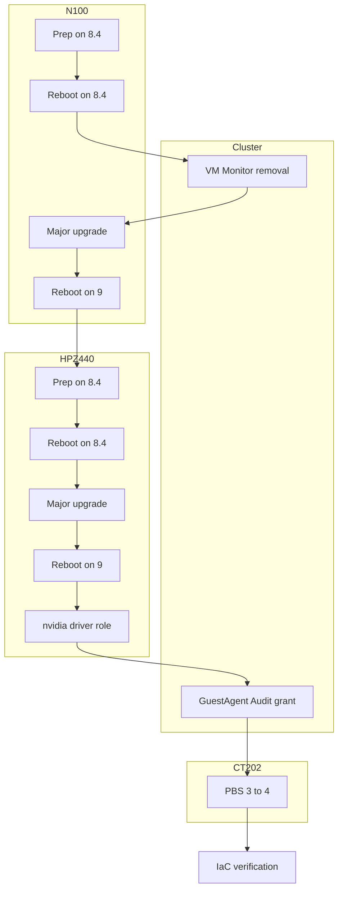
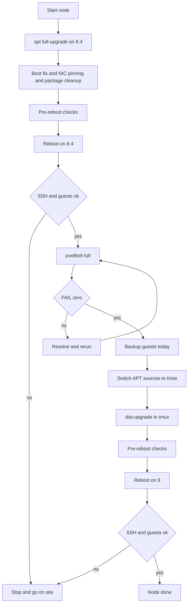

# Design Document

## Overview

**Purpose**: 2 ノードクラスタ `cluster0` の n100 と hp-z440 を Proxmox VE 8.4 から 9 の最新版へ、CT 202 の Proxmox Backup Server を 3 から 4 の最新版へ上げる。

**Users**: ホームラボ運用者が、物理コンソールなしで SSH と tmux だけを使って作業する。

**Impact**: 両ノードと CT 202 のベースが Debian 12 から 13 になる。両ノードのカーネルが 6.8 から 7.0 系になる。hp-z440 の NVIDIA ドライバの入手元が Debian non-free から NVIDIA の CUDA リポジトリに変わる。hp-z440 から Ceph のサーバー側パッケージが外れる。

### Goals
- 両ノードが PVE 9 系の最新版、CT 202 が PBS 4 系の最新版で稼働する
- アップグレード前に稼働していたゲスト、バックアップ、Terraform と Ansible による管理が引き続き成立する
- hp-z440 のホストで GTX 1650 が使え、自動で入るカーネルの更新でもその状態が崩れない

### Non-Goals
- ゲスト内の OS の更新 (CT 202 を除く)
- ストレージやネットワークの構成の変更、QDevice の追加
- `TerraformProvisioner` ロールの IaC への取り込み
- `/etc/pve/ceph.conf` などの Ceph の構成ファイルの削除
- VM 105 の設定の変更

## Boundary Commitments

### This Spec Owns
- 両ノードの APT の参照先、ブート構成、NIC 名の固定、パッケージ構成
- hp-z440 の NVIDIA ドライバの導入と、カーネル更新時の保護
- クラスタのカスタムロール `TerraformProvisioner` の権限
- CT 202 の中の Debian と PBS の版
- `pbs` ロールの APT リポジトリの定義形式
- 新しい Ansible ロール `nvidia_driver`
- 作業の記録 `manual-operations.md`

### Out of Boundary
- VM 105 の設定と、hp-z440 の再起動で VM 105 が起動したときの扱い (保留中)
- PBS のバックアップの対象と除外 (`host_vars/pbs/main.yml`)
- ゲストの中の構成 (k3s、gitea、nas、tv)
- 調査で見つかったホスト上の別件 (mariadb、beszel-agent の重複、postfix の滞留、VM 108 の存在しない PCI アドレス)

### Allowed Dependencies
- Proxmox の pve-no-subscription と pbs-no-subscription リポジトリ、Debian 13 の公式リポジトリ
- NVIDIA の CUDA リポジトリ (debian13/x86_64)
- 既存の Ansible の接続方法 (Infisical から `ANSIBLE_SSH_PRIVATE_KEY` を供給する)
- PBS の既存のバックアップジョブ

### Revalidation Triggers
- PVE 9 の新しいマイナー版でカーネルの既定の系列が変わったとき (`nvidia_driver` のビルドの成否が変わる)
- `TerraformProvisioner` の権限を変えたとき (`terraform plan` の成否)
- `pbs` ロールのリポジトリの定義を変えたとき

## Architecture

### Existing Architecture Analysis

- 両ノードは UEFI + GRUB + LVM ルートで、`proxmox-boot-tool` の管理下にない。`systemd-boot` のメタパッケージだけが PVE 8.1〜8.4 の ISO から持ち込まれている
- APT の参照先とブート構成は IaC の外にあり、手動で管理されている。自動更新の範囲だけを `proxmox_unattended_upgrades` ロールが宣言する
- corosync は管理用ブリッジ `vmbr0` 側のアドレスだけを使う。`vmbr1` はノード間の直結リンク
- ゲストを逃がす共有ストレージが無いため、ノードの作業中はそのノードのゲストがすべて止まる

### Architecture Pattern & Boundary Map

作業は「準備」と「メジャー更新」の 2 段階に分ける。準備の変更はすべて PVE 8.4 のまま入れ、8.4 の再起動で検証してからメジャー更新に進む。再起動 1 回で検証する変数を減らすことで、コンソールが無い状態で原因を切り分けられないリスクを下げる。



**Architecture Integration**:
- Selected pattern: ノードごとの直列実行。準備と更新の 2 段階に分ける
- Domain/feature boundaries: クラスタ共有の設定 (権限) は 1 回だけ変更し、ノードの作業から切り離す
- Existing patterns preserved: ホストの構成は Ansible のロールで宣言する。手動の操作は spec の `manual-operations.md` に記録する
- New components rationale: `nvidia_driver` ロールは、要件 5.2 / 5.3 の「パッケージ管理の下」と「カーネル更新時の保護」を宣言として残すために新設する
- Steering compliance: シークレットは Infisical から供給する。`site.yml` には日常適用のものだけを入れる

**ノードの順序**: n100 → hp-z440 → CT 202。n100 は GPU と PBS を持たず変更点が少ないので、手順の不備を先に見つけられる。PBS は両ノードの後に上げる。PVE 9 から PBS 3 へのバックアップは公式に互換。

### Technology Stack

| Layer | Choice / Version | Role in Feature | Notes |
|-------|------------------|-----------------|-------|
| Hypervisor | Proxmox VE 9.2 系の最新 (作業時点で pve-manager 9.2.32) | 両ノードの更新先 | ベースは Debian 13 trixie |
| Kernel | `proxmox-default-kernel` が指す 7.0 系 (作業時点で 7.0.14-30) | 両ノードの既定のカーネル | 6.17 系は固定先の予備としてだけ使う |
| Backup | Proxmox Backup Server 4.2 系の最新 | CT 202 の更新先 | |
| GPU Driver | CUDA リポジトリの `nvidia-kernel-open-dkms` 620.70.06 と `nvidia-driver-cuda` | hp-z440 の GTX 1650 | `nvidia-driver-pinning-620` でブランチを固定する |
| Bootloader | GRUB (`grub-efi-amd64`)。removable のフォールバックも更新する | 両ノードの起動 | `systemd-boot` メタパッケージは削除 |
| IaC | Ansible (既存)、Terraform + bpg/proxmox 0.111.1 (既存、版は変えない) | 構成と資源の管理 | |

## File Structure Plan

### Directory Structure
```
ansible/
├── roles/
│   └── nvidia_driver/                  # hp-z440 の NVIDIA ドライバとカーネル更新時の保護
│       ├── defaults/main.yml           # ドライバのブランチ、パッケージ一覧、CUDA リポジトリの URL
│       ├── tasks/main.yml              # cuda-keyring の導入、パッケージの導入、フックの配置
│       ├── files/nvidia-dkms-guard     # 判定と固定を行うスクリプト
│       └── templates/                  # nvidia-dkms-guard.service、apt-daily-upgrade.service の drop-in、DPkg::Post-Invoke、modules-load.d、nouveau のブラックリスト
└── playbooks/
    └── nvidia_driver.yml               # hp-z440 だけに適用する独立したエントリポイント
.kiro/specs/proxmox-ve9-upgrade/
└── manual-operations.md                # ホスト上の手動操作とその結果の記録
```

### Modified Files
- `ansible/roles/pbs/tasks/main.yml` — `apt_repository` による 1 行形式の追加を `deb822_repository` に置き換え、旧来の `proxmox-backup.list` を削除する
- `ansible/roles/pbs/defaults/main.yml` — 無効化する enterprise リポジトリの定義に deb822 形式 (`pbs-enterprise.sources`) を加える
- `.kiro/steering/tech.md` — Proxmox VE と PBS の版、ベースの Debian、LXC テンプレートの版、hp-z440 の NVIDIA ドライバの記述を実機に合わせる
- `.kiro/steering/product.md` — Active Specifications に本 spec を加える

`nvidia_driver.yml` は `site.yml` に入れない。ドライバのブランチを変える操作は日常適用とライフサイクルが異なるため、`host_health.yml` と同じく独立したエントリポイントにする。

## System Flows

### 1 ノードの作業



- 「Pre-reboot checks」は再起動前の確認一式 (後述の `PreRebootCheck`)。1 つでも満たさなければ再起動しない
- 「SSH and guests ok」は再起動後の確認一式 (後述の `PostRebootCheck`)。満たさなければもう一方のノードに進まない (要件 2.6)
- 「Reboot on 9」の前に `BootDeadman` を置き、`PostRebootCheck` を満たしたら外す
- ノードの作業は 1 つの tmux セッションの中で行う (要件 2.5)
- hp-z440 は、再起動の前に VM 105 の扱いが決まっていることを前提とする (後述)

## Requirements Traceability

| Requirement | Summary | Components | Flows |
|-------------|---------|------------|-------|
| 1.1 | 8.4 の最新を適用し再起動 | NodePrep | 1 ノードの作業 |
| 1.2 | `pve8to9` の FAIL ゼロ | NodePrep, ClusterPrivilege | 1 ノードの作業 |
| 1.3 | WARN の記録 | NodePrep, manual-operations.md | |
| 1.4 | `VM.Monitor` を含むロールが無い | ClusterPrivilege | |
| 1.5 | 当日のバックアップ | NodeMajorUpgrade | 1 ノードの作業 |
| 1.6 | ルートの空き 10 GB 以上 | NodePrep | |
| 2.1 | NIC 名の固定 | NodePrep | |
| 2.2 | 固定した NIC 名だけを参照 | NodePrep | |
| 2.3 | ブートローダの構成 | NodePrep, PreRebootCheck | |
| 2.4 | 再起動後の SSH と `vmbr1` の疎通 | PostRebootCheck, BootDeadman | |
| 2.5 | tmux の中で実行 | NodeMajorUpgrade | |
| 2.6 | SSH が戻らなければ止まる | PostRebootCheck, BootDeadman | 1 ノードの作業 |
| 3.1 | 1 ノードずつ | 全体の順序 | 全体図 |
| 3.2 | 9 系の最新 | NodeMajorUpgrade | |
| 3.3 | trixie と pve-no-subscription だけ (hp-z440 は CUDA リポジトリを加える) | NodeMajorUpgrade, NvidiaDriverRole | |
| 3.4 | quorum の回復 | PostRebootCheck | |
| 3.5 | 新しいノードから古いノードへ移さない | 全体の順序 | |
| 4.1 | 稼働中だったゲストの復帰 | PostRebootCheck | |
| 4.2 | k3s ノードが Ready | PostRebootCheck | |
| 4.3 | パススルーの維持 | PostRebootCheck | |
| 4.4 | 停止中のゲストを起動しない | PostRebootCheck | |
| 5.1 | `nvidia-smi` が GPU を認識 | NvidiaDriverRole | |
| 5.2 | パッケージ管理で導入 | NvidiaDriverRole | |
| 5.3 | ビルド失敗のカーネルを既定にしない | NvidiaDriverRole (DkmsGuardHook) | |
| 5.4 | beszel の GPU 項目 | NvidiaDriverRole (P5 の後の完了判定) | |
| 6.1 | Ceph のリポジトリが無い | NodePrep | |
| 6.2 | 依存以外の Ceph パッケージが無い | NodePrep | |
| 6.3 | Ceph の FAIL が無い | NodePrep | |
| 7.1 | PBS 4 系の最新 | PbsUpgrade | |
| 7.2 | バックアップの保持 | PbsUpgrade | |
| 7.3 | 更新後のジョブの成功 | PbsUpgrade | |
| 7.4 | PBS 3 の間もジョブが成功 | PbsUpgrade | |
| 8.1 | `terraform plan` に差分が無い | ClusterPrivilege, IaCVerification | |
| 8.2 | `site.yml` が通る | PbsRoleDeb822, IaCVerification | |
| 8.3 | unattended-upgrades の範囲の維持 | IaCVerification | |
| 8.4 | steering の更新 | IaCVerification | |

## Components and Interfaces

| Component | Domain | Intent | Req Coverage | Key Dependencies | Contracts |
|-----------|--------|--------|--------------|------------------|-----------|
| ClusterPrivilege | クラスタ | `TerraformProvisioner` の権限の付け替え | 1.2, 1.4, 8.1 | pveum (P0) | State |
| NodePrep | ノード | 8.4 のまま準備の変更を入れる | 1.1–1.3, 1.6, 2.1–2.3, 6.1–6.3 | APT (P0), pve-network-interface-pinning (P0) | Batch |
| NodeMajorUpgrade | ノード | 8.4 から 9 への更新 | 1.5, 2.5, 3.2, 3.3 | PBS (P0), Proxmox リポジトリ (P0) | Batch |
| PreRebootCheck | ノード | 再起動してよいかの判定 | 2.3 | | Service |
| PostRebootCheck | ノード | 再起動後の受入の判定 | 2.4, 2.6, 3.4, 4.1–4.4 | k3s (P1) | Service |
| BootDeadman | ノード | 9 での最初の再起動で管理経路が戻らないとき、8.4 で起動を確かめたカーネルへ自動で戻す | 2.4, 2.6 | proxmox-boot-tool (P0) | State |
| NvidiaDriverRole | hp-z440 | ドライバの導入とカーネル更新時の保護 | 5.1–5.4 | CUDA リポジトリ (P0), beszel hub (P2) | Batch, State |
| PbsUpgrade | CT 202 | PBS 3 から 4 への更新 | 7.1–7.4 | hp-z440 (P0) | Batch |
| PbsRoleDeb822 | IaC | `pbs` ロールのリポジトリ定義の deb822 化 | 8.2 | | State |
| IaCVerification | IaC | 更新後の IaC の整合の確認 | 8.1–8.4 | Infisical (P0), HCP Terraform (P0) | Batch |

### クラスタ

#### ClusterPrivilege

| Field | Detail |
|-------|--------|
| Intent | `VM.Monitor` を外し、両ノードが 9 になってから `VM.GuestAgent.Audit` を足す |
| Requirements | 1.2, 1.4, 8.1 |

**Responsibilities & Constraints**
- 外す時期は、n100 の 8.4 での再起動の確認が済んだあと、n100 の `pve8to9` を実行する前とする
- 足す時期は、hp-z440 の再起動後の確認が済んだあととする。PVE 8 のノードが未知の権限をどう扱うかの確認を避けるため
- 外してから足すまでの間は `terraform plan` / `apply` を実行しない。PVE 8.4 では guest agent からの IP の取得 (`agent.wait_for_ip`) が `VM.Monitor` を要求するため
- 他の権限と ACL は変えない

**Contracts**: State [x]

##### State Management
- 変更前: `Datastore.Allocate, Datastore.AllocateSpace, Datastore.AllocateTemplate, Datastore.Audit, Sys.Audit, VM.Allocate, VM.Audit, VM.Backup, VM.Clone, VM.Config.CDROM, VM.Config.CPU, VM.Config.Cloudinit, VM.Config.Disk, VM.Config.HWType, VM.Config.Memory, VM.Config.Network, VM.Config.Options, VM.Monitor, VM.PowerMgmt`
- 中間: 変更前から `VM.Monitor` を除いたもの
- 変更後: 中間に `VM.GuestAgent.Audit` を加えたもの
- 変更は `pveum role modify` で行い、各時点の `pveum role list` の該当行を `manual-operations.md` に記録する

### ノード

#### NodePrep

| Field | Detail |
|-------|--------|
| Intent | メジャー更新の阻害要因を、PVE 8.4 のまま取り除く |
| Requirements | 1.1, 1.2, 1.3, 1.6, 2.1, 2.2, 2.3, 6.1, 6.2, 6.3 |

**Responsibilities & Constraints**

作業の開始時に `apt-daily-upgrade.timer` を `systemctl disable --now` で止め、ノードの作業がすべて終わってから戻す。`stop` だけでは enabled のまま残り、作業中の再起動でタイマーが再開する。`proxmox_unattended_upgrades` ロールがタイマーを `started` にするため、作業の間は `site.yml` と `proxmox_unattended_upgrades.yml` を実行しない。Proxmox の Origin のパターンには codename の条件が無いため、APT の参照先を trixie に切り替えてから `dist-upgrade` が終わるまでの間に unattended-upgrades が動くと、trixie の Proxmox パッケージが単独で入る。

両ノード共通:
1. `apt update && apt full-upgrade` で 8.4 系の最新にする
2. `systemd-boot` メタパッケージを削除する。`systemd-boot-efi` は残す
3. debconf の `grub-efi-amd64 grub2/force_efi_extra_removable` を `true` にし、`grub-efi-amd64` を再インストールする。`/boot/efi/EFI/BOOT/BOOTX64.efi` が更新される

hp-z440 だけ (NIC 名の固定より前に行う):
4. `/etc/network/interfaces` から実在しない `enxc436c0eafd1d` の定義を除く。PVE は起動時に `interfaces.new` で `interfaces` を置き換えるので、固定の後に `interfaces` を直すと再起動で失われる
5. Ceph のサーバー側 9 パッケージ (`ceph`、`ceph-base`、`ceph-mds`、`ceph-mgr`、`ceph-mgr-modules-core`、`ceph-mon`、`ceph-osd`、`ceph-volume`、`libsqlite3-mod-ceph`) を削除し、`/etc/apt/sources.list.d/ceph.list` を削除する。クライアント側の 14 パッケージは Proxmox VE が依存するので残す
6. Debian non-free の NVIDIA ドライバ 535 のパッケージ一式を `apt purge` で削除する。trixie の 550 は PVE 9 のカーネルでビルドできず、残すとメジャー更新の途中で DKMS のビルドが失敗するため。GPU はメジャー更新が終わるまで使えない。`/etc/modules` の `nvidia` と `nvidia_uvm` の行もここで外す (残すと再起動のたびに `systemd-modules-load` が失敗する)。カーネルの引数の `nouveau.modeset=0` は残すので、nouveau が読み込まれても画面の出力を取らない

両ノード共通 (NIC 名の固定):
7. `pve-network-interface-pinning generate` を既定の引数で実行する。両ノードの PVE 8.4.21 に入っていることは確認済み。物理 NIC をすべて `nicN` に割り当て、`/usr/local/lib/systemd/network` に `.link` を生成する。対象の設定ファイル (`/etc/network/interfaces`、`/etc/pve/nodes/<node>/host.fw`、`/etc/pve/sdn/controllers.cfg`、`/etc/pve/sdn/fabrics.cfg`) のうち存在するものに `.new` を生成する
8. 生成された `.new` をすべて元のファイルと `diff -y` で突き合わせる。インターフェース名を含む行 (`post-up ethtool -K eno1 ...` 等) がすべて新しい名前になっていることを確かめ、置き換わっていない行は `.new` の側を手で直す。ツールが書き換えない `/etc/pve/firewall/cluster.fw` に旧名が無いことを確かめる (調査時点では両ノードとも存在しない)
9. `update-initramfs -u -k all` を実行し、`.link` を initramfs に含める

最後に:
10. `PreRebootCheck` を満たしてから再起動し、`PostRebootCheck` を満たすことを確かめる (要件 1.1)。再起動先は 8.4 系の最新のカーネル

**Contracts**: Batch [x]

##### Batch / Job Contract
- Trigger: 作業者がノードごとに実行する
- Input / validation: 着手前にルートの空きが 10 GB 以上あること (要件 1.6)
- Output: `pve8to9 --full` の結果を `manual-operations.md` に記録する。FAIL は 0 件、WARN は各項目について解消したか解消しない理由を書く (要件 1.3)。hp-z440 の Ceph の FAIL は 5 の後で消えることを確かめる (要件 6.3)
- Idempotency & recovery: 各段階は再実行できる。NIC 名の固定は、再起動の前なら手順 7 が生成した `.new` すべてと `.link` を削除し、`update-initramfs -u -k all` を再実行して取り消せる

#### NodeMajorUpgrade

| Field | Detail |
|-------|--------|
| Intent | 公式手順に沿って 8.4 から 9 へ上げる |
| Requirements | 1.5, 2.5, 3.2, 3.3 |

**Responsibilities & Constraints**
- 着手前に、当該ノードのゲストのうち `pbs_backup_targets` に含まれるものを PBS へ手動でバックアップする (要件 1.5)
- APT の参照先を deb822 形式の 2 ファイルに置き換え、他の `.list` と `.sources` を削除する
  - `/etc/apt/sources.list.d/debian.sources`: `deb.debian.org/debian` の `trixie trixie-updates` と `security.debian.org/debian-security` の `trixie-security`。Components は `main contrib non-free-firmware`
  - `/etc/apt/sources.list.d/proxmox.sources`: `download.proxmox.com/debian/pve` の `trixie`、Components は `pve-no-subscription`、Signed-By は `/usr/share/keyrings/proxmox-archive-keyring.gpg`
  - `/etc/apt/sources.list` は空にする
- `apt update && apt dist-upgrade` を tmux の中で実行する (要件 2.5)。`/etc/default/grub` を置き換えるか問われたら、既存のファイルを残す
- 更新後に `proxmox-default-headers` を入れる。hp-z440 はさらに `libdw1t64` を入れる (NVIDIA の DKMS ビルドに要るため)
- 他方のノードへゲストを移動しない (要件 3.5)

**Contracts**: Batch [x]

##### Batch / Job Contract
- Trigger: `NodePrep` と再起動後の確認が完了し、`pve8to9 --full` の FAIL が 0 件のとき
- Output: `pveversion -v` の出力と `apt policy` の参照先の一覧を `manual-operations.md` に記録する
- Idempotency & recovery: `dist-upgrade` が途中で止まった場合は、同じ tmux の中で `apt -f install` と `dist-upgrade` を再実行する。ホスト OS を更新前に戻す手段は無い

#### PreRebootCheck

| Field | Detail |
|-------|--------|
| Intent | 再起動して管理経路が戻るかを、再起動の前に判定する |
| Requirements | 2.1, 2.2, 2.3 |

**Contracts**: Service [x]

##### Service Interface
```typescript
interface PreRebootCheck {
  run(node: "n100" | "hp-z440"): Result<void, PreRebootFailure[]>;
}
type PreRebootFailure =
  | { kind: "nic_link_missing"; nic: string }          // 物理 NIC に対応する .link が無い
  | { kind: "interfaces_unknown_name"; name: string }  // interfaces.new が .link に無い名前を参照している
  | { kind: "stale_name_reference"; file: string }     // .new または cluster.fw が旧い NIC 名を参照している
  | { kind: "initramfs_stale" }                        // 対象カーネルの initramfs が .link より古い
  | { kind: "grub_entry_missing"; kernel: string }     // grub.cfg に対象カーネルの項目が無い
  | { kind: "efi_removable_stale" }                    // EFI/BOOT/BOOTX64.efi が EFI/proxmox 側より古い
  | { kind: "boot_entry_missing" };                    // efibootmgr の BootOrder に proxmox の項目が無い
```
- Preconditions: パッケージの操作がすべて完了している
- Postconditions: 失敗が 0 件のときだけ再起動する。結果を `manual-operations.md` に記録する
- hp-z440 では、VM 105 の扱いが決まっていることを追加の前提とする

#### PostRebootCheck

| Field | Detail |
|-------|--------|
| Intent | 再起動後にそのノードの作業を完了とみなしてよいかを判定する |
| Requirements | 2.4, 2.6, 3.4, 4.1, 4.2, 4.3, 4.4 |

**Contracts**: Service [x]

##### Service Interface
```typescript
interface PostRebootCheck {
  run(node: "n100" | "hp-z440", before: GuestSnapshot): Result<void, PostRebootFailure[]>;
}
interface GuestSnapshot {
  running: number[];                       // 作業前に稼働していた VMID/CTID
  stopped: number[];                       // 作業前に停止していた VMID/CTID
  passthrough: Record<number, string[]>;   // VMID ごとのパススルーの識別子 (USB の vendor:product、by-id のディスク)
}
type PostRebootFailure =
  | { kind: "ssh_unreachable"; via: "vmbr0" }
  | { kind: "link_unreachable"; via: "vmbr1" }
  | { kind: "no_quorum" }
  | { kind: "guest_not_running"; id: number }
  | { kind: "guest_started_unexpectedly"; id: number }
  | { kind: "k3s_node_not_ready"; node: string }
  | { kind: "passthrough_missing"; id: number; device: string };
```
- `before` は作業の開始時に `qm list` / `pct list` / `qm config` から取る
- 判定に使うもの: 作業 PC からの SSH (`vmbr0` 側)、もう一方のノードから `vmbr1` のアドレスへの ping、`pvecm status` の Quorate、`qm list` / `pct list`、`kubectl get nodes`、VM 110 の USB は `qm monitor 110` の `info usb`、raw のディスクはゲストの中の `lsblk`
- VM 105 は `running` / `stopped` のどちらにも含めない
- GPU の判定 (要件 5.1, 5.4) は再起動後の確認に含めない。hp-z440 の GPU は `NvidiaDriverRole` の適用 (P5) まで使えないため、P5 の後の完了判定で行う (`nvidia-smi -L` と console-pi の Beszel hub の GPU 項目)
- `ssh_unreachable` のときは何もできない。もう一方のノードの作業に進まず、現地での対処を待つ (要件 2.6)

#### BootDeadman

| Field | Detail |
|-------|--------|
| Intent | 9 での最初の再起動で、ユーザー空間までは起動したのに管理経路が戻らない場合に、8.4 で起動を確かめたカーネルへ自動で戻す |
| Requirements | 2.4, 2.6 |

**Responsibilities & Constraints**
- 戻り先は、NodePrep の再起動 (8.4) で起動と `PostRebootCheck` を確かめたカーネル (作業時点で 6.8.12-43-pve)。`dist-upgrade` の後も `proxmox-kernel-6.8` 系のパッケージは残る
- 置く時期は `NodeMajorUpgrade` の `dist-upgrade` の後、9 での最初の再起動の前。外す時期は `PostRebootCheck` を満たした後
- ホストの一時的な仕組みとし、IaC には入れない。配置と撤去は `manual-operations.md` に記録する
- 戻せる範囲: 起動が `multi-user.target` まで進んだが、NIC やドライバの退行で SSH が届かない場合
- 戻せない範囲: 起動の途中での停止とカーネルパニック。現地での対処になる (受け入れ済みのリスク)

**Contracts**: State [x]

##### State Management
- 構成: oneshot の `upgrade-deadman.service` と、`OnBootSec=15min` の `upgrade-deadman.timer`。待ち時間の 15 分は試算上の値で、作業で決める
- 確認の印: 作業者が SSH で `/run/upgrade-deadman/confirmed` を作る。`/run` は起動のたびに消えるので、起動ごとに確認が要る
- 発動の条件: タイマーの時点で確認の印が無く、かつ稼働中のカーネルが戻り先のカーネルと異なること。戻り先で起動している場合は何もしない (戻り先で再起動を繰り返さない)
- 発動時の動作: `proxmox-boot-tool kernel pin <戻り先のカーネル>` で既定の起動対象を固定し、`systemctl reboot` する
- 戻ったあと: 作業者は戻り先のカーネルで原因を調べる。固定は作業者が手動で外す

**Implementation Notes**
- Validation: 置いた直後、8.4 のうちに `systemctl list-timers` でタイマーが有効になっていることを確かめる
- Risks: 戻り先の 6.8 のカーネルが、trixie のユーザー空間と nicN の `.link` の組み合わせで起動できるかは未検証。戻り先でも SSH が戻らなければ現地での対処になる

### hp-z440

#### NvidiaDriverRole

| Field | Detail |
|-------|--------|
| Intent | GTX 1650 のドライバを APT で導入し、カーネル更新でビルドに失敗しても起動対象を守る |
| Requirements | 5.1, 5.2, 5.3, 5.4 |

**Responsibilities & Constraints**
- NVIDIA の `cuda-keyring` パッケージ (CUDA リポジトリ `debian13/x86_64`) を入れ、リポジトリと署名鍵を NVIDIA の提供する形で登録する
- `nvidia-driver-pinning-620`、`nvidia-kernel-open-dkms`、`nvidia-driver-cuda` を入れる。`nvidia-driver-cuda` が `nvidia-smi` と `nvidia-persistenced` を提供する。X 関連のパッケージ (`nvidia-open` メタパッケージ、`nvidia-settings`、`nvidia-xconfig`) は入れない
- CUDA リポジトリは unattended-upgrades の対象に入れない。ドライバの更新はこのロールの変数を変えて行う
- `/etc/modprobe.d/` に nouveau のブラックリストを置き、`update-initramfs -u -k all` を実行する。Debian のドライバを purge すると、Debian のパッケージが置いていたブラックリストも消えるため
- 適用の最後に、nouveau が読み込まれていれば `modprobe -r nouveau` で外し、`modprobe nvidia` で読み込む。再起動はしない。nouveau を外せなかった場合は止まって報告し、追加の再起動は `PreRebootCheck` / `PostRebootCheck` の対象として行う
- 起動時の読み込みは `/etc/modules-load.d/nvidia.conf` (`nvidia`、`nvidia_uvm`) で宣言する。`/etc/modules` の同じ行は NodePrep の手順 6 で外している
- `firmware-nvidia-gsp` が CUDA リポジトリの 620.70.06 から入っていることを `apt policy firmware-nvidia-gsp` で確かめる。Debian の non-free-firmware にも同名のパッケージ (550 系) があるため
- DkmsGuardHook を配置する。本体は systemd の oneshot ユニット `nvidia-dkms-guard.service` で、`OnFailure=notify-failure@%n.service` を宣言する。起動の契機は 2 つで、どちらも `systemctl start --no-block` で本体を起動するだけにする
  - `apt-daily-upgrade.service` の drop-in の `ExecStopPost=`。unattended-upgrades の成否に関わらず実行される
  - `/etc/apt/apt.conf.d/` の `DPkg::Post-Invoke`。手動の apt の実行のたびに呼ばれる。起動に失敗しても apt の終了コードに影響しないよう、末尾で `|| true` とする

**Dependencies**
- Inbound: NodeMajorUpgrade — `proxmox-default-headers` と `libdw1t64` が入っていること (P0)
- Inbound: `systemd_failure_notify` ロール — `notify-failure@.service` が hp-z440 にあること。`host_health.yml` が hp-z440 に適用済み (P1)
- External: CUDA リポジトリ — パッケージの供給 (P0)

**Contracts**: Batch [x] / State [x]

##### Batch / Job Contract
- Trigger: `ansible-playbook playbooks/nvidia_driver.yml` (hp-z440 だけが対象)
- Output: `dkms status` で `nvidia/620.70.06` が稼働中のカーネルに対して `installed` になる。`nvidia-smi -L` が GTX 1650 を表示する (要件 5.1)。console-pi の Beszel hub で hp-z440 の GPU 項目が更新される (要件 5.4)。これが hp-z440 の完了判定になる
- Idempotency & recovery: 再実行で同じ状態になる

##### State Management (DkmsGuardHook)
- 判定をカーネルのパッケージのフック (`/etc/kernel/postinst.d`) に置かない理由: カーネルの postinst は `run-parts --exit-on-error` で、dkms のフックがビルドに失敗すると非 0 を返して後続のフックを止める。Proxmox のヘッダパッケージは `header_postinst.d` を実行しない。このため、判定は apt の実行が終わった後に行う
- 判定 1 (パッケージの状態): `dpkg --audit` が構成の終わっていないパッケージを報告したら失敗とする。dkms のビルドの失敗でカーネルのパッケージの構成が止まった場合はここで検出する。この状態では `zz-update-grub` が走っていないため、新しいカーネルは GRUB の既定にならない。ただし unattended-upgrades は以後の実行で止まり続けるので、通知して作業者が直す
- 判定 2 (次の起動の対象): 次の起動で GRUB が選ぶカーネル (固定されていればそのカーネル、無ければ導入済みで最新の Proxmox のカーネル) について、`dkms status -m nvidia -k <版>` が `installed` でなければ失敗とする。ただし印のファイルがある間は、このユニット自身の固定を除いた起動対象、つまり導入済みで最新の Proxmox のカーネルを判定する。自身の固定先を判定すると、固定の直後の実行で成功と判定して固定を外し、次の実行でまた固定する往復になるため
- 判定 2 の失敗時: `proxmox-boot-tool kernel pin <稼働中のカーネル>` で既定の起動対象を固定し、固定したことを示す印のファイルを `/var/lib/nvidia-dkms-guard/` に置く。印が既にあるときは固定し直さない
- いずれかの失敗で非 0 で終わり、`OnFailure` が既存の通知経路 (Discord) へ知らせる
- 判定 2 の成功時: 印のファイルがあれば (このユニットが固定した場合に限り) `proxmox-boot-tool kernel unpin` で固定を外し、印を消す。作業者が手動で固定した場合は印が無いので触らない
- 固定は `/etc/default/grub.d/` のスニペットと `update-grub` で行う。`proxmox-boot-tool` の管理下にない GRUB 構成でも効く

### CT 202

#### PbsUpgrade

| Field | Detail |
|-------|--------|
| Intent | 公式手順に沿って PBS を 3 から 4 へ上げる |
| Requirements | 7.1, 7.2, 7.3, 7.4 |

**Responsibilities & Constraints**
- 着手の条件は、両ノードが PVE 9 になり、`ClusterPrivilege` の付け替えが終わっていること
- PBS 3 のままの期間も、各夜のバックアップジョブの成否を確認する。失敗した場合は PBS の更新を前倒しする (要件 7.4)
- 着手前に退避を 2 つ取る
  - `/etc/proxmox-backup` を tar にまとめ、hp-z440 の `local` ストレージの下に置く
  - CT 202 を `local` ストレージへ vzdump する。データストアの `mp0` はバックアップ対象外 (既定) のまま
- データストアを read-only のメンテナンスモードにし、`pbs3to4 --full` の FAIL を 0 件にしてから、`proxmox.sources` (`download.proxmox.com/debian/pbs`、`trixie`、`pbs-no-subscription`) と `debian.sources` に置き換えて `dist-upgrade` する。`proxmox.sources` の内容は `PbsRoleDeb822` と同じ (Signed-By は `/usr/share/keyrings/proxmox-release-trixie.gpg`。事前に取得しておく)
- CT を再起動し、メンテナンスモードを解除する

**Contracts**: Batch [x]

##### Batch / Job Contract
- Output: `proxmox-backup-manager versions` の出力、更新前後の `proxmox-backup-client snapshot list` の件数を `manual-operations.md` に記録する (要件 7.2)。翌夜のジョブの結果を確かめる (要件 7.3)
- Idempotency & recovery: 更新に失敗した場合は、vzdump から CT 202 の rootfs を戻す。データストアは `mp0` にあり、rootfs の復元の影響を受けない

### IaC

#### PbsRoleDeb822

| Field | Detail |
|-------|--------|
| Intent | `pbs` ロールが trixie の CT 202 に二重のリポジトリ定義を作らないようにする |
| Requirements | 8.2 |

**Responsibilities & Constraints**
- `apt_repository` による `proxmox-backup.list` の追加を、`deb822_repository` による `proxmox.sources` に置き換える。URI は `http://download.proxmox.com/debian/pbs`、suite は `ansible_distribution_release`、component は `pbs-no-subscription`、Signed-By は既存の `pbs_repo_keyring_path` (`/usr/share/keyrings/proxmox-release-trixie.gpg`)。`PbsUpgrade` で手動で作る `proxmox.sources` も同じ内容にする。同じ URI と suite に異なる Signed-By の定義が並ぶと APT がエラーにするため
- 旧来の `proxmox-backup.list` が残っていれば削除する
- 無効化する enterprise リポジトリに、deb822 形式の `pbs-enterprise.sources` を加える
- 鍵の取得は既存の `pbs_repo_key_url` のまま (`ansible_distribution_release` で trixie の鍵になる)

#### IaCVerification

| Field | Detail |
|-------|--------|
| Intent | 更新後の IaC と実機の整合を確かめる |
| Requirements | 8.1, 8.2, 8.3, 8.4 |

**Responsibilities & Constraints**
- `terraform plan` を Infisical 経由で実行し、エラーが無く、差分が無いことを確かめる。実行は `ClusterPrivilege` の付け替えの後に限る
- `ansible-playbook playbooks/site.yml --limit proxmox_nodes,pbs` を、まず `--check --diff` で、次に本適用で実行する
- 両ノードの `/etc/apt/apt.conf.d/50unattended-upgrades` の有効行が更新前と同じで、`unattended-upgrade --dry-run` が trixie の Debian-Security と Proxmox の Origin を対象にすることを確かめる (要件 8.3)
- steering の Proxmox VE、PBS、Debian、LXC テンプレート、hp-z440 の NVIDIA ドライバの記述を実機に合わせる (要件 8.4)

## Error Handling

### Error Strategy
- 判定はすべて段階の境目で行い、満たさなければ次の段階に進まない。特に再起動の前後
- 自動での巻き戻しは行わない。戻す手段があるもの (`interfaces.new` と `.link` の削除、CT 202 の vzdump) だけを手順に含める

### Error Categories and Responses
- **管理経路の喪失** (再起動後に SSH が戻らない): もう一方のノードの作業を止める。9 での最初の再起動なら、15 分 (仮) 後に `BootDeadman` が戻り先のカーネルで再起動するのを待つ。それでも戻らない場合と、8.4 での再起動の場合は現地での対処になる
- **パッケージの更新の失敗** (`dist-upgrade` の途中停止): 同じ tmux の中で依存を直して再実行する。再起動はしない
- **DKMS のビルドの失敗** (hp-z440): GPU が使えないだけで、ホストの起動と管理経路には影響しない。DkmsGuardHook が既定の起動対象を固定し、通知する
- **PBS の更新の失敗**: CT 202 を vzdump から戻す
- **Terraform の権限不足**: 付け替えの前後で `terraform plan` を実行しないことで回避する

### Monitoring
- 作業の記録は `manual-operations.md` に残す
- DkmsGuardHook が固定したときは、`OnFailure` から既存の通知経路 (Discord) へ知らせる。`proxmox-boot-tool kernel list` に固定されたカーネルが表示される

## Testing Strategy

- **ローカルでの事前検証**: CUDA リポジトリの 620.70.06 のオープンモジュールが、PVE のカーネル 7.0.14-30 と 6.17.13-21 のヘッダでビルドできることを docker で確かめた (済み)
- **NvidiaDriverRole**: `ansible-lint` を通す。hp-z440 への適用は `--check --diff` の後に本適用する。DkmsGuardHook は、実際の apt の操作で確かめる。(1) 正常な状態で `apt install --reinstall` を 1 件実行し、ユニットが成功して固定が起きない。(2) 稼働中ではない導入済みのカーネルについて `dkms remove nvidia/620.70.06 -k <版>` で未導入の状態を作り、そのカーネルを既定にした状態で apt を実行すると、固定、印の作成、通知が起きる。(3) `dkms install` で戻して apt を実行すると、固定と印が外れる。
- **PbsRoleDeb822**: `ansible-lint` を通す。CT 202 の更新後に `--check --diff` で差分が無いことを確かめる
- **ノードごとの受入**: `PreRebootCheck` と `PostRebootCheck` を、各再起動の前後に実行する
- **IaC**: `IaCVerification` の手順をすべて実行する

## Security Considerations
- `VM.Monitor` を外して `VM.GuestAgent.Audit` を足すことで、Terraform のトークンの権限は HMP モニタへのアクセスを失い、guest agent の情報取得に限られる
- CUDA リポジトリの署名鍵は NVIDIA の `cuda-keyring` パッケージで導入し、他のリポジトリに使わない

## Migration Strategy

```mermaid
flowchart LR
    P0[n100 prep and reboot] --> P1[Remove VM Monitor]
    P1 --> P2[n100 major upgrade]
    P2 --> P3[hp-z440 prep and reboot]
    P3 --> P4[hp-z440 major upgrade]
    P4 --> P5[nvidia driver role]
    P5 --> P6[Grant GuestAgent Audit]
    P6 --> P7[PBS 3 to 4]
    P7 --> P8[IaC verification]
```



- P1 から P6 の間は `terraform plan` / `apply` を実行しない
- P3 の前に VM 105 の扱いが決まっていなければならない。VM 105 は `onboot: 1` のため、hp-z440 の再起動 (P3 と P4) で起動する。本 spec は VM 105 の設定を変更しない
- 各段階の間に日をまたいでよい。日をまたぐ場合は、夜間のバックアップジョブが成功していることを確かめてから次の段階に進む
